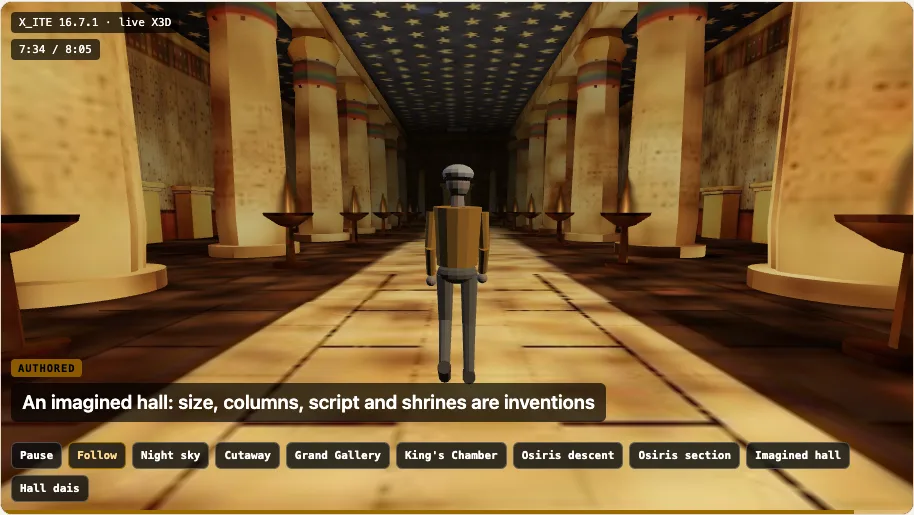

# Giza Crawl v2 · Blenderized

## v3: final-quality bake on an NVIDIA L4 (23 Nov 2026)

v3 is v2 with its baked textures and X3D replaced by the `g4`-profile bake. The page, the build sources, the sky and the
before/after shots are copied from v2 unchanged, so text on the page that says "v2" describes the same route.

| | v2 | v3 |
|---|---|---|
| bake profile | `quick` | `g4` |
| baked surfaces | 45 | 45 |
| samples per surface | 24 to 40 | 384 to 640 |
| largest texture | 1024 px | 4096 px |
| textures on disk | 1.3 MB | 18.8 MB |
| bake time, all surfaces | 232 s (METAL, Blender 5.1.0) | 982 s (OptiX on one NVIDIA L4, Blender 5.3.0) |
| whole build | 280 s | 1032 s |

Rig for every v3 number: Colab, one NVIDIA L4, Cycles OptiX, Blender 5.3.0, x3d-blender-io `8e56437`, notebook
`x3d.lab/notebooks/blender_bakes/giza_bakes_g4_v2.ipynb`. It was an L4, not the G4 the runbook names. Grading used v2's
per-zone grades (`retone.py`). `assets/crawl.x3d` validates as X3D 4.0 (x3d_mcp fork `4d433af`), sha256 `03c423511d15136b…`.
The page loads with no console errors in headless Chromium (software GL); frame rate was not measured, and
`receipts/check.json` is v2's.

Known defects of v3:
- **Grand Gallery texture repaired by hand.** The OptiX bake left NaN texels in that one surface. They made its light
  percentiles NaN in `bake.json` (which stopped the page reading the file) and stopped the gutter fill for the top half of
  the atlas. The shipped JPEG has its black texels filled from their neighbours in display space, and `bake.json` now holds
  `null` and a note on that row. A few dark specks remain. The proper fix is a regrade from the linear cache with NaN set to
  zero (`cell8b_pack_nansafe.py`); the caches are still in Drive.
- Textures are 18.8 MB against 1.3 MB, so the first load is slower on a phone.


v1 is unchanged. v2 keeps v1's route, H-Anim explorer and chase camera, and rebuilds everything it walks through in
Blender. v1 painted every invented surface magenta (that was the flat pink Hall of Records). v2 keeps the Authored label
on every caption and in the metadata, and gives up the paint.



## What was done in Blender

| Zone | Look | Technique |
|---|---|---|
| Plateau | moonlit night under the 2560 BC sky | rippled sand, coursed Khafre and Menkaure (Petrie positions); one sun lamp as the moon (a stage light from azimuth 300°, as in the Sky Machine); an opaque Khufu baked only for its shadow |
| Passages | visitor lamps | limestone courses tilted to each passage's slope; rock-cut bedrock with chisel tracks below the base |
| Grand Gallery | corbels raked from below | the seven-course corbelled section swept along the slope; 22 spot uplights on the ramps |
| King's Chamber | polished granite, one cold beam | granite crystals (voronoi) under ashlar joints; a narrow spot and a faint cone down the southern shaft (Authored light, documented shaft) |
| Subterranean Chamber | raw bedrock | the unfinished stepped floor built as geometry |
| Osiris Shaft | a descent into the dark | sparse work lamps, cold glow from under the water, a spot on the sarcophagus; on each descent the chase camera hangs above the climber and looks straight down, turning slowly; descents slowed to 0.32 m/s; the page closes the fog in |
| Hall of Records (Authored) | torch-lit hypostyle | 16 lathed papyrus-bundle columns, painted walls carrying an invented script (not hieroglyphs), a star ceiling, gilt shrines, a dais under a light well, bronze braziers with sprite flames |

Every surface is baked (`build/bakery.py`): albedo from the procedural materials at full size, light (direct and indirect, soft
shadows, bounce) at a quarter of that, multiplied, cached as linear float, then graded once per zone (`build/retone.py`, with a
push-pull fill so mipmaps never pull in empty texels). The sky is six Background faces made from the Sky Machine's star data
(`build/sky_cube.py`: HYG v4.1, ERFA precession, Alnitak on the meridian at 44.67° in 2560 BC, the same value the Sky Machine's
table shows).

## What the exporter carried or lost

Carried by x3d-blender-io 47ed742: `UnlitMaterial` + `emissiveTexture` + `TextureCoordinate` for every baked surface, the
H-Anim humanoid and its 8 fps pose, the keyed chase camera and 9 Viewpoints, `x3d_metadata` grades on every mesh, an RGBA
flame sprite. Baked away: the procedural node trees and every scene light. Added after export by `build/postprocess.py`: the
sky Background faces, one `Fog` (the page sets its range per chapter), `NavigationInfo` FLY with the headlight off. Lost:
view-dependent gloss (a bake sees each surface from its normal only).

## Checks (what ran)

- x3d_mcp fa0b389: `assets/crawl.x3d` XSD valid, 0 semantic errors, 0 warnings (`receipts/validation.json`).
- Headless Chromium with SwiftShader, X_ITE 16.7.1, v1 and v2 pages, same 11 chapters set through SAI
  (`build/shots.cjs`, `receipts/check.json`): 0 console errors on both; median frame time with the tour running 142 ms (v1)
  and 123 ms (v2); no GPU, so these are relative, not real frame rates.

## Honest limits

- **The textures in this folder are a quick-profile bake** (1/4 of the texel density, 1/4 of the samples; 45 surfaces,
  1.0 MB of JPEG, 280 s on an 8 GB M3). The final-quality bake runs on the G4 (`build/G4-BAKE-RUNBOOK.md`) and will replace
  `assets/tex/`, `receipts/bake.json` and these numbers.
- Seen only in headless software GL. Not checked on a phone or a real GPU.
- Lamps, ladders, braziers, the light well and the southern-shaft beam are staging, and the page says so.

## Rebuild

```bash
python3 build/make_tiles.py build/tiles
/Applications/Blender.app/Contents/MacOS/Blender -b --python build/build_crawl_v2.py -- OUT x3d-blender-io/source --profile=quick
python3 -I build/sky_cube.py ../../blender-giza-numbers/v4/assets/sky.x3d ../../blender-giza-numbers/v4/assets/sky-data.json SKY
python3 -I build/assemble.py OUT SKY .
node build/shots.cjs ../../.. OUT_SHOTS
```
