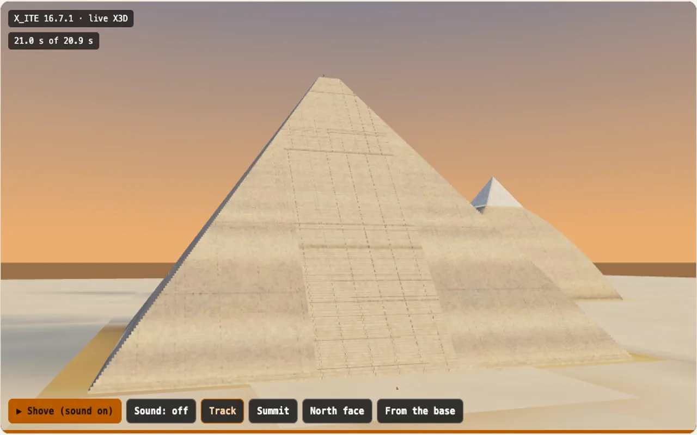

# Giza Fall v2 · Blenderized

## v3: final-quality bake on an NVIDIA L4 (23 Nov 2026)

v3 is v2 with its baked textures and X3D replaced by the `g4`-profile bake. The page, the build sources and everything
else are copied from v2 unchanged, so text on the page that says "v2" describes the same scene.

| | v2 | v3 |
|---|---|---|
| bake profile | `quick` | `g4` |
| baked surfaces | 11 | 11 |
| samples per surface | 24 to 24 | 384 to 384 |
| largest texture | 1024 px | 4096 px |
| textures on disk | 0.6 MB | 6.9 MB |
| bake time, all surfaces | 102 s (METAL, Blender 5.1.0) | 188 s (OptiX on one NVIDIA L4, Blender 5.3.0) |

Rig for every v3 number: Colab, one NVIDIA L4, Cycles OptiX, Blender 5.3.0, x3d-blender-io `8e56437`, notebook
`x3d.lab/notebooks/blender_bakes/giza_bakes_g4_v2.ipynb`. It was an L4, not the G4 the runbook names. Grading used the same
per-zone grades as v2 (`retone.py`). `assets/fall.x3d` validates as X3D 4.0 (x3d_mcp fork `4d433af`), sha256 `5fe48ccc7b88a12e…`.
The page loads with no console errors in headless Chromium (software GL); frame rate was not measured.

The rigid-body simulation ran again on Blender 5.3.0, so the fall itself differs slightly from v2 (contact count and duration). `receipts/fall.json` holds this run.

v1 is unchanged. v2 runs v1's build (same seed, same 203 course heights, same Bullet ragdoll, figures and cameras). After the
simulation, `build/blenderize_fall.py` replaces what they fall on and what is around them.

## What was done in Blender

- **The north face:** the stepped Great Pyramid is rebuilt from v1's course heights and cut into baked parts:
  - the strip of the north face the explorer falls down, in three parts by height, so the close camera sees about 56 texels per metre in the `local` profile;
  - the rest of the north face;
  - the other three faces.
- **Stone:** every course is weathered limestone (blocks, joints, pitting, wind-scoured edges).
- **Khafre and Menkaure:** both become stepped cores. Khafre keeps a casing cap; Menkaure has a red granite foot (extents illustrative).
- **Light:** a low summer-evening sun from the west-north-west rakes the north face. Light is baked into textures; v1's two suns stay, for the figures only.
- **UVs:** stepped faces are UV-projected onto their own face plane (`bakery.unwrap_slope`), not one island per riser.

## What the exporter carried or lost

Carried by x3d-blender-io 47ed742:
- baked `UnlitMaterial` + `emissiveTexture`;
- both HAnimHumanoids;
- 32 interpolators on one TimeSensor;
- 4 viewpoints.

Baked away: materials and the bake sun. The build still swaps in a `Background` sky after export, as v1 did; v2's is an evening gradient.

## Checks (what ran)

- x3d_mcp fa0b389: `assets/fall.x3d` XSD valid, 0 semantic errors, 0 warnings (`receipts/validation.json`).
- Headless Chromium with SwiftShader, X_ITE 16.7.1: v1 and v2 shot at v1's eight strip times plus the North-face camera, with every interpolator set through SAI (`build/ab_shots.cjs`, `shots/check.json`). 0 console errors on both. Median frame time with the fall running: 175 ms (v1) and 141 ms (v2). No GPU, so these are relative only.

## Honest limits

- **The fall is not v1's frame for frame.** Blender 5.1.0 re-ran v1's seeded simulation and it lands differently from v1's Blender 5.3 run: 20.9 s against 22.3 s, so mid-fall poses differ. `receipts/fall.json` and the impact sounds are v2's own run.
- These are `quick`-profile textures (1/4 density, 1/4 samples). The final bake runs on the G4 (`build/G4-BAKE-RUNBOOK.md`).
- The borders between the fall strip and the rest of the face show as faint seams, because the parts have different texel densities. Not fixed yet.
