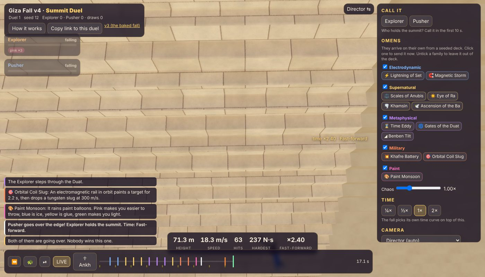

# Giza Fall v4 · Summit Duel

v1 to v3 replay one fall that Blender computed in advance. **v4 simulates every duel live in the browser.** Two
active H-Anim ragdolls, the Explorer and the Pusher from v1, duel on Khufu's 12.7 m summit, 138.5 m up. They carry
paintball pistols, and they shove. A seeded deck of omens arrives while they fight: electrodynamic, supernatural,
metaphysical, military and paint. One of them goes over the edge, and the tumble down the 203 courses plays under a
different time curve each time. Any moment can be reviewed backwards, and the Ankh can rewrite what happens next.

The duellists are CPU-driven; you direct. You can send any omen, leave whole families out, set the chaos, pick a
camera, call the winner, and rewind.

## What it reuses from v1 and v3
- **The pyramid you see** is v3's own `assets/fall.x3d` and its 11 baked textures. `src/x3dload.js` reads them into
  three.js: Transform, Shape, IndexedFaceSet, UnlitMaterial with emissiveTexture, PhysicalMaterial, DEF/USE.
  - It skips the H-Anim figures, viewpoints, lights and interpolators, and the page lists what it skipped.
  - Close up, a world-space limestone grain is multiplied into the bakes.
  - The two faces v3 baked at low density are lit live, with sun and shadows, because a fall can now go down any face.
- **The pyramid the bodies hit** has the same 203 course heights. `build/extract.py` re-runs v1's seeded generator
  (`random.Random(7)`) and writes `data/giza.json`, which a gate regenerates byte-identical.
- **The bodies** come from v1:
  - 11 parts placed at the H-Anim joint centres read from v3's X3D;
  - v1's masses (80 kg), friction 0.45 and restitution 0.15;
  - v1's hit measure: m |Δv − g Δt| above 18 N·s, once per body per 40 ms.

## What is new
| Part | How |
|---|---|
| Physics | Rapier 0.21, deterministic build, at 120 Hz with 8 solver iterations. 202 static course slabs, and a kinematic capstone of 12 × 12 tiles that can tilt and be painted. |
| Active ragdolls | Hand-written joint motors (PD torques on quaternion error) hold poses: standing, walking, aiming, shoving, celebrating. "Puppet strings" (an upright torque and a support force under the pelvis) work while balance b > 0. Hits lower b. Below 0.12 the figure goes limp, then gets up again. Below the summit it stays limp. |
| CPU duellists | A seeded temperament each: aggression, accuracy, preferred range, nerve. They keep away from the rim and step out of telegraphed danger. Pellets leave the real forearm, so a wobbling arm shoots wide. A rush closes in to shove. |
| Paint | 45 m/s pellets push with 13 N·s each. **Pink** adds 35 % to every later push (like the percentage in Smash Bros.). On the floor: **blue** is ice (friction 0.035, min-combined), **yellow** is glue (2.2, max-combined), and **green** is bouncy or, on a body, light. |
| Omens (12) | ⚡ Lightning of Set (the mast is a lightning rod; struck duellists carry charge and push or pull by Coulomb's law) · 🧲 Magnetic Storm (pellets turn by (q/m) B dt each step; an orbiting pole drags the pistols) · ⚖️ Scales of Anubis (g × 0.35 and × 1.75) · ☀️ Eye of Ra · 🌪️ Khamsin · ⌛ Time Eddy (inside it, velocity × ¼ and gravity × 1/16; both restored on the way out) · 🌀 Gates of the Duat · ◢ Benben Tilt · 🕊️ Ascension of the Ba (gravity points up for 1.8 s) · 💥 Khafre Battery (shells fired from Khafre's real summit position in v3's X3D, 5.5 s flight, exact landing marker) · 🎯 Orbital Coil Slug · 🎨 Paint Monsoon |
| Ending | After 50 s, Ma'at's judgement makes every blow 20 % harder every 5 s, up to 6×. A figure has fallen when its pelvis is 1.6 m below the summit. If the other one follows within 3 s, it is a draw. |
| The fall | Seven time curves: Bullet dip, Stutter, Long exhale, Freeze frames (a hit stop on hard impacts), Dream, Fast-forward and Random walk. Four camera shots, cut at random. A live HUD shows height, speed, hits, hardest hit and the time scale. |
| Rewind | Every step is recorded, and review plays forwards, backwards or at 0.15×. Review shows recorded poses; it does not run the simulation. Every 2 s the page keeps a complete checkpoint: Rapier's snapshot, every controller, the omen state, the RNG and the step. **☥ Ankh** restores the checkpoint before the moment on screen, re-simulates to that step with your clicks, then reseeds fate. **Verify replay** re-simulates the whole duel from its seed and your clicks and compares a hash every second. |
| Attract mode | One duel follows another, with seeds counting up. Each duel can be shared as a link (`#seed=`). The score and your betting streak are kept in this browser only. |

Tone: slapstick with weight. The artillery and the lightning look physically serious. There is no blood; these
are crash-test-style explorers, as in v1. The omen strengths are game constants, not measurements, and the page says so.

## Run
Open `index.html` through the site (it reads `../v3/assets/`). For a local server: `python3 -m http.server` in
`docs/`, then go to `/demos/blender-giza-fall/v4/`. There is nothing to build. Keys: Space pauses, ← steps back 1 s,
A is the Ankh, L returns to live, N starts the next duel.

## What I checked (23 Nov 2026; one Linux machine; Node 22.23.5; headless Chrome 153 on SwiftShader, no GPU)

Every number here was read by the thread that built the demo, so under Loom law 44 they are Likely until a second reader recomputes them.
| Check | Result | Where |
|---|---|---|
| `node --test test/sim.test.mjs`, limits in `test/limits.json` | **10 of 10 pass** | `receipts/node-gates.json` |
| Model: `data/giza.json` regenerates byte-identical; it names v3's `fall.x3d` (sha256 `5fe48ccc…`) | pass | gate 1 |
| The portable sine against `Math.sin` over 200,000 arguments; no approximate built-in in the 5 simulation files | worst 4.4e-14 | gate 2 |
| Two undisturbed duellists standing for 60 s, pelvis height 0.91 ± 0.06 m | 0.905 and 0.905 m | gate 3 |
| Lorentz step: turn per step against (q/m) B dt, and speed kept | 1.3e-15 rad; the explicit-Euler twin drifts 7.8 % and fails | gate 4 |
| Anubis: a limp body's fall acceleration against g × scale | −3.396 (want −3.434) and −16.96 (want −16.97) m/s² | gate 5 |
| Time eddy: pellet entry speed ratio | 0.2501 | gate 6 |
| Shell landing point against its target | 0 m; it explodes on step 660 = 5.5 s | gate 7 |
| Same seed gives the same step hashes; another seed does not | pass | gate 8 |
| A checkpoint restored and run 2,000 steps gives the identical hash; restoring without the controllers, or without the RNG, diverges (both controls caught) | pass | gate 9 |
| 16 seeded duels all end within 150 s; Explorer 6, Pusher 9, draw 1; median fall at 61.5 s; every fall drops more than 130 m | pass | gate 10 |
| **Cross-host:** Chromium builds the same model bytes and the same 3,600 per-step hashes as Node (0 differ), and the same bits for 20,000 portable sines | pass | `receipts/browser.json`, `receipts/duel-seed11.physics.json` |
| The page: 0 console errors; all 12 omens sent; a full round to rest; review; Ankh; in-page Verify replay equal | pass | `receipts/browser.json`, `shots/` |
| x3d.loom `kit/loom pagetraps` (5 sim units read, 0 errors). Its wrong twin, one `Math.sin` added, fails with `sim-nonportable-math` | pass / fail as expected | `receipts/loom-pagetraps.json` |
| x3d.loom `kit/loom physics` on the run record. Its wrong twin, one replay mismatch, fails with `PHYS_HASH_DRIFT` | pass / fail as expected | `receipts/loom-physics.json` |

Rebuild the receipts: `WRITE_RECEIPTS=1 node --test test/sim.test.mjs` (without it, a test run writes to the temp folder and never touches `receipts/`), then `node build/check_page.mjs` and
`node build/run_record.mjs` with the docs server running. Both scripts say how in their first lines.

## Honest limits
- **Not shown:**
  - a second machine;
  - Firefox and WebKit;
  - a real GPU;
  - a phone;
  - frame rate (SwiftShader rendering is too slow to judge);
  - a person playing.
- **Balance is measured on 16 seeds only.** Pusher 9 to Explorer 6 is within chance at that size, but it is not shown to be even. *Suspected:* a starting-side effect.
- **Few pellets hit.** About 10 % of shots land, because the AI aims through a physically wobbling arm, so shoves decide most duels. That is on purpose, but it has not been tuned by play.
- **The tilt omen shows a stone slab;** the baked summit under it stays flat.
- **Splats on bodies are view-only.** They are lost when you review or use the Ankh. Tile paint is in the simulation and survives both.
- **Review shows poses, pellets, debris and tiles.** One-shot effects (bolts, blasts) are not replayed in review.
- **The live faces replace v3's bake** on the east, south and west faces and on the rest of the north face. The fall strip keeps its bake.
- **Size:** `vendor/` is 6.3 MB (Rapier with its wasm inlined, and three.js), loaded from this folder only (`vendor/VENDOR.md` has the hashes).

## Files
`index.html` · `src/` (simulation, marked `// loom:sim`: `pmath.js`, `figure.js`, `ai.js`, `omens.js`, `sim.js`; page and view: `main.js`, `view.js`, `x3dload.js`, `audio.js`) · `data/giza.json` · `build/` (`extract.py`, `check_page.mjs`, `run_record.mjs`) · `test/` · `receipts/` · `shots/` · `vendor/`.
