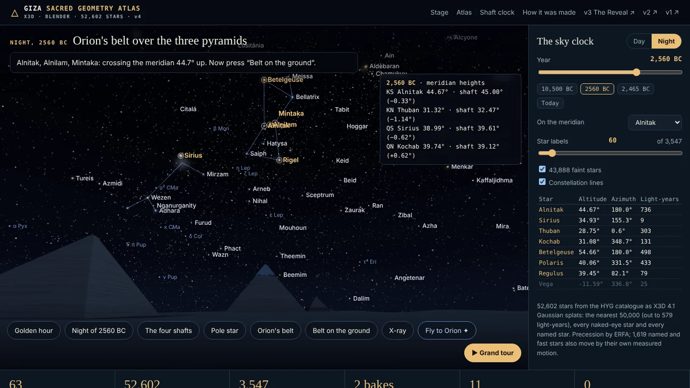
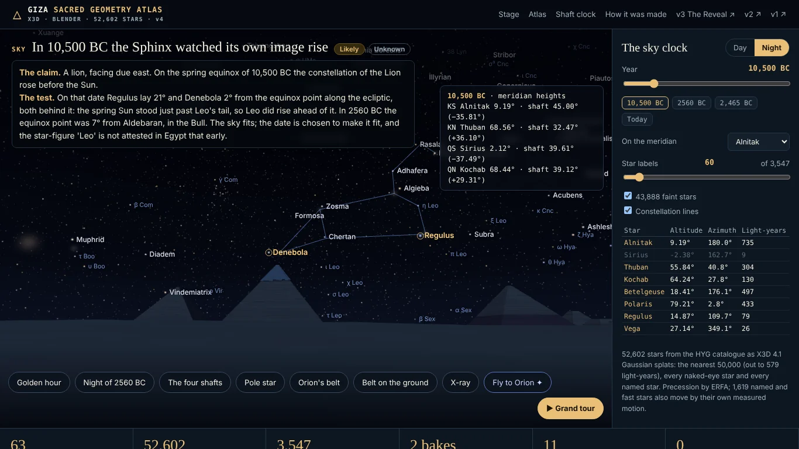
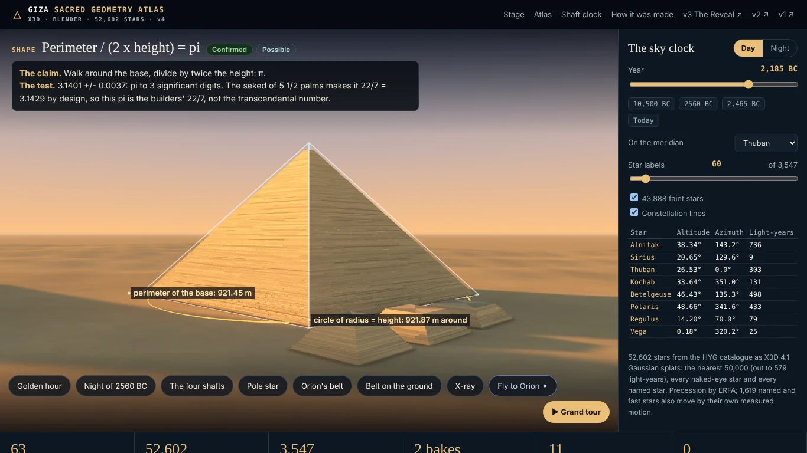
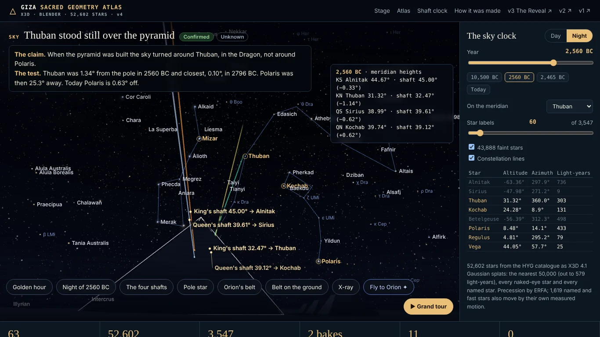

# Giza: The Sacred Geometry Atlas (Demo 65, v4)

Sixty-three sacred-geometry claims about the Giza pyramids. Each one is staged in full, then measured against Petrie's survey and the real sky of 2560 BC. The page has two halves, as the owner chose ("A & C"):

- **The showpiece.** A plateau modelled in Blender, with Cycles light baked in for golden hour and for a moonlit night, under 52,602 real stars drawn as X3D 4.1 Gaussian splats with 3,547 labels.
- **The atlas.** 63 claims, each graded twice and each with a "Show in 3D" button that flies the stage to a small proof.

v1, v2 and v3 are untouched beside this folder.

| | |
|---|---|
|  |  |
|  |  |

More frames are in `shots/`: the four shafts, Herschel's passage line, the belt on the ground, the x-ray chambers, the fly-out, the atlas cards and a phone frame. All were taken in the rig named below. Run it from the repository root with `python -m http.server 8000 --directory docs`, then open `http://localhost:8000/demos/blender-giza-numbers/v4/`.

## What is on the page

| Part | What it does |
|---|---|
| **Stage** | One X_ITE browser, two layers. Layer 0 holds the stars in light-years; layer 1 holds the plateau in metres. Each frame the page copies the plateau camera's orientation to the sky camera, so the stars stand at infinity behind the pyramids. |
| **Two bakes** | Golden hour (Sun 10° up in the west-south-west) and night (Moon 44° up in the north-west). Pyramids carry one baked colour per face; the ground carries a 4096² lightmap. The browser draws both unlit. Day and night share one set of coordinates by `USE`. |
| **Sky clock** | Year slider from 13,000 BC to AD 2100. Precession is ERFA's long-term model sampled every 50 years and interpolated; 1,619 named and fast stars also move by their own measured motion. Pick the star that stands on the meridian. Label slider up to 800 at once. |
| **11 proof rigs** | Square and seked, circle of radius = height, hemisphere, Khafre's 3-4-5, Menkaure's slope, chambers and passages (x-ray), the four shafts as 60 km rays, the belt on the ground, cardinal lines, the 29.9792458° line, the corner diagonal. |
| **Fly to Orion** | The sky camera leaves Earth toward Alnitak. The belt comes apart, because Alnilam is nearly three times farther than its neighbours. |
| **Grand tour** | A dozen stops, about four minutes. The same button stops it. |
| **Shaft clock** | An SVG chart: the height of each shaft star on the meridian against the shaft angle, 3600 BC to 1600 BC. |
| **Atlas** | Filter by family, number grade or design grade; search; switch the voice between wonder, test or both. Digits that match character for character are gold (the v3 rule). |

## Two grades on every claim

- **The number**: Confirmed, Likely, Suspected, False or Untested. Does the arithmetic hold against the survey, inside the survey's own error?
- **The design**: Designed, Possible, Coincidence or Unknown. Did the builders mean it?

Tally: number grades are Confirmed 30, Likely 22, Suspected 5, False 5, Untested 1. Design grades are Designed 11, Possible 15, Coincidence 29, Unknown 8. So 30 claims hold as numbers and only 11 were surely meant. One claim (`khafre_137`) was made up here on purpose, to show how easy one is to find; its card says so.

## Findings (all computed by the scripts in `build/`)

| Claim | Result | Grade |
|---|---|---|
| Royal cubit = π/6 m | 0.52375 ± 0.00013 m against 0.52360: 1.17 errors off, 3 literal digits | Confirmed / Coincidence |
| Khafre is a 3-4-5 triangle | 53°10′ ± 4′ against 53°07′48″ | Confirmed / Designed |
| King's Chamber height | Petrie §155: 230.09 ± 0.15 in; the √5 rule needs 230.45 in, 2.4 errors off | Confirmed / Possible |
| Four shafts, four stars | Each shaft fits its star in a different year: 2492, 2357, 2359 and 2383 BC. Spread 135 years, all after Khufu | Likely / Possible |
| Orion's belt on the ground | Pin Alnitak on Khufu and Mintaka on Menkaure: Alnilam lands 28 m from Khafre's centre. The map is rotated 36° from south-up in 2560 BC, 13° in 10,500 BC | Likely / Possible |
| Thuban as pole star | 1.34° from the pole in 2560 BC; closest 0.10° in 2796 BC | Confirmed / Unknown |
| Herschel's passage star | Thuban's lowest pass matched the passage in 3409 BC and 2185 BC, not in 2560 BC (2.1° too high) | Suspected / Coincidence |
| Spence's plumb-line stars | Kochab over Mizar in 2465 BC here; she gave 2467 BC | Likely / Possible |
| Leo rising, 10,500 BC | Regulus 21° and Denebola 2° behind the equinox point: Leo did rise ahead of the spring Sun | Likely / Unknown |
| Orion lowest in 10,500 BC | Alnitak's lowest culmination is 9.1° in 10,701 BC | Confirmed / Unknown |
| (Earth + Moon) ÷ Earth = 14/11 | 1.27270 against 1.27273, 5 literal digits | Confirmed / Coincidence |

## Files

- `index.html`, `atlas.css`: the page.
- `atlas.mjs`: page controller (stage start, proofs, tour, sky panel, cards, shaft chart). URL parameters: `?claim=<id>`, `?go=<stop>`, `?poster=1` (do not start the renderer).
- `stage.mjs`: the X_ITE stage (camera tweens, light switch, rigs, sky rotation, moving stars, labels on a 2D overlay).
- `sky-math.mjs`, `atlas-math.mjs`: pure maths, tested in `tests/atlas.test.mjs`. `literalDigits` comes from `../v3/wonder-math.mjs`.
- `assets/giza.x3d` (X3D 4.0, 2.33 MB, 610 KB gzipped), `assets/sky.x3d` (X3D 4.1, 3.89 MB, 896 KB gzipped), `assets/ground-day.jpg`, `assets/ground-night.jpg`, `assets/stage-data.json`, `assets/sky-data.json`.
- `receipts/atlas.json` (the 63 claims), `receipts/claims-v4.json` (the 10 computed in depth), `receipts/bake-receipt.json`, `receipts/hero-still.json`, `receipts/witness.json` (the gates' own outputs), `receipts/loom/` (the four Loom witness files).
- `shots/hero-cycles.webp`: the poster, a Cycles still from the same camera as the live stage. The other files in `shots/` are rig screenshots of the live page.

## Rebuild

Nothing in `assets/` or `receipts/` is edited by hand. With Blender 5.3 as the `bpy` wheel, pyerfa, numpy and Pillow:

```
python build/verify_sacred.py build hygdata_v41.csv receipts/claims-v4.json
python build/build_atlas.py   build hygdata_v41.csv ../v1/receipts/claims.json receipts/claims-v4.json receipts/atlas.json
python build/build_sky.py     build hygdata_v41.csv assets/sky.x3d assets/sky-data.json
python build/build_plateau.py BAKE_DIR --no-hero        # needs BAKE_DIR/_addon/io_scene_x3d -> x3d-blender-io/source
python build/hero_still.py    BAKE_DIR/plateau.blend hero-still.png --exposure 0.4
python build/build_stage.py   BAKE_DIR receipts/claims-v4.json assets
python build/make_witness.py  . LOOM_EVIDENCE finalcheck.json hygdata_v41.csv x3d-blender-io 8 8
```

The final bake took 291 s (day) and 148 s (night) for the ground, on the CPU. `build/finalcheck.cjs` is the browser walk.

## Checks run (19 Nov 2026)

See `receipts/witness.json` for the exact outputs.

- **Grammar**: `giza.x3d` is valid against the X3D 4.0 XSD and `sky.x3d` against 4.1. Validator: x3d_mcp fork 39c6e94.
- **Meaning**: 0 errors and 0 warnings from the same fork's semantic checks.
- **Loom traps** (15 rules, strict host) and **Loom page traps** (8 rules, 5 files): 0 errors, 0 warnings.
- **Unit tests**: `node --test tests/atlas.test.mjs`, 8 of 8. The page's JavaScript sky agrees with the Python receipt for the four shaft stars and for Thuban.
- **Browser rig**: X_ITE 16.7.1 in Playwright headless Chromium with SwiftShader at 1366 px and 390 px. All 63 proofs were shown; the tour, the fly-out and the sliders were driven. Console clean, no failed request, no sideways scroll.
- **Not checked**: a real GPU, a real phone, Firefox, Safari. No frame rate is quoted, because software GL says nothing about one.

The gates and the frame check sent the work back five times before this shipped: `UnlitMaterial` outside the declared profile (semantic check), four `GaussianSplats` without a bounding box and a `MetadataSet` with no `containerField` (Loom traps), a viewpoint written with a zero rotation axis because the camera faced due south, a half turn (unit test), and a deep link that showed the wrong sky because the proof asked for it before the stars had loaded (a frame that did not match its own table).

## What is illustrative, not surveyed

- Course heights and counts, and how much of each top is missing.
- The queens' pyramids, the ground relief and the base levels (Khafre and Menkaure stand 10 m higher here).
- The passage run and the chambers' east offset. The angles on the labels are Petrie's.
- The Sun and the Moon are stage lights, not an ephemeris. The Moon was placed in the north-west so that the faces seen under Orion are lit. The stars are real.
- The shaft angles are Gantenbrink's 1993 values as commonly cited; they were not re-read in this session, so claims that rest on them are graded Likely at best.
- The poster was rendered from the scene file of the bake made before the Moon was moved. The day lights and the geometry are the same in both. `receipts/bake-receipt.json` carries a `hero` block from the script, but the final bake ran with `--no-hero`; `receipts/hero-still.json` is the poster's real receipt.

## X_ITE 16.7.1 findings (Confirmed in the rig above)

1. A `GaussianSplats` node under a `Transform` with scale 300 or more crashed the page; scale 30 and scale 1 work. The stars therefore stay in light-years and live in their own layer.
2. A `Viewpoint` created through the SAI is not used until `set_bind` is sent.
3. A `LayerSet` with the star field in layer 0 and the scene in layer 1 draws the stars behind everything, with no depth trick.
4. Binding a second viewpoint is the clean way to move the camera: it clears the visitor's own orbit offsets.
5. 52,602 splats draw in software GL.

## Credits and licences

- Stars: [HYG Database v4.1](https://github.com/astronexus/HYG-Database) by David Nash, CC BY-SA 4.0. `assets/sky.x3d` and `assets/sky-data.json` are derived from it and carry the same licence.
- Survey: W. M. Flinders Petrie, *The Pyramids and Temples of Gizeh* (1883), public domain, read from Ronald Birdsall's transcription. Great Pyramid base: Glen Dash, 2015.
- Renderer: X_ITE 16.7.1 (MIT). Modelling and light: Blender 5.3 (GPL). Exporter: x3d-blender-io.
- Page code and generators: GPL-3.0-or-later.
