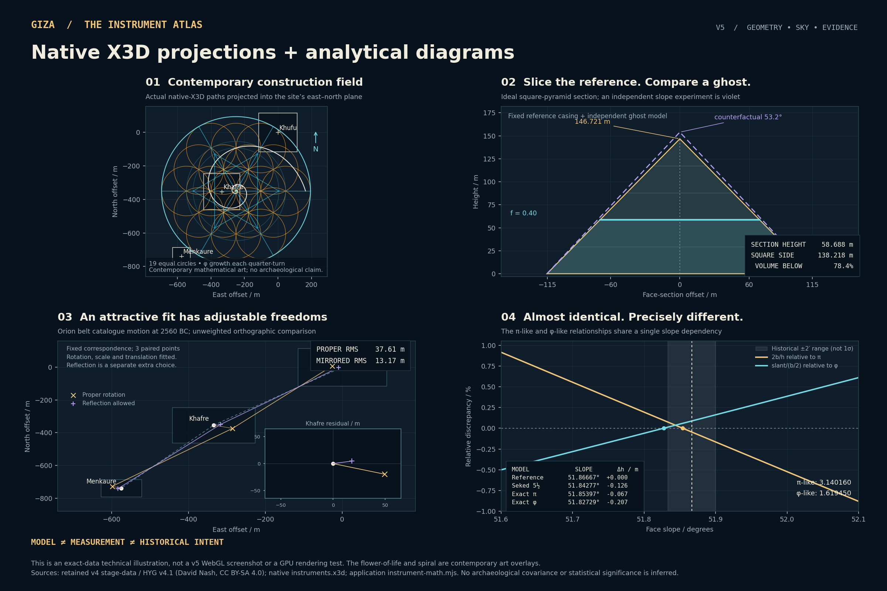

# Giza v5 — The Living Geometry Laboratory

An additive successor to the v4 Sacred Geometry Atlas, reviewed against `8beeb09` on 19 November 2026. V1–v4 remain unchanged. V5 retains the Blender/Cycles plateau, two lighting bakes, 52,602 catalogue stars and 63-claim atlas, then adds native X3D instruments and a linked analytical workbench.

## Run

From the repository root:

```bash
python -m http.server 8000 --directory docs
```

Open `http://localhost:8000/demos/blender-giza-numbers/v5/`. Windows with WSL works by starting the server in WSL and opening that address in Windows Chrome/Edge. WebGL2 is needed for the live X_ITE stage. Ratio, section and Orion fitting instruments work independently of WebGL. Serve over HTTP; direct file opening cannot reliably fetch modules and receipts.

The downloadable review bundle provides `START-WINDOWS.bat` and `serve.py`; Python's standard library is sufficient. No API key or Blender installation is needed to view the retained bakes.



This overview is an analytical diagram, not a WebGL screenshot. Rebuild with `python build/make_overview.py` (Matplotlib required for the optional poster).

## New instruments

| Instrument | What it reveals |
|---|---|
| Ghost geometry | An independently scalable luminous envelope and triangle compare a counterfactual slope against the fixed baked reference monument. |
| Ratio microscope | Exact π/φ and rational seked presets, response curves and magnified height residuals reveal the shared dependence on one slope. |
| Stereotomy scanner | A level section links native X3D to width, area and volume. An ideal pyramid contains 87.5% of its volume below half-height. |
| Geometric garden | Nineteen equal circles and a true logarithmic golden spiral form contemporary mathematical art; no ancient design claim is implied. |
| Survey cages | Wire envelopes, centre markers, baselines, a compass frame and dimensions reveal the three-pyramid layout. |
| Orion correspondence bench | Proper and explicitly reflected similarities, fixed star/pyramid pairs, residual vectors, metric scale and per-pair residuals. |
| Celestial lens | Polar sky map, daily stellar trail, exact epoch readouts, below-horizon annotations and catalogue depth of the belt stars. |
| Presentation controls | Cinema layout, a pinned live stage for linked tinkering, display gain, rendering profiles, stop-motion control and JSON experiment export. |

The Orion bench is distinct from v4's endpoint-pinned construction. At 2560 BC the shipped data give approximately **37.609 m RMS** for a proper fit and **13.169 m RMS** when reflection is explicitly allowed. These residuals follow optimization of four continuous transform parameters against three fixed pairs. They are neither probabilities of intention nor survey confidence measures. There is no correspondence search or selection-corrected null model.

The ghost changes only analytical geometry. The scanner always uses the reference casing dimensions. Display gain changes screen brightness; day/night illumination remains baked. These controls do not produce a dated Sun/Moon ephemeris or a new Cycles solution.

## Technical hardening

- Camera replacement, cancellation and immediate jumps settle all pending transition promises. Stopped flights cannot write completion captions; queued instrument motion is cancelled too.
- Proper motion synchronizes cores, all 179 matched halo copies, constellation endpoints, labels and readouts at every requested year. Immutable J2000 baselines prevent accumulating motion twice.
- Sky and overlay failures are separate, bounded and handled; the plateau and analytical charts remain useful independently.
- Labels stay inside the canvas and collision occupancy reserves every row touched. Long rig labels truncate on small canvases.
- The stage idles on camera callbacks, pauses when hidden/offscreen, supports disposal and honors reduced motion for JavaScript cameras.
- Profiles request 2/4/8 samples and 30/45/60 fps caps. Actual MSAA and performance depend on the device/browser; no achieved FPS is claimed.

## Evidence corrections

`build/apply_review.py` derives v5's atlas from archived v4, retaining original titles, grades and tests on amended records:

- King's Chamber becomes **Likely** for the displayed height/spatial-triangle relation; inherited **Confirmed** concerned the separate 2:1 plan.
- “Joints under 0.5 mm” becomes **Suspected** as a literal threshold: a 0.508 mm mean does not establish that bound.
- Four further comparisons carry explicit review notes: Sun-distance approximation, Menkaure's same-slope assertion, the latitude target and inferred π intention.
- Design labels are editorial plausibility judgments, not probabilities or documentary proof. Revised number tally: 28 Confirmed, 23 Likely, 6 Suspected, 5 False, 1 Untested.

Read [REVIEW.md](REVIEW.md) for fourteen prioritized findings, primary-source checks and creative/research directions. Later seked texts are not direct Old Kingdom design records. Catalogue distances and linear space motion are estimates, not a perfect reconstruction of ancient observations.

## Files and reproducible builds

Inherited plateau/sky assets, lighting textures, stage data, original verification receipts and frames remain byte-identical to v4. Copied v4 build scripts and screenshots are provenance, not new v5 rendering evidence.

New Python standard-library builds:

```bash
python docs/demos/blender-giza-numbers/v5/build/build_instruments.py
python docs/demos/blender-giza-numbers/v5/build/build_instrument_data.py
python docs/demos/blender-giza-numbers/v5/build/apply_review.py
```

- `atlas.mjs`: controller, action sequencing, tour, cards and shaft chart.
- `stage.mjs`, `stage-lifecycle.mjs`: X_ITE access, motion, catalogue synchronization, lifecycle and loading.
- `instrument-math.mjs`: pure geometry, similarity fitting and tangent projection.
- `instruments.mjs`, `instruments.css`: linked workbench and controls.
- `celestial-lens.mjs`: polar sky and catalogue depth.
- `assets/instruments.x3d`: additive 4.0 scene; no replacement cameras/lights/background.
- `assets/belt-instrument.json`: compact catalogue-derived data, with source hash and attribution.
- `receipts/upgrade-witness.json`: v5 verification scope; inherited witness files remain historical.

Public scene names include `InstrumentSection`, `InstrumentGeometry`, `InstrumentHarmonics`, `InstrumentSurvey`, `SliceTransform`, `SliceFillMaterial` and `ExperimentEnvelope`. Stage APIs include `setInstrument`, `setSlice`, `setModel`, `setInstrumentOpacity`, `starVector`, `cancelTransition`, `setQuality`, `pause`, `resume`, `invalidate` and `dispose`. Sky and instrument readiness are separate promises.

## Verification

```bash
node --test docs/demos/blender-giza-numbers/v5/tests/*.test.mjs
python docs/demos/blender-giza-numbers/v5/tests/integrity.py
```

Optional DOM/controller tests use `linkedom@0.18.12` installed outside the project:

```bash
npm install --prefix /tmp/giza-test-deps linkedom@0.18.12
LINKEDOM_PATH=/tmp/giza-test-deps/node_modules/linkedom/esm/index.js node --test docs/demos/blender-giza-numbers/v5/tests/*.test.mjs
```

DOM and SAI mocks verify wiring/state; they do not establish browser pixels, GPU support or native layout. Exact results are in the upgrade witness.

All three scenes can be checked against X3D schemas and semantics:

```bash
python tools/assurance/validate_scenes.py docs/demos/blender-giza-numbers/v5 --x3d-mcp /path/to/x3d_mcp --glob 'assets/*.x3d' --expect 3 --semantic --out receipts/validation-v5.json
```

**Visual/GPU limitation:** live v4's atlas and poster were inspected, but the review's cloud browser could not create its WebGL browser. V5's new WebGL composition and responsive layout have not been visually verified in this run. Included v4 frames are not v5 screenshots. Check cold loading, every layer/camera, rapid replacement/stop, epoch changes, 390/768/1366 px layouts, partial failures, keyboard controls, MSAA and real GPU frame times before production promotion.

## Licences

Code and new scene generators: GPL-3.0-or-later. HYG-derived star/belt data: David Nash, CC BY-SA 4.0, attribution retained. X_ITE: MIT with its bundled licence. New overlays are procedural additions, not a fresh Blender I/O round-trip witness.
