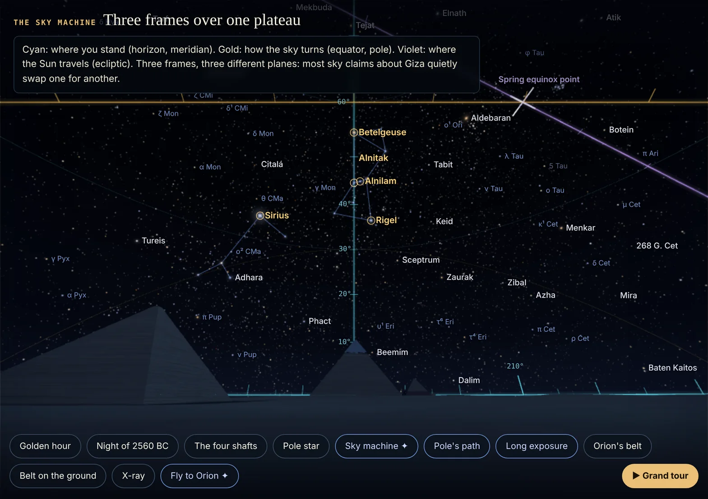
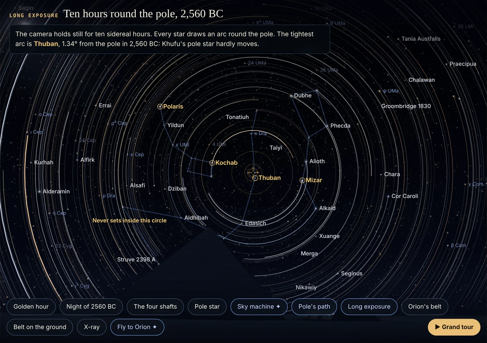
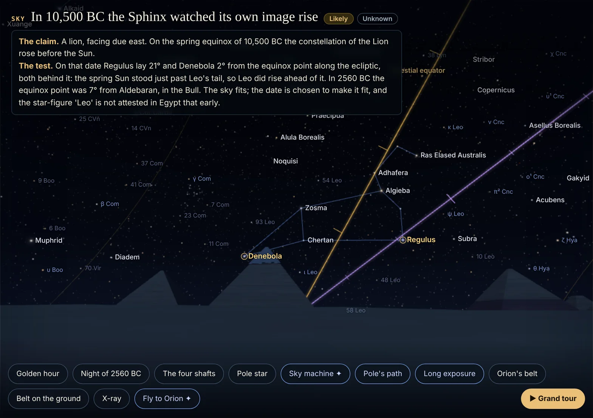

# Giza v6: The Sky Machine

Demo 65, version 6. It follows the v5 engineering review build (kept beside it exactly as delivered, in `../v5/`)
and keeps everything v4 and v5 had: the Cycles-baked plateau in two lights, 52,602 catalogue stars as Gaussian
splats, 63 claims graded twice, and the v5 instruments. Versions 1 to 5 are not touched. v6 reads the v4 bakes and
stars from `../v4/assets/` instead of copying them, so the whole folder is about 2.5 MB.







## What is new

Every sky claim about Giza names a line nobody can see: a meridian, a pole, an equinox. v6 draws those lines inside
the star layer of the X3D scene, and they move when the year does.

| # | Piece | What it shows |
|---|---|---|
| 1 | **Three frames of the sky** (`assets/celestial.x3d`) | Cyan: horizon and meridian (where you stand). Gold: equator, pole and the circle of stars that never set (how the sky turns). Violet: ecliptic with equinox and solstice points (where the Sun travels), tipped by the obliquity of the year on the clock. |
| 2 | **The pole's path** | The loop the Earth's axis draws among the stars in about 25,800 years, with a tick every thousand calendar years. Drag the pole along it on the chart and the 3D sky follows. |
| 3 | **Long exposure** | The camera holds still for ten sidereal hours and every star brighter than magnitude 4.9 draws its arc, coloured by spectral class. North in 2560 BC, north today, south in 2560 BC. |
| 4 | **Angular ruler** | A great-circle arc between any two named stars with the angle in degrees, for the year on the clock and for AD 2000. |
| 5 | **Shaft consensus** | The v4 shaft clock found a different best year for each shaft. This asks all four for one year. |
| 6 | **Survey microscope** | Petrie's casing, core and socket squares drawn against a perfect square with the errors magnified up to 5,000 times. |
| 7 | **How many witnesses?** | Each of the 63 claims is tied to the one measured fact it rests on. Two claims on one fact are one witness. |

Claims in the atlas now switch on their own frame: the Leo claim shows the ecliptic and the equator, the shafts show
the meridian, Thuban shows the pole.

## Numbers found, graded

Validator and rig are named in [receipts/witness.json](receipts/witness.json). Grades: Confirmed, Likely, Suspected.

1. **Confirmed (unit tests + the v4 Python receipt).** Thuban stood 1.34° from the pole in 2560 BC and came closest,
   0.10°, about 2797 BC. The v4 receipt printed 2796 BC; the minimum is flat for years, so one year either way is
   inside the model.
2. **Confirmed.** Asked for one year, the four shafts choose 2403 BC and still miss by 0.26° RMS. In 2560 BC the miss
   is 0.74° RMS (the same four misses v4 printed: −0.33°, −1.14°, −0.62°, +0.62°). Meridian altitudes only: no
   refraction, no bends in the shafts, Gantenbrink's angles as commonly cited.
3. **Confirmed (arithmetic on Petrie's own table).** Walk the casing square's four lengths and four bearings and you
   come back 0.04 inch (1 mm) from the start after 921 m. The worst corner stands 21 mm from a perfect square. The
   core closes to 1.0 inch; the sockets miss a square by 218 mm.
4. **Confirmed.** Orion's belt end to end (Alnitak to Mintaka) is 2.734° in 2560 BC and 2.736° in AD 2000: the stars'
   own motion changes it by 0.002°.
5. **Confirmed.** The obliquity was 23.98° in 2560 BC against 23.44° today (ERFA long-term model).
6. **Likely.** Polaris comes closest to the pole, 0.46°, about AD 2102; Vega never came closer than about 3.5°
   (around 12,050 BC). These rest on linear space motion over thousands of years.
7. **Editorial, not computed.** The 63 claims rest on 19 separate facts about the monuments. 11 claims stand on the
   one slope of the Great Pyramid, 8 on its base side, 12 on no measurement of Giza at all, 3 on the sky alone, and
   19 need a unit the builders did not have. Of the 28 Confirmed claims, 6 measure nothing at Giza and the rest
   stand on 8 facts. The table is in `build/build_witness.py`; it was made by reading each claim's test.

## What the review asked for, and where it went

`../v5/REVIEW.md` is the review. Its fixes arrived in v5 and v6 keeps them. v6 adds these on top:

- **Sky and ground fell out of step** after the stage had been off screen (found in the rig on v5 code, Confirmed
  there): in X_ITE 16.7.1 a canvas set from `update="false"` back to `"auto"` draws again but its ProximitySensor
  keeps reporting the old pose. v6 sets `"true"`, binds a pose again when the stage returns, and waits for the scroll
  before moving the camera. v5 is left as delivered.
- The caption now follows the overlays, the x-ray follows the section scanner, and the garden, survey and ghost
  overlays each have a camera stop that frames them.
- The meridian-height readout steps aside while frames, the ruler or an exposure are on.
- Field callbacks guard themselves (Loom page trap `xite-callback-unguarded`).
- "Proper" and "reflected" fits keep the review's numbers (37.609 m and 13.169 m RMS); they are reproduced by the
  v5 unit tests from the shipped data, not by a second independent program.

## Honest limits

- Mean pole and mean ecliptic: no nutation, no refraction, no Sun, Moon or planets. A long exposure is one unbroken
  night however long it runs.
- Frames, ribbons and halos have a fixed angular width so they can be seen. They are not error bars.
- The stars keep the HYG catalogue's positions and linear space motion; far from AD 2000 that is an estimate.
- Tested only in headless Chromium with software GL. No frame rate is quoted. Not yet seen on a real GPU.

## Run and rebuild

```bash
python -m http.server 8000 --directory docs     # then open /demos/blender-giza-numbers/v6/
node --test docs/demos/blender-giza-numbers/v6/tests/*.mjs     # 65 tests; set LINKEDOM_PATH for the DOM ones
```

```bash
cd docs/demos/blender-giza-numbers/v6
python build/build_celestial.py assets/celestial.x3d assets/celestial-data.json ../v4/assets/sky.x3d ../v4/assets/sky-data.json   # needs pyerfa
python build/build_survey.py assets/survey.json
python build/build_witness.py ../v5/receipts/atlas.json receipts/atlas.json
python build/write_witness.py . 65 65
```

## Credits

Stars: HYG database v4.1 by David Nash, CC BY-SA 4.0. Precession: ERFA `ltpequ` / `ltpecl` (Vondrak et al. 2011).
Survey: W. M. Flinders Petrie, *The Pyramids and Temples of Gizeh* (1883), sections 20 and 21. Renderer: X_ITE
16.7.1. Code: GPL-3.0-or-later.
