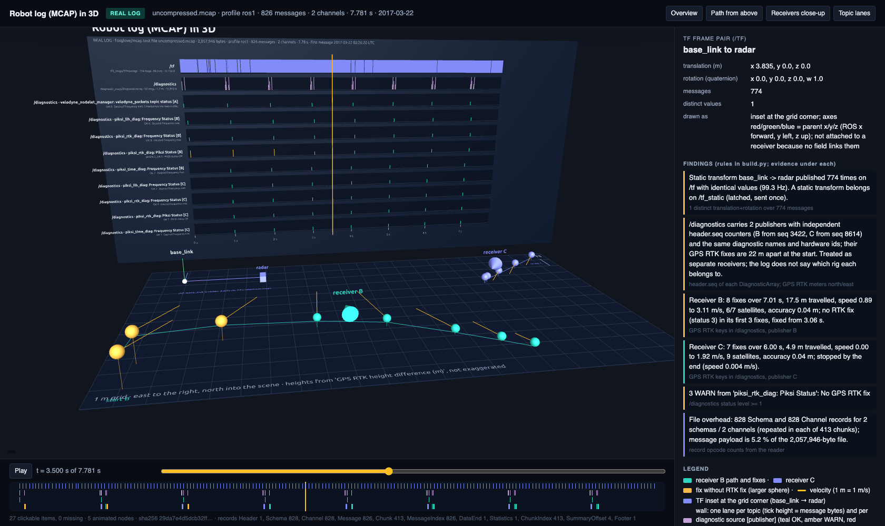

# MCAP robotics log in 3D (`build_mcap.py`, `mcap.py`, `mcap.html`)

**Real log.** The file is `rust/mcap/tests/data/uncompressed.mcap` from github.com/foxglove/mcap (main at `d330d56fe772`), fetched through Git LFS from `media.githubusercontent.com` on 2026-11-20:
- 2,057,946 bytes, sha256 `29da7e4d…`, which matches the LFS pointer's oid;
- profile `ros1`, written by `mcap go #(devel); golang-mcap-v0`;
- 826 messages on 2 channels over 7.781 s, first message 2017-03-22 02:26:20 UTC;
- 413 uncompressed chunks.



## What you see

- **Ground (1:1 metres from the RTK base, east to the right, north into the scene):** GPS RTK fixes decoded from `/diagnostics` (`diagnostic_msgs/DiagnosticArray` key/values "GPS RTK meters north/east/height difference", velocity, solution status, satellites, accuracy).
  - Two receivers, each with its own colour, path, velocity arrows (1 m = 1 m/s) and a moving cone marker in the replay.
  - Fixes without an RTK fix are larger amber spheres.
- **TF inset** at the grid corner: `base_link → radar` from `/tf`. It isn't attached to a receiver, because no field in the log links them.
- **Wall:** one lane per topic (tick height = message bytes) and one per diagnostic source and publisher (teal OK, amber WARN, red ERROR), over log time, with a playhead.
- **Page:** the same house style as the pcap page, with a side panel, findings with their evidence, a scrubber, a lane strip and four views.

## What the log shows (computed by build_mcap.py)

- **Two GPS publishers inside `/diagnostics`.** They keep independent `header.seq` counters (from 3422 and from 8614) and use the same diagnostic names and hardware IDs. Their fixes are 22 m apart at the start. Treating them as one receiver produced a fake 160 m zigzag in the first build; they are now split by sequence continuity. The log does not say which rig each belongs to.
- **Receiver B:**
  - 8 fixes over 7.01 s, 17.5 m travelled at 0.89–3.11 m/s, 6–7 satellites;
  - no RTK fix (status 3, three WARN "No GPS RTK fix") in its first 3 fixes, fixed from 3.06 s.
- **Receiver C:** 7 fixes over 6.00 s, 4.9 m travelled, 9 satellites, slows from 1.92 m/s to a stop (0.004 m/s).
- **`/tf`:** one static transform (`base_link → radar`, x 3.835 m, identity rotation) published 774 times with identical values at 99.3 Hz. A static transform belongs on `/tf_static`.
- **File overhead:** 828 Schema and 828 Channel records for 2 schemas and 2 channels, repeated in each of the 413 chunks. Message payload is 5.2 % of the file.

## Reader

`mcap.py` follows the MCAP spec (format version 0):
- **Records:** magic at both ends; opcode u8 + u64 length; Header, Schema, Channel, Message, Chunk (records inside), Statistics, Metadata, Attachment, DataEnd.
- **Defensive parsing:** every field is bounds-checked, and an overrun is recorded as a problem rather than trusted.
- **Compression:** uncompressed chunks are read. zstd chunks are read only if Python's own `compression.zstd` exists (3.14+); otherwise they are counted as skipped, and no external decompressor is run. lz4 is not supported yet.
- **ROS 1 decoding:** messages are decoded from the `ros1msg` schema text (primitives, strings, time/duration, fixed and variable arrays, nested types, `Header`). Byte arrays are summarised, not expanded.
- **Not supported yet:** ROS 2 CDR, protobuf and JSON encodings. The scene would still show channels and lanes for them, without decoded values.

```bash
cd ~/Projects/x3d/work/capture-3d && python3 -I build_mcap.py
```

Open http://127.0.0.1:8849/mcap.html with the same server as the pcap page (`python3 -m http.server 8849 --bind 127.0.0.1 --directory ~/Projects/x3d/work/capture-3d`).

## Checks (2026-11-20)

- **Reader:** 0 problems, 0 skipped chunks; record counts match the file's Statistics record (826 messages, 413 chunks).
- **x3d_mcp:** XSD valid; semantic 0 errors, 0 warnings, 31 infos (unused-DEF notes for TouchSensors). See `out/mcap-validation.txt`.
- **X_ITE 16.7.0 in headless Chromium:**
  - 27 of 27 clickable items resolved.
  - Console: 0 errors, 0 warnings.
  - Real clicks opened receiver B fixes 4 and 5 and the TF inset; one click landed on empty floor.
  - Play from 1.0 s advanced 0.97 s of log time in 2 s of wall time (7.78 s of log over a 16 s replay).
- **Not checked:** other MCAP files, compressed chunks, and non-ROS 1 encodings.
