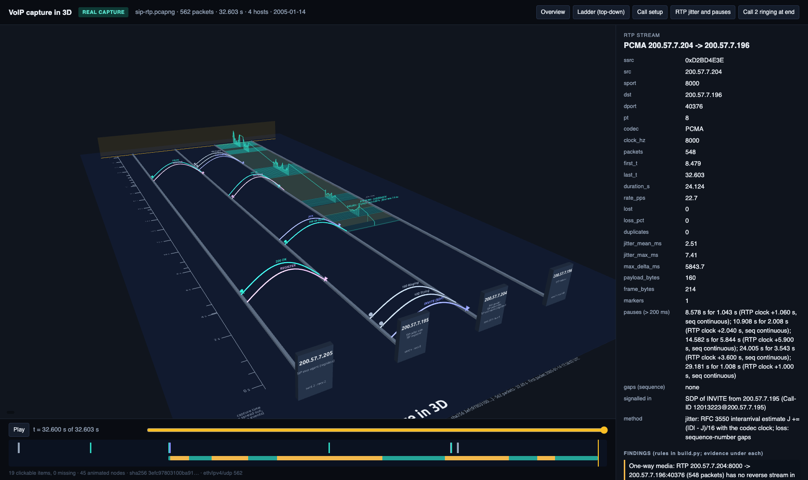

# capture-3d: a Wireshark capture as a 3D ladder diagram (X3D 4.0 + X_ITE)

**Real capture.** This is Wireshark's own test file `sip-rtp.pcapng`, from `gitlab.com/wireshark/wireshark/-/raw/master/test/captures/sip-rtp.pcapng`:
- 144,300 bytes, sha256 `3efc97803100ba91…`, fetched 2026-11-20 (upstream master at `2294e810f57b`);
- written by TShark 3.6.11;
- first packet 2005-01-14 17:58:02 UTC;
- 562 packets over 32.603 s, all Ethernet/IPv4/UDP.

It is the classic public SIP sample (bestel.com / Verso.com test users).



> MCAP: Wireshark writes **pcap/pcapng** (this page). **MCAP** (Foxglove's robotics log format) now has its own reader and scene: see [README-MCAP.md](README-MCAP.md) and `mcap.html`.

## What you see

- **Rails = hosts** (`200.57.7.205`, `.195`, `.204`, `.196`), ordered greedily so heavy talkers sit next to each other. Each rail's end card shows the roles the host *played*: SIP registrar, caller or callee side, RTP sender or receiver, user agent.
- **Time recedes into the scene (−Z).** Signalling bursts happen milliseconds apart, so consecutive SIP events are spread to at least 0.9 m; otherwise time is 1.1 m per second. The ruler on the left prints real capture time, so the warp is visible.
- **SIP messages are arcs** from sender to receiver with an arrowhead and a label: requests indigo, REGISTER mauve, 1xx grey, 2xx teal, 4xx–6xx red. A click shows the start line, Call-ID, CSeq, From/To, User-Agent, the time to the first response, and the SDP media offer.
- **The RTP stream is a band** between its sender and receiver.
  - The teal curve above it is the RFC 3550 interarrival jitter per packet, with fence posts every 4th packet.
  - Amber blocks are pauses over 200 ms.
  - Red posts would be sequence gaps; there are none here.
- **Replay** (Play / scrubber / click the lane strip): a playhead plane sweeps through time, each SIP arc pops in at its moment with a white sphere flying along it, and the RTP band grows with the playhead. The flight time of 0.6 s is visual only; real one-way latency here is milliseconds.
- **Findings card:** plain rules over the decoded packets, each with its evidence line.
- **Viewpoints:** Overview, Ladder (top-down, the classic flow graph), Call setup, RTP jitter and pauses, Call 2: rings, no answer.

## What the capture shows (computed by build.py)

- **Call 1** (`12013223@200.57.7.195`): INVITE → 100 Trying → 180 Ringing after **47.5 ms** → 200 OK after **8.478 s** → ACK.
- **One RTP stream:** PCMA (payload type 8) from `.204:8000` to `.196:40376`, SSRC `0xD2BD4E3E`, 548 packets from 8.479 s to 32.603 s.
  - **0 lost**; jitter mean **2.51 ms**, max **7.41 ms**.
  - 160-byte payloads (20 ms of PCMA).
- **One-way media:** no RTP in the reverse direction appears in this capture. Either the call had one-way audio or the capture point saw only one direction; the file alone cannot say which.
- **Five pauses** in the stream: 1.04, 2.01, 5.84, 3.54 and 1.01 s.
  - The sequence numbers stay continuous across all five, and the RTP timestamp advanced by about the same time (for example +5.90 s over the 5.84 s pause).
  - So the sender stopped sending (silence suppression or hold), and no packets were lost. This is why the average rate is 22.7 packets/s, not 50.
- **Registrations:** 3 REGISTER requests from 2 user agents, all answered 200 OK.
- **Call 2** (`12015624@200.57.7.195`): INVITE → 100 → 180 Ringing after **26.8 ms**, to the same user agent while call 1's audio is still flowing. No 200 OK arrives before the capture ends.

## Files and run

| file | what |
|---|---|
| `pcap.py` | Standard-library reader for pcapng (SHB, IDB with ts-resolution, EPB, SPB) and classic pcap (µs/ns, either byte order). Decodes Ethernet/VLAN/SLL/raw, IPv4/IPv6, UDP/TCP, SIP (RFC 3261 incl. compact headers), SDP, RTP/RTCP. Every length is bounds-checked; malformed blocks are counted and skipped. |
| `build.py` | Analysis (hosts, dialogs, setup times, RTP jitter / loss / pauses, findings) → `out/capture-scene.x3d` (about 80 KB), `out/capture-panel.json`, `out/build-report.json` |
| `index.html` | X_ITE page: side panel, findings, legend, scrubber with a lane strip (SIP ticks, RTP span, pauses), view buttons |
| `downloads/wireshark/sip-rtp.pcapng` | The capture: untrusted input, read only by `pcap.py` run as `python3 -I` |
| `shots/` | Five X_ITE screenshots |

```bash
cd docs/demos/capture-3d/v1 && python3 -I build.py
```

```bash
python3 -m http.server 8849 --bind 127.0.0.1 --directory docs   # then open /demos/capture-3d/v1/
```

To use another capture: `python3 -I build.py path/to/file.pcapng`. Any SIP/RTP or plain UDP/TCP capture gives rails and arcs. The arcs and findings are SIP-specific; other protocols are counted under `unclassified` in the panel data. Large captures would need aggregation into flows, which isn't built yet.

## Checks (2026-11-20)

- **pcap.py:** 562 of 562 packets decoded, 0 malformed blocks.
- **x3d_mcp** (`validate_one.py`): XSD valid; semantic 0 errors, 0 warnings, 24 infos (unused-DEF notes for TouchSensors read by the page). See `out/validation.txt`.
- **X_ITE 16.7.0 in headless Chromium (Playwright, 1680x1000):**
  - 19 of 19 clickable items resolved, 45 animated nodes.
  - Console: 0 errors, 0 warnings.
  - Real mouse clicks opened 180 Ringing, host `200.57.7.204` and the RTP stream. Two further clicks beside thin arcs hit nothing: arcs are 3.5 cm tubes, and their labels are also clickable.
  - Play from 8.0 s advanced to 10.5 s of capture time in 2 s of wall time (the 32.6 s capture replays in 26 s).
- **Not checked:** other captures, TCP-heavy captures (handshakes, retransmissions are decoded but not drawn), GPU and mobile rendering.
