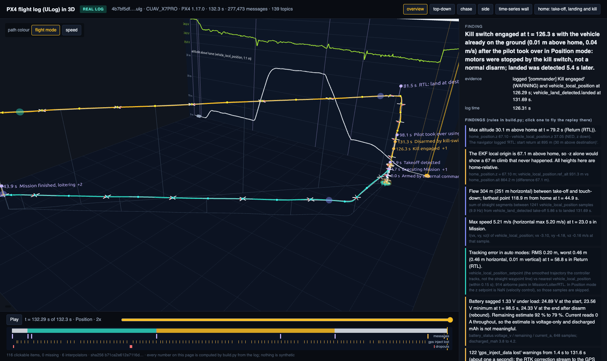

# PX4 flight log (ULog) in 3D

> **Notice, 2026-11-22.** The raw flight log `downloads/px4-flight-review/4b7bf5df-…ulg` was removed from this repository because it contains GPS latitude and longitude. The page and the built scene (`out/`) show only metres relative to home and are unaffected. `build.py` needs the log, so to rebuild, download it again from Flight Review (CC BY 4.0, see the Sources table). It remains in the git history of earlier commits. See [NOTICE.md](NOTICE.md) and [../../DATA-ATTRIBUTION.md](../../DATA-ATTRIBUTION.md).


A real PX4 quadrotor flight, read from its `.ulg` log with a standard-library reader, turned into an X3D 4.0 scene and an X_ITE page. The page has a replay, a scrubber, click-for-details, a legend, named viewpoints and a findings card.



**What the log shows:**
- **4.7 s** Mission starts: a climb to 5 m, then about 119 m south-west at 5 m/s.
- **43.9 s** Mission finished, then RTL. The vehicle climbs to 30 m, flies home and descends.
- **98.1 s** The pilot takes over in Position mode and lands by hand.
- **126.3 s** The motors are stopped with the **kill switch**, already on the ground.

Every number on the page is computed by `build.py` from the log and names its topic. Nothing in the scene is synthetic.

## Run

```bash
python3 -I build.py            # ~2 s: out/flight-scene.x3d, out/flight-panel.json, out/flight-report.json
python3 -m http.server 8851 --bind 127.0.0.1    # run from `docs/`, then open /demos/drone-flight-3d/v1/
open http://127.0.0.1:8851/
node shoot.mjs                 # headless X_ITE check + shots/ (serves the folder itself on an ephemeral port)
```

`python3 -I ulog.py FILE.ulg` prints an inventory of any ULog file: topics, counts, logged strings and dropouts.

## Sources

| file | source | bytes | sha256 |
|---|---|---|---|
| `downloads/px4-flight-review/4b7bf5df-6bdb-4815-be4c-070a3c520d60.ulg` | PX4 Flight Review public log `4b7bf5df-6bdb-4815-be4c-070a3c520d60` (review.px4.io, file from `cdn.logs.px4.io`; CDN last-modified 2026-10-13). Listed as Quadrotor, CUAV_X7PRO, v1.17.0, 2m12s, modes Position, Mission, Loiter, Return to Land. | 14,525,217 | `b71ca2e612e7116d0ed5a6cbaf289c254f29b5e90543b795637e1c8cecc8e315` |
| `downloads/px4-pyulog/sample.ulg` | `PX4/pyulog` `test/sample.ulg` (last changed in commit `820565a`, 2016-12-02). Used only to test the reader. | 4,053,364 | `81952e6059bc095717e7911c010e07f85749d6b04d332a5ffc51575a3fd0a558` |

**Why the pyulog sample was not used for the scene:** it is a 69 s bench log. The vehicle never arms, position stays at 0, 0, and there are no setpoints.

**Privacy:** the flight log contains GPS latitude and longitude, and the uploader made it public on Flight Review. The scene shows only metres relative to home; coordinates are not drawn or printed.

**Format reference:** PX4 docs, "ULog File Format" (docs.px4.io/main/en/dev_log/ulog_file_format.html).

Downloads are read only with `python3 -I`; nothing from them is executed.

## Method

**`ulog.py`** is a defensive reader of about 220 lines, standard library only.
- It parses the header, flag bits (`B`), formats (`F`, including nested types and `_padding` fields), info and multi-info (`I`, `M`), parameters (`P`, `Q`), subscriptions (`A`), data (`D`), logged strings (`L`, `C`) and dropouts (`O`).
- Every length is bounds-checked. A bad message is counted and the reader resyncs on the next sync magic. Unknown message types are skipped, as the spec requires.
- Result: 0 undecodable messages in both files.
- One bug was found along the way: PX4 writes `char[0]` (empty) multi-info values for perf counters, which the first version rejected.

**Frame.** X3D X = east, Y = up, Z = south, 1 unit = 1 m, origin at `home_position`. In NED terms: `X = y - home.y`, `Y = home.z - z`, `Z = -(x - home.x)`.
- **Altitude is measured from home, not from the local origin.** In this log the EKF origin is **67.1 m above home**: `vehicle_local_position.ref_alt` is 931.3 m and `home_position.alt` is 864.2 m.
- Using `-z` directly would have shown a 67 m climb that never happened.
- Cross-check: the home-relative maximum (30.1 m) matches the navigator's own message, "RTL: start return at 895 m (30 m above destination)" (864.2 + 30 ≈ 895).

**Attitude.** The `vehicle_attitude.q` quaternion (FRD body to NED) is turned into an X3D rotation by `C·R·Cᵀ`, where C is the NED → (east, up, south) basis change (det +1). The glyph is modelled with its nose along −Z, so at yaw 0 it points north.

**Flight modes.** Taken from `vehicle_status.nav_state` (PX4 `VehicleStatus.msg` values). Every change lines up with a logged string: "Executing Mission" at 4.7 s, "Mission finished, loitering" and "Returning to launch" at 43.9 s, "Pilot took over using sticks" at 98.1 s.

**Take-off and touch-down.** From `vehicle_land_detected.landed`: 5.86 s and 131.69 s.

**Ghost path and tracking error.** The ghost is `vehicle_local_position_setpoint`. This is the smoothed trajectory the controller tracks, not the straight waypoint line. Error is measured against the nearest `vehicle_local_position` sample within 0.15 s. Samples where the setpoint is NaN are skipped; in Position mode z is velocity-controlled, so that applies there.

**Findings.** Nine rules in `build.py` (`findings()`), each printed with its evidence:

| finding | value |
|---|---|
| max altitude | 30.1 m above home at t = 79.2 s (RTL) |
| EKF origin offset | 67.1 m above home |
| distance | 304 m flown (251 m horizontal); farthest point 118.9 m from home |
| max speed | 5.21 m/s at 23.0 s (Mission) |
| tracking error | RMS 0.20 m, worst 0.46 m (Mission, Loiter, RTL) |
| battery | 24.89 V → 23.56 V minimum under load (1.33 V sag); 24.33 V after disarm. `current_a` is 0 for the whole log, so the 92 % → 79 % estimate is voltage-only. |
| GPS warnings | 122 `gps_inject_data lost` warnings, about one a second for the whole flight (RTK correction stream) |
| kill switch | engaged at 126.3 s, 0.01 m above home at 0.04 m/s |
| logger dropouts | 5, 1,810 ms in total; the largest is 878 ms |

**Scene contents:**
- **Path:** coloured by flight mode or by speed. The two versions sit in a `Switch` and the page toggles between them.
- **Shadow and drop lines:** the path's ground shadow, with drop lines every 5 s.
- **Ghost and whiskers:** the setpoint ghost, with red error whiskers every 1 s where the error is over 0.3 m.
- **Glyphs:** 31 attitude glyphs, one every 4 s, all USE of one DEF.
- **Clickable samples:** 67 spheres, one every 2 s.
- **Event flags:** 8, one per group of logged messages within 1 s. Each is labelled with its first message and coloured by its worst level.
- **Finding markers:** one sphere per finding.
- **Wall (north of home):** X is log time. It shows altitude (1:1 m), battery voltage, a mode band, the GPS warning lane and dropout boxes.
- **Replay:** one `TimeSensor` plays the log at 2× (66 s, plus a 1 s lead and a 3 s hold). It drives the airframe (position and attitude at 4 Hz keys), its shadow, the chase-camera rig and the wall playheads.
- **Viewpoints:** overview, top-down, chase, side, time-series wall, and home (take-off, landing and kill).

## Files

| path | what |
|---|---|
| `ulog.py` | standard-library ULog reader; `python3 -I ulog.py FILE` prints an inventory |
| `build.py` | analysis, findings and X3D writer (standard library) |
| `index.html` | X_ITE 16.7.0 page (loads X_ITE 16.7.0 from `../../x3d-mujoco-bridge/v1/vendor/x_ite/`) |
| `shoot.mjs` | headless Playwright check and screenshots (uses the Playwright install in `x3d-mujoco-bridge/bridge/node_modules`) |
| `out/flight-scene.x3d` | the scene (321 KB) |
| `out/flight-panel.json` | data for the page: items, findings, timeline |
| `out/flight-report.json` | counts, frame, modes, findings, topic counts |
| `out/validation.txt`, `out/xite-check.txt`, `out/build-log.txt` | check outputs |
| `shots/` | 6 X_ITE screenshots: overview, top-down by speed, side, chase at 30 s, wall at 98 s, home at 126 s |

## Checks (2026-11-20)

- **ulog.py:**
  - Flight log: 0 undecodable messages out of 277,473 data messages, 139 topics.
  - pyulog sample: 0 out of 64,542.
- **x3d_mcp** (`validate_one.py`): XSD valid. Semantic check: 0 errors, 0 warnings, 126 infos (unused-DEF notes for TouchSensors the page reads by name). See `out/validation.txt`.
- **X_ITE 16.7.0 in headless Chromium (Playwright, 1680x1000, SwiftShader):**
  - 116 of 116 clickable items resolved.
  - A real mouse click on a path sample opened its panel ("t = 58.0 s").
  - A hover scan found the wall, path samples, a finding marker and an event flag.
  - Play from 40 s advanced about 5.2 s of log time in 3 s of wall time (2× replay).
  - Console: 0 errors and 0 page errors. 4 warnings, all Chromium's WebGL driver note "GPU stall due to ReadPixels", caused by X_ITE picking on SwiftShader.

## Limits

- **One log.** Other airframes (fixed-wing, VTOL), other PX4 versions, and logs with appended data (`incompat` flag bit 0) are not tested. The reader parses the flag but does not seek to appended offsets.
- **Mode names.** `nav_state` names come from a table of common values; an unknown value is shown as `nav_state N`.
- **Glyph size.** Arms are 2.4 m, about 5× a real quad, so they read from 100 m. Their position and orientation are true; their size is not.
- **Tracking error** is measured against the controller's smoothed setpoint. It is not the error against the planned waypoint line, which the log only carries as 11 `position_setpoint_triplet` messages (not drawn).
- **Battery.** No current sensor (`current_a` = 0), so there is no energy or mAh finding. Voltage depends on load.
- **The wall view** looks north across the flight area, so the 30 m RTL leg passes in front of the wall.
- **Not checked:** GPU and mobile rendering, other browsers, screen readers.
