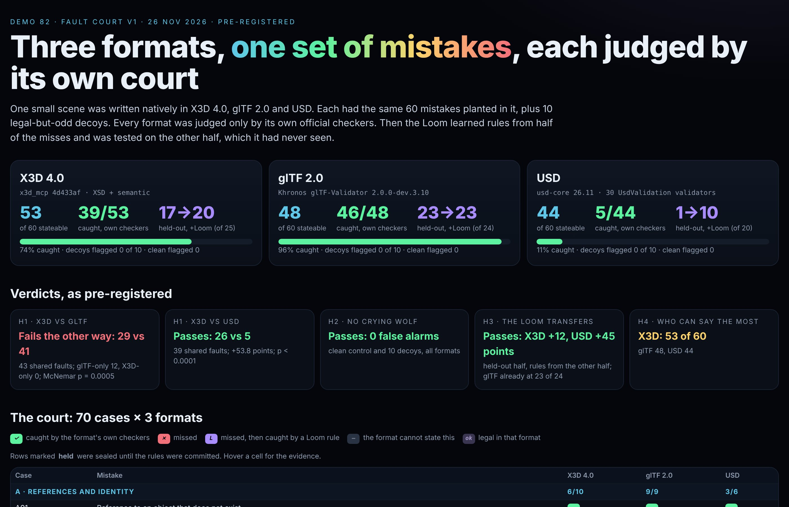

# Fault Court v1 (Demo 82)

One small scene was written **natively** in X3D 4.0, glTF 2.0 and USD by three independent writers. The same 60 mistakes were planted in each, in six format-neutral families, plus 10 legal-but-unusual decoys and a clean control. Each format was judged by its **own** official checkers. Then Loom rules were written from the misses in one half of the faults and tested on the other half, which had stayed sealed until the rules were committed.

Pre-registered in x3d.loom `fault-court/PREREG.md` (commit 697bf5d). The rules are at cf0b6b4. The kit, rules and full results (`results/score.json`) are in x3d.loom `fault-court/`, and `data/score.json` here is a copy.

| | X3D 4.0 | glTF 2.0 | USD |
|---|---|---|---|
| Mistakes the format can state (of 60) | **53** | 48 | 44 |
| Caught by its own checkers | 39 | **46** | 5 |
| Held-out half, plus Loom rules | 17 → **20** of 25 | 23 → 23 of 24 | 1 → **10** of 20 |
| False alarms (clean + 10 decoys) | 0 | 0 | 0 |

**Verdicts (pre-registered):**

- **H1 against glTF fails, in the opposite direction.** On the 43 faults both formats can state, X3D caught 29 and glTF 41 (McNemar p = 0.0005). glTF caught 12 that X3D missed; X3D caught none that glTF missed.
- **H1 against USD passes:** 26 vs 5.
- **H2 passes:** no false alarms.
- **H3 passes:** the Loom rules transfer to unseen faults, X3D +12 points and USD +45.
- **H4:** X3D can state the most mistakes.

**Corrections, with the score left as registered:**

- F03 was legal in X3D, where `nearDistance -1` means automatic.
- A01 in X3D was caught for the wrong reason.
- glTF's NaN catches are JSON parse refusals.

See Loom failure modes 318 to 322.

**Instruments:**

- **X3D:** x3d_mcp fork 4d433af, XSD 4.0 plus semantic_diagnostics.
- **glTF:** Khronos glTF-Validator 2.0.0-dev.3.10.
- **USD:** usd-core 26.11, Stage.Open plus 30 UsdValidation validators.

**Page:** static, with no 3D canvas. Tested in headless Chromium (Playwright), with 0 console and page errors. Rebuild it with `python3 build/make_page.py`.

**Threats:** one author chose the faults and wrote the rules, and there is one scene. The faults are kinds of mistake, not real-world files.
