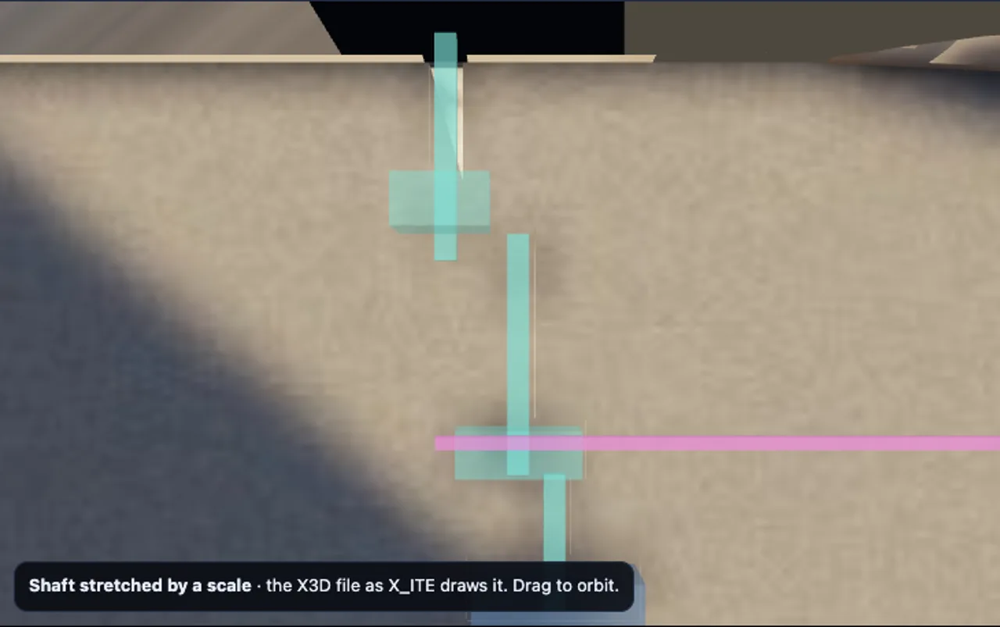

# The Fault Lab v4 · each case inside a Blender context layer

v1 to v3 are unchanged. v4 is v3's page (with its lifted glTF packets); in the "X3D in X_ITE" view it adds the heritage context layer from
[Semantic Twin Cases v3](../../semantic-twins/v3/) beside each case's scene, with an `Inline`. The layer contains:
- the rock, cut on a section through the shafts, with the record's boxes carved out;
- the plateau;
- a Sphinx massing;
- a stepped Khufu.

It is a copy in `context/`, so this folder does not depend on that one. The layer was carved from the **clean** record, so a planted geometry fault shows against it: in `?case=scaled-shaft` the stretched shaft no longer fits its hollow.

The layer is not part of any case, record, check or count. `?context=off` turns it off.

## Checks (what ran)

- The context file is byte-identical to Semantic Twins v3's: XSD valid, 0 semantic errors, 0 warnings, with x3d_mcp fa0b389 (`context/validation.json`).
- Headless Chromium with SwiftShader, X_ITE 16.7.1: v3 and v4 loaded on `?case=scaled-shaft`, 0 console errors on both (`shots/check.json`).
- **Not rerun:** the checkers, validators, glTF/USD conversions and the Blender leg. Their inputs and outputs are v1's and v2's, unchanged.
- Textures are a `quick`-profile bake. The G4 bake replaces them (`../../semantic-twins/v3/build/G4-BAKE-RUNBOOK.md`).
