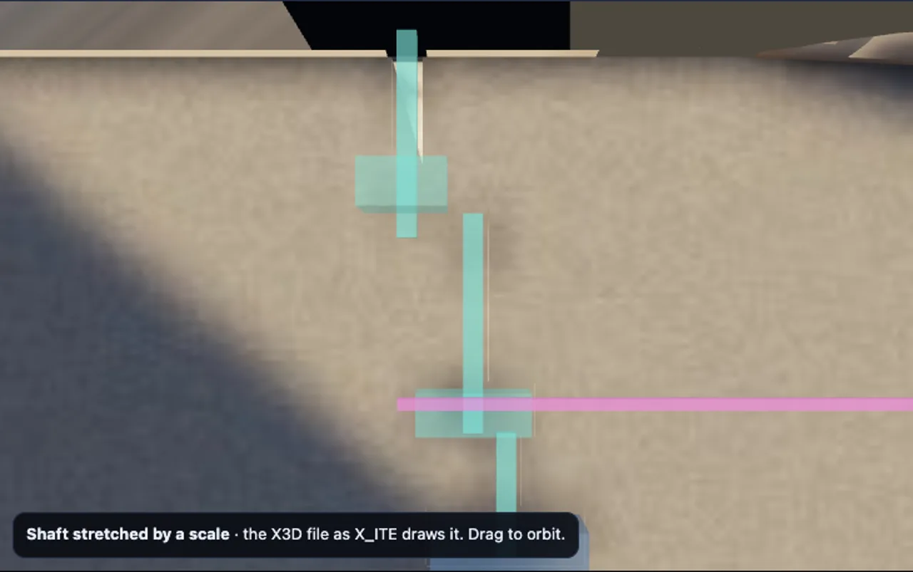

# The Fault Lab v4 · each case inside a Blender context layer

## v5: final-quality bake on an NVIDIA L4 (23 Nov 2026)

v5 is v4 with its baked textures and X3D replaced by the `g4`-profile bake. The page, the build sources and everything
else are copied from v4 unchanged, so text on the page that says "v4" describes the same scene.

| | v4 | v5 |
|---|---|---|
| bake profile | `quick` | `g4` |
| baked surfaces | 5 | 5 |
| samples per surface | 32 to 32 | 512 to 512 |
| largest texture | 512 px | 2048 px |
| textures on disk | 0.1 MB | 1.2 MB |
| bake time, all surfaces | 16 s (METAL, Blender 5.1.0) | 38 s (OptiX on one NVIDIA L4, Blender 5.3.0) |

Rig for every v5 number: Colab, one NVIDIA L4, Cycles OptiX, Blender 5.3.0, x3d-blender-io `8e56437`, notebook
`x3d.lab/notebooks/blender_bakes/giza_bakes_g4_v2.ipynb`. It was an L4, not the G4 the runbook names. Grading used the same
per-zone grades as v4 (`retone.py`). `context/heritage-context.x3d` validates as X3D 4.0 (x3d_mcp fork `4d433af`), sha256 `3d579e3137520fe3…`.
The page loads with no console errors in headless Chromium (software GL); frame rate was not measured.

v1 to v3 are unchanged. v4 is v3's page (with its lifted glTF packets); in the "X3D in X_ITE" view it adds the heritage context layer from
[Semantic Twin Cases v3](../../semantic-twins/v3/) beside each case's scene, with an `Inline`. The layer contains:
- the rock, cut on a section through the shafts, with the record's boxes carved out;
- the plateau;
- a Sphinx massing;
- a stepped Khufu.

It is a copy in `context/`, so this folder does not depend on that one. The layer was carved from the **clean** record, so a planted geometry fault shows against it: in `?case=scaled-shaft` the stretched shaft no longer fits its hollow.

The layer is not part of any case, record, check or count. `?context=off` turns it off.

## Checks (what ran)

- The context file is byte-identical to Semantic Twins v3's: XSD valid, 0 semantic errors, 0 warnings, with x3d_mcp fa0b389 (`context/validation.json`).
- Headless Chromium with SwiftShader, X_ITE 16.7.1: v3 and v4 loaded on `?case=scaled-shaft`, 0 console errors on both (`shots/check.json`).
- **Not rerun:** the checkers, validators, glTF/USD conversions and the Blender leg. Their inputs and outputs are v1's and v2's, unchanged.
- Textures are a `quick`-profile bake. The G4 bake replaces them (`../../semantic-twins/v3/build/G4-BAKE-RUNBOOK.md`).
