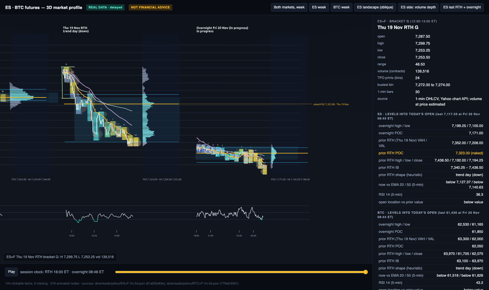

# futures-3d: ES and BTC futures as a 3D market profile (X3D 4.0 + X_ITE)

> **Notice, 2026-11-22.** The raw Yahoo Finance files named below (`downloads/yahoo/`) were removed from this repository because no licence permitting redistribution was found. The page and the built scene (`out/`) use only the derived numbers and are unaffected. `build.py` needs those two files, so to rebuild, fetch them again as described under Files and run. They remain in the git history of earlier commits. See [NOTICE.md](NOTICE.md) and [../../DATA-ATTRIBUTION.md](../../DATA-ATTRIBUTION.md).


**Real data, delayed. A visual study tool, not financial advice.**



## What you see

Each market has its own panel: ES (CME E-mini S&P 500) at the bottom, BTC (CME Bitcoin futures) at the top. The four complete regular sessions (Mon 16 to Thu 19 Nov 2026, 09:30–16:00 ET) and today's overnight session up to the last bar (Fri 20 Nov 08:45 ET) sit side by side and share one price scale per market, so levels line up across days.

- **Front face (X = time, Y = price):** a TPO chart. Each 30-minute bracket (A–M; 60-minute brackets a… overnight) prints a cell at every price bin it traded. Colour runs from blue (early) to gold (late). Cells outside the value area are dimmed, single prints are orange, and the initial balance has a green bracket on the left.
- **Depth into the screen (Z):** the volume traded at that price inside that bracket (square-root scale). This is the 3D part. Turn to the *side* view and the week becomes a landscape: you can see *when* during the day the volume built at a level, not just how much.
- **Right of each session:** its volume profile as a horizontal histogram. The value area (70 %) is blue, the POC amber, and a blue band marks the value area across the session.
- **Lines:** POC (amber), VAH/VAL (blue), naked POCs (dim amber to the right edge, labelled), EMA 20 (amber) and EMA 50 (mauve) on 5-min closes, session VWAP (white). 5-min candles sit on the front plane.
- **RSI 14** (5-min, Wilder) pane under each market, with 30/50/70 guides. The line turns red at 70 or above and teal at 30 or below.
- **Replay:** one session clock (Play / scrubber) builds every session in parallel, RTH 09:30→16:00 and overnight 18:00→08:45. Each bracket's cells grow in depth during its 30 minutes. Its candles, EMAs, VWAP and RSI appear when the bracket completes, and the profile wall grows bracket by bracket. Nothing from the future is drawn.
- **Practical side panel:**
  - **Levels into today's open, per market:** overnight high/low/POC; prior day's VAH/VAL/POC, high/low/close and IB; naked POCs; position against EMA 20/50; RSI; open inside, above or below prior value.
  - **Clicks:** a bracket shows its OHLC, volume, TPO count and busiest bin. A session profile shows shape, VA, POC, IB, single-print ranges, VWAP and naked status.
- **Viewpoints:** Both markets, ES week, BTC week, ES landscape (oblique), ES side (volume depth), ES last RTH + overnight.

At the time of the data (Fri 20 Nov 08:45 ET), for example:
- ES Thursday was a trend day down: range 244.50, IB 96.25, close 7,194.25 near the 7,192.00 low.
- Its POC 7,323.00 is naked, and the overnight session traded 7,105–7,199.25, below Thursday's value area (7,206–7,352).
- These numbers come from `out/futures-panel.json` and are recomputed on every build.

## Method (also in the `build.py` docstring)

| item | rule |
|---|---|
| data | `downloads/yahoo/ES=F.1m.5d.json` (sha256 `61af22e8...`), `BTC=F.1m.5d.json` (sha256 `779afc92...`), from Yahoo Finance's chart endpoint (`query1.finance.yahoo.com/v8/finance/chart/<sym>?interval=1m&range=5d`, unofficial, no key, delayed). Fetched 2026-11-20 at about 275–283 KB each. These are continuous front-month contracts. Not redistributed here (removed 2026-11-22; see the notice at the top). |
| sessions | RTH 09:30–16:00 ET for complete weekdays. BTC uses the same window so the two markets line up (CME BTC trades almost 23 h). Overnight = 18:00 ET previous day → last bar. |
| bins | ES 2.00 points, BTC 100 USD |
| volume at price | **estimated**: each 1-min bar's volume spread evenly over the bins between its low and high (not tick data) |
| value area | 70 % of session volume, grown from the POC two bins at a time toward the larger side |
| IB | high/low of the first two RTH brackets |
| single prints | bins inside the session range touched by exactly one bracket, merged into ranges |
| naked POC | no later 1-min bar in the file traded through it |
| shape | **heuristic**: trend if range > 2 × IB and the close is in the outer 20 % of the range; otherwise P / b / D by where the POC sits (above 62 %, below 38 %, or between) |
| EMA 20/50, RSI 14 | on 5-minute closes over the whole continuous series (overnight included), so values at the RTH open are warmed up |
| VWAP | per session, 1-min typical price × volume |

## Files and run

`build.py` (stdlib only) → `out/futures-scene.x3d` (about 2.1 MB), `out/futures-panel.json`, `out/build-report.json`. `index.html` is the page. the page loads X_ITE 16.7.0 from `../../x3d-mujoco-bridge/v1/vendor/x_ite/` in this repository. `shots/` holds six X_ITE screenshots.

```bash
cd docs/demos/futures-profile-3d/v1 && python3 -I build.py
```

```bash
python3 -m http.server 8848 --bind 127.0.0.1 --directory docs   # then open /demos/futures-profile-3d/v1/
```

To refresh the data, re-run the two `curl` fetches with any User-Agent: about 280 KB each, the URL in the table above, saved over the files in `downloads/yahoo/`. Then rebuild.

## Checks (2026-11-20)

- **x3d_mcp** (`validate_one.py`, local fork): XSD valid; semantic 0 errors, 0 warnings, 150 infos. The infos are unused-DEF notes for the TouchSensors the page reads through SAI. See `out/validation.txt`.
- **X_ITE 16.7.0 in headless Chromium (Playwright, 1680x1000):**
  - 144 of 144 clickable items resolved, 278 animated nodes.
  - Console: 0 errors, 0 warnings.
  - Real mouse clicks opened Thu bracket G, Thu bracket L, overnight bracket m and the overnight profile.
  - Play from 20 % advanced the session clock from 10:48 to 11:27 ET in 2.2 s of wall time.
  - At 13:05 the replay shows only brackets A–H and no later candles or indicators.
- **Not checked:** GPU and mobile rendering, and the in-app browser pane, where X_ITE's load stalls while the pane is hidden.

## Limits

- Five trading days of 1-min data is all the free endpoint gives at this resolution. Rebuilding the week rolls the window.
- Yahoo's futures volume is the continuous front contract. Around a roll it would mix contracts. ES is not near its roll (the December contract rolls in mid-December). CME BTC is monthly and expires on the last Friday (27 Nov 2026), so volume may already be moving to December, and this file cannot show that.
- Volume at price and single prints come from 1-min bars, so very fast bars smear volume across their range.
- No order flow (bid/ask delta), because the data has no trade side.
