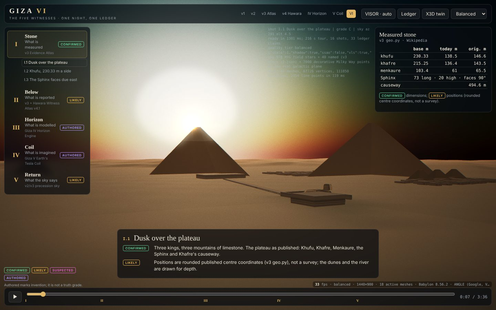

# Giza VI · The Five Witnesses

One night at Giza in five acts, one ledger, four grades. Giza VI merges the v3 Evidence Atlas, the Hawara Witness Atlas v4.1, Giza IV Horizon Engine and Giza V Earth's Tesla Coil into a single 216-second guided film you can stop and walk around in, drawn by Babylon.js 8.56.2 with an X3D 4.0 twin of every vertex.

| Act | Witness | Source edition | Act grade | Shots | What you see |
|---|---|---|---|---|---|
| I · Stone | what is measured | v3 Evidence Atlas | Confirmed | 3 | sunset behind Khafre, god rays, Khufu's 230.33 m face, the Sphinx facing east |
| II · Below | what is reported | v3 + Hawara v4.1 | Likely | 4 | x-ray of the Osiris Shaft (30.37 vs 35.45 vs 41.48 m), a cut to Hawara 81.6 km south, VISOR over the twelve courts and the conjectured lower walls |
| III · Horizon | what is modelled | Giza IV | Authored | 3 | ghosted Khufu, Grand Gallery, the granite King's Chamber, the authored king with ankh and Was-sceptre, Giza IV's oscillator curve |
| IV · Coil | what is imagined | Giza V | Authored | 3 | the sky plate at 80 km drawn at 571 m, standing arcs whose brightness is paid for by V's live energy ledger, the valley beacons |
| V · Return | what the sky says | v2/v3 sky | Likely | 3 | real HYG stars precessed from 10,500 BCE to 2000 CE (Orion's belt from 10.0° to 58.8°), then the equinox dawn over the Sphinx |

Every caption line carries **Confirmed**, **Likely**, **Suspected** or **Authored** (invention, not a truth grade). The ledger drawer (L) holds 33 claims across the five editions with sources.

## Run

From the repository root: `python3 -m http.server 8800 --directory docs`, then open <http://localhost:8800/demos/giza-osiris-hall/v6/>. Windows: `py -m http.server 8800 --directory docs`. Keep the whole `giza-osiris-hall/` folder: VI imports `../v3/sky-math.js`, `../v3/stars_v2.json`, `../v5/tesla.mjs`, `../v5/resonance.mjs` and `../v4/hawara.mjs` unchanged.

URL options: `?q=cinematic|balanced|lite` (default balanced, auto steps down after 4 s under 14 fps), `?shot=IV.2` (open paused on a shot), `?t=120`, `?pause`, `?sky=az,alt` (debug sun).

Keys: Space play/pause, ← → previous/next shot, V cycles VISOR auto/on/off, L ledger. Dragging the scene pauses the tour and frees the camera; Play blends back into the film from where you are.

## Rendering, and why each trick is there

| Technique | Babylon feature | Where it shows | Tier |
|---|---|---|---|
| Physically based stone, granite, gold, water | PBRMaterial, 6 procedural texture sets (blocks of 0.7 m courses, sand ripples, granite speckle, mudbrick) baked to albedo + normal on the CPU at load (≈0.8 s) | every surface | all |
| Preetham sky and image-based light | SkyMaterial (turbidity 9) rendered into a 256 px ReflectionProbe that is the scene environment, refreshed when the sun moves | sunsets, ambient colour | all |
| Night dome, storm tint | custom ShaderMaterial blended over the day sky by sun altitude | Acts IV and V | all |
| Real stars | 978 HYG field stars + 40 named, positioned each epoch by v3 GizaSky (ERFA precession), point sprites sized by magnitude | Act V | all |
| Milky Way | 7,000 points on the real galactic plane (IAU rotation), brightness decorative | night acts | all |
| Shadows | DirectionalLight + PCF ShadowGenerator fitted to the casters (2048 px, 4096 cinematic) | everywhere in daylight | balanced, cinematic |
| God rays | VolumetricLightScatteringPostProcess from the sun disc | Act I sunset, Act V dawn | balanced, cinematic |
| HDR bloom, ACES tone mapping, vignette, grain, chromatic aberration, sharpen, FXAA | DefaultRenderingPipeline | everywhere | all |
| Ambient occlusion | SSAO2RenderingPipeline | courts, chambers, mastabas | cinematic |
| Depth of field | DefaultRenderingPipeline DoF | King's Chamber | balanced, cinematic |
| Emissive glow | GlowLayer on arcs, ankh, Was, beacons | Acts III and IV | all |
| Lines with width | GreasedLine (arcs, field figure, beacon links) | Act IV | all |
| Particles | chamber dust motes, arc-root sparks (rate tied to delivered arc power) | Acts III and IV | all |
| VISOR | custom post-process: depth + luma Sobel edges, thermal palette, scan lines, reticle; labelled a look, not a sensor | Act II Hawara, on demand | all |
| X-ray | ground and courts fade to 12 % to 30 % alpha to show what lies under them | Act II | all |

## Files

| File | Role |
|---|---|
| `world.mjs` | the only geometry source: 40 descriptors, pure functions, seeded, no DOM |
| `story.mjs` | 5 acts, 16 shots (camera paths, sun, epoch, layers), graded captions, the 33-row ledger |
| `app.mjs` | Babylon renderer, director, instruments, HUD, verbose log, `window.__giza6.report()` |
| `index.html`, `giza6.css` | the page |
| `giza-vi.x3d` | X3D 4.0 twin of the same vertices with per-Shape grade metadata, 16 Viewpoints, each with its own FLY NavigationInfo (speed scaled to the shot; EXAMINE second, and a Fly / Examine toggle in twin.html) |
| `twin.html` | the twin drawn by X_ITE 16.6.0 (from v3/vendor); Authored layers start hidden (a `Switch`), one checkbox shows them |
| `validation-vi.json` | x3d_mcp receipt for the exact twin bytes |
| `build/export_x3d.mjs`, `build/gate.sh` | rebuild the twin; validate it |
| `tests/v6.test.mjs` | offline contracts (`node --test tests/v6.test.mjs`) |
| `assets/` | seven 1440x900 screenshots (headless Chromium 157, SwiftShader, balanced tier) |
| `vendor/babylon/` | Babylon.js 8.56.2 + sky material (Apache-2.0) |
| `VALIDATION.md`, `NOTICE.md` | receipts, limits, credits |

See `VALIDATION.md` for every number, the validator and the browser and hardware behind it.
