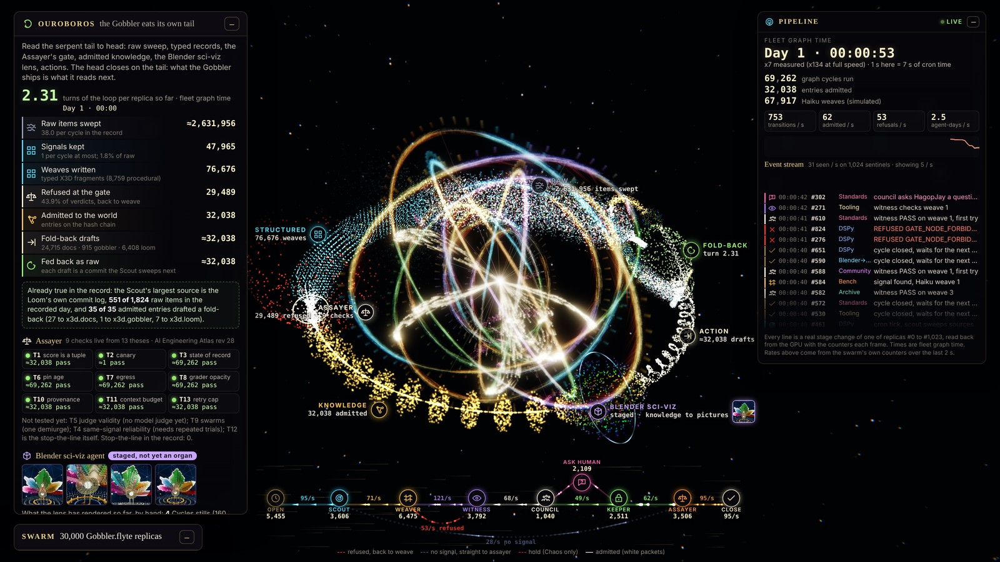

# Gobbler Gyroscope v4: the Ouroboros (Demo 23, version 4)

v1 (`../v1/`), v2 (`../v2/`) and v3 (`../v3/`) are unchanged. v4 keeps v3 whole (30,000 replicas of the Gobbler.flyte LangGraph graph on the ten flywheel hoops, the swarm panel, the pipeline layer) and wraps a **serpent** around the gyroscope that shows what the fleet's work becomes, and where it goes: back into its own tail.

Owner's ask, 24 Nov: "demonstrate activity, but unstructured to structured to knowledgeable actionable practical DATA routed back and folded back into its own tail ouroboros style recursively and aesthetically. Bring in the Assayer of course! the Blender SCI-VIZ agent which should launch sooner than later."

Press **O** (or the "Ouroboros (O)" button) to hide or show the serpent. **P** still toggles the pipeline layer. Everything about the swarm, its calibration and the pipeline layer is in [`../v3/README.md`](../v3/README.md) and is not repeated here.

## Reading the serpent, tail to head

A ring of 60,000 point sprites, radius 5 scene units, tilted slightly and slowly breathing. Matter moves from the tail to the head; its shape changes at each phase.

| Along the body | Phase | What you see | What it stands for |
|---|---|---|---|
| 0.00-0.26 | **Raw** | a loose, jittering cloud in five colours | what the Scout sweeps. Colours are the five recorded classes of raw item (x3d, adjacent, x3d-video-net, noise, amd-x3d namesakes) in their recorded proportions (799 / 309 / 271 / 327 / 118 of 1,824). Grey namesake items drift away and are set aside. |
| 0.26-0.455 | **Structured** | the cloud snaps onto a cyan lattice | weaves: typed X3D fragments |
| 0.455-0.50 | **Assayer gate** | a bright hoop; a share of the stream turns red and is thrown out | the witness and Assayer verdicts. The ejected share follows the swarm's **live** refusal rate (refused / (passed + refused)), so the Chaos slider visibly changes it. |
| 0.50-0.715 | **Knowledge** | gold beads on a thread | entries admitted to the world's hash chain |
| 0.715-0.785 | **Blender sci-viz lens** | a second hoop; the beads pass through and split into a spectrum | the sci-viz agent, which is **staged**: see below |
| 0.785-0.935 | **Action** | a tight white double helix | fold-back drafts: pull requests to x3d.docs, x3d.loom, x3d.gobbler |
| 0.935-1.00 | **Head** | jaws closing on the tail tip | the bite: what was shipped is what the Scout reads next |

**Recursive.** At the bite sits a second, smaller serpent (0.34 scale) with all the same phases, and at its bite a third. 72% of the sprites are in the big serpent, 20% in the second, 8% in the third. See `shots/o4-bite-nested.jpg`.

**Why the loop is not just a picture.** On the recorded day the Scout's largest single source was the Loom's own commit log (551 of 1,824 raw items), and all 35 admitted entries drafted a fold-back (27 to x3d.docs, 7 to x3d.loom, 1 to x3d.gobbler). The Gobbler already eats what it ships. The receipt-to-rule engine closes a second loop the same way: 28 candidate rules from failure receipts, put back to the Blender add-on, 25 closed and 0 still live on 2.7.4.

**Density is a picture, counts are numbers.** The number of sprites in a phase is chosen to read well, not to scale. Every count is on a label or in the panel.

## The Ouroboros panel (left)

| Block | What it shows | Where it comes from |
|---|---|---|
| Turn counter | graph cycles completed per replica so far, and the fleet's graph time | live swarm counters |
| Funnel | raw items swept, signals kept, weaves written, refused at the gate, admitted, fold-back drafts, fed back as raw | live counters. Rows marked **≈** are a live counter times a recorded ratio (38.0 raw items per cycle; the 27 / 7 / 1 split of fold-backs). |
| Already true in the record | the two facts above | `ouro/data.json` |
| Assayer | the nine checks that run today out of 13 theses (T1 score tuple, T2 canary, T3 state of record, T6 pin age, T7 egress, T8 grader opacity, T10 provenance, T11 context budget, T13 retry cap), each with a pass count that follows its recorded rule (every cycle, every admitted entry, or once a day), and the four not tested yet (T4, T5, T9, T12). Stop-the-line in the record: 0. | x3d.gobbler `flyte/runs/sim-2026-11-18-r5/assay-report.json`, AI Engineering Atlas rev 28 |
| Blender sci-viz agent, "staged, not yet an organ" | four Cycles stills of the glass Gobbler and what has been rendered by hand so far: 4 stills at 160 samples, a 120-frame turntable, Blender 5.3.0 through x3d-blender-io 2.7.4, light baked onto 11,616 faces | x3d.gobbler `mascot/glass` receipts; thumbnails are 128 px crops of its stills |
| The Loom, its memory | 44 laws, 269 failure modes, 13 theses, 28 rules from receipts | x3d.loom at ef79f14, counted by x3d.gobbler `mascot/loom_counts.py`; R2R figures from x3d.loom `LEARNINGS-r2r-engine.md` and `R2R.md` |
| Eating now | a feed of the 60 newest commits on seven public repos since 18 Nov 2026 | `git log` at the heads listed in `ouro/data.json` |
| Next on the frontier board | top five frontiers | the 23 Nov board in x3d.gobbler; ranks are judged scores (Suspected), read them as a tier |

Labels on the serpent carry the same live numbers and follow the ring as the camera turns.

## What is real, what is simulated, what is staged

- **Recorded:** everything in `ouro/data.json`. `source/ouro_data.py` rebuilds it from local checkouts (`python3 source/ouro_data.py --repos <dir holding the repos> --out ouro/data.json`). The recorded day is a sim day: fixture feeds, simulated Haiku, zero model calls (tape sha256 in the file).
- **Simulated live:** the 30,000 replicas, as in v2 and v3. The panel's live rows come from their counters. No model is called and nothing is billed.
- **Staged:** the Blender sci-viz agent is **not** a node of the Gobbler graph today. Its renders exist because a person ran Blender. The lens on the serpent and the "knowledge to pictures" label show where it would sit (after the Keeper: admitted knowledge in, validated pictures out, each with a receipt). No sci-viz counter is shown because none exists.
- **Not modelled:** the swarm's state machine has no fold-back step; "fold-back drafts" and "fed back as raw" equal the admitted count because in the record every admitted entry drafted one (35 of 35). A fleet where that ratio differs would need the step added to `model.js`.

## How it is built

- `ouro/ouro.js`: one WebGL2 canvas laid over the swarm (additive blending, transparent clear), so it works unchanged whether the swarm draws with WebGPU or WebGL2. It reads the swarm's camera each frame (`GobblerSwarm.cam.vp`), places sprites entirely in the vertex shader from a per-sprite seed (no per-frame uploads), and takes three live numbers as uniforms (refusal share, admitted-rate pulse, hold rate under Chaos) plus the recorded raw class mix.
- `ouro/ouro-hud.js`, `ouro/ouro.css`: the panel and the labels. Labels are clamped clear of the side panels and the pipeline rail.
- `source/ouro_data.py`, `ouro/data.json` (schema `gobbler.ouroboros/1`), `ouro/thumbs/`.
- `swarm/swarm.js` v4 edits against v3: the camera starts further back and higher (pitch 0.42, distance 17; `?dist=` overrides) so the serpent fits, and `worldMatrix()` is exposed. `swarm/model.js`, `gpu.js`, `gl.js`, `hud.js`, `pipe.js` are byte-identical to v3.
- `index.html` and `solo.html` v4 edits against v3: build id, title, kicker, nav chips (v1 to v4), the `Ouroboros (O)` button, the three `ouro/` includes; the swarm panel starts folded and parks bottom left.

## Tested, and on what

| Check | Result | Rig |
|---|---|---|
| JS vs WGSL parity on v4's files, four runs | bit-identical 4 of 4, same hashes as v3 (a60287d1, 5ce35415, ed133b85, b9654a29) | Chrome for Testing 158.0.8127.36, headless, SwiftShader WebGPU |
| `solo.html` on WebGPU | serpent, labels, panel, pipeline layer all draw (`shots/o1`) | same, through `?capture=1` |
| `index.html` with `navigator.gpu` removed | WebGL2 gyroscope with the serpent over it (`shots/o2`); 0 console errors, 0 page errors, 0 HTTP errors | same, WebGL2 on ANGLE/SwiftShader |
| Chaos 1.0 | red ejection at the gate grows with the live refusal rate; hold line live on the rail (`shots/o3`) | same |
| 414 px wide | serpent and short labels; panels hidden (`shots/o5`) | same, WebGL2 |

**Not tested here.** No real GPU: SwiftShader is a CPU rasteriser, so no frame rate in this folder is a GPU frame rate and none is quoted; the fps badges and the low measured speed-up on the pipeline clock in the shots are the rig's. The integrated WebGPU path of `index.html` (the swarm on Babylon's device) cannot present in this rig and was not exercised with the serpent over it; the overlay does not touch that path's device. v3's integration harness was not re-run for v4. The 60,000 extra sprites have not been timed on any GPU. Touch orbit on a phone was not tested.

## Files

`shots/`: o1 solo on WebGPU (2x capture, shown at 1600 x 900); o2 the v4 page on WebGL2; o3 Chaos 1.0; o4 the bite with the nested serpent, 2x crop; o5 414 px wide. All: Chrome for Testing 158.0.8127.36 headless, SwiftShader.
