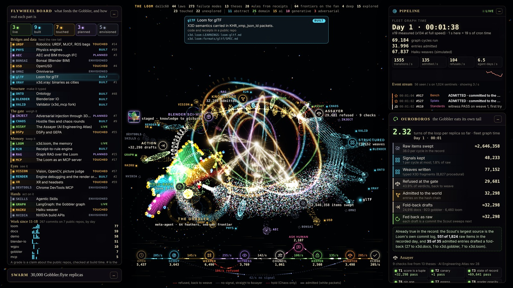

# Gobbler Gyroscope v5: the Gobbler returns (Demo 23, version 5)

v1 to v4 are unchanged (`../v1/` ... `../v4/`). v5 keeps v4 whole (the 30,000-replica swarm, the pipeline layer, the Ouroboros serpent) and adds three things: the Gobbler itself as the serpent's head, a ring of **lanes** that feed the serpent with an honest grade on each, and a **flywheel board** that puts the grades, the Loom's counts and the project's recent work on screen at once.

Owner's ask, 25 Nov: "Lets add the Gobblers head back to the v4 Vortex. Lets increase the visual info and visual density even further to v5 with 200% more good useful info transmission ... signal all of the first paragraph and MORE in the proof of concept scene." The first paragraph named: ontology, agentic skills, rendering-engine profiling and debugging, adversarial injection, DSPy, the Assayer, graph RAG on LangGraph with Haiku and NVIDIA build APIs, vision and OpenCV, a Chrome DevTools MCP, Blenderizer IO 4.0, XR, x3d.loom, and more bridges (URDF, physics, AEC, Bonsai, OpenUSD, Omniverse).

Keys: **G** bird, **L** lanes, **O** serpent, **P** pipeline. The serpent, swarm and pipeline are documented in [`../v4/README.md`](../v4/README.md) and [`../v3/README.md`](../v3/README.md).

## 1. The Gobbler is the serpent's head

The bird at the bite is the glass mascot from x3d.gobbler (`mascot/glass/gobbler-glass.x3d`, Gobbler 6.1), not a drawing of it. `source/gobbler_points.py` reads that X3D file and writes `ouro/gobbler.bin`: its 11,736 triangles with the scene's own per-face colours and a face normal, plus 6,556 points (shells for the eyes, the heart and the 64 frontier gems, and sparks on the faces). The page draws the triangles as additive glass, dim face-on and bright at grazing angles, so the form reads without a depth buffer.

- Its head sits on the ring exactly where the serpent's head closes on the tail, beak along the direction of travel.
- Its fan is the frontier board: 64 feathers and 64 gems, one per frontier.
- Its heart beats when the swarm admits an entry.
- The nested serpent at the bite has its own smaller bird.

The ring is turned so the bite faces the default camera. See `shots/g4-bird.jpg`.

**One thing the bird does not say.** The glass bird was built on 24 Nov at Loom commit 139896f and wears 228 failure-mode beads. The Loom has 273 today (the fact strip shows the current count). The bird is a recorded object; it does not grow on this page.

## 2. The lanes, and how real each one is

27 small moons sit outside the serpent, each at the place where its work feeds in, with a stream of particles running inward. Colour is the lane's **grade**:

| Grade | Means | Lanes |
|---|---|---|
| **live** (green) | runs inside the recorded Gobbler graph | 3 |
| **built** (cyan) | code and receipts in a public repo | 9 |
| **touched** (amber) | first evidence only | 7 |
| **planned** (violet, dashed) | on the 23 Nov frontier board with a written first step, not started | 3 |
| **envisioned** (grey, dashed) | named by the owner on 25 Nov, nothing in the repos yet | 5 |

A grade is a claim about the public repos. Every lane above "envisioned" names at least one evidence path, and `source/ouro_data.py` fails the build if a named path does not exist. The grades themselves are a judgement made while reading those paths on 25 Nov; treat a grade as Likely, and the existence of its evidence as Confirmed.

| Feeds | Lane | Grade | One fact |
|---|---|---|---|
| raw tail | URDF (robotics) | touched | the MuJoCo bridge reads MJCF; URDF is a written plan |
| | Physics | built | PhysX and MuJoCo bridges, a Rapier lab, a physics playbook |
| | AEC / BIM (IFC) | planned | first step written: one open building, 10 quantities against IfcOpenShell |
| | Bonsai | envisioned | |
| | OpenUSD | touched | the glass Gobbler leaves Blender as usdc; no conformance run yet |
| | Omniverse | envisioned | |
| | glTF | built | X3D semantics carried in KHR_xmp_json_ld packets |
| | x3d.xray | built | binaries, code and captures as scenes |
| structure | Ontology | built | ontology cross-validation in the validator fork; SHACL shapes for style |
| | Blenderizer IO | built | **2.7.4 today**; 4.0 is the named target |
| | Validator (x3d_mcp fork) | built | |
| gate | Adversarial injection | planned | an untrusted-text guard exists; the 40 hostile scenes are not built |
| | Hostile files, chaos rounds | built | three rounds against the Blender add-on; other readers not yet |
| | The Assayer | live | 9 of 13 thesis checks on every recorded cycle |
| | DSPy / GEPA | touched | sweep and pilots done; the rule-proposer seam is built and switched off |
| memory | x3d.loom | live | the Scout reads its commit log; every fold-back lands here |
| | Receipt-to-rule engine | built | |
| | Graph RAG over the Loom | planned | an agent memory module exists; retrieval over the Loom is not built |
| | The Loom as an MCP server | touched | |
| eyes | Vision, OpenCV, picture judge | touched | OpenCV used in one kit; the picture judge is not calibrated |
| | Engine debugging, render oracle | built | Vulkan validation layers in x3d.wgpu receipts; **profiling: not yet** |
| | XR | touched | one XR scene; no headset frame-time witness |
| | Chrome DevTools MCP | envisioned | headless Chrome rigs check every page today; the MCP is not wired |
| hands | Agentic Skills | envisioned | no skill files in the repos |
| | LangGraph (the Gobbler graph) | live | five organs, one graph; the recorded day is a sim day |
| | Haiku weaver | touched | **simulated in the record, zero model calls** |
| | NVIDIA build APIs | envisioned | no call has been made |

**Stream density is a picture of the grade, not a measured flow.** Only the three live lanes have counters, and those are on the Ouroboros panel.

## 3. The flywheel board, the spotlight and the fact strip

- **Flywheel board** (left): every lane in one line (key, name, grade, rank among the 64 frontiers where the lane is on the board), then commits per day since 18 Nov for seven public repos (267 commits at build time). Ranks are judged scores: read them as a tier.
- **Spotlight** (top centre): walks the lanes one by one every 2.6 s and shows the fact and the evidence paths behind the grade. Hover a board row to hold it. The matching label on the scene lights up.
- **Fact strip** (top): the Loom at its current commit (44 laws, 273 failure modes, 13 theses, 28 rules from receipts at da11c60), and the frontier board by status (4 deep, 15 explored, 23 touched, 22 unexplored) and by family.
- The Ouroboros panel moves to the right, under the pipeline column; both are shorter and scroll.

What is on screen at once in v5 that was not in v4: 27 graded lanes, 27 labels on the scene, the bird, the spotlight card, the strip (16 figures), and seven sparklines.

## How it is built

- `ouro/v5.js`, `ouro/v5.css`: everything new. It draws through one hook (`GobblerOuroboros.extra`) on the serpent's own WebGL2 canvas, so it works over the WebGPU swarm and the WebGL2 fallback alike.
- `ouro/ouro.js` v5 edits against v4: that hook, and a `turn` option for the ring. `ouro/ouro-hud.js`, `ouro/ouro.css` and all of `swarm/` except the camera distance in `swarm.js` (20, was 17) are byte-identical to v4.
- `source/ouro_data.py` gains the lane table, the commit activity and the 64-frontier list (schema `gobbler.ouroboros/2`). `source/gobbler_points.py` and `ouro/gobbler.json` are new.
- No model was called and nothing was billed to build or run it.

Rebuild the data: `python3 source/ouro_data.py --repos <dir holding the repos> --out ouro/data.json` and `python3 source/gobbler_points.py --x3d <x3d.gobbler>/mascot/glass/gobbler-glass.x3d --out ouro`.

## Tested, and on what

| Check | Result | Rig |
|---|---|---|
| JS vs WGSL parity on v5's files, four runs | bit-identical 4 of 4, same hashes as v3 and v4 (a60287d1, 5ce35415, ed133b85, b9654a29) | Chrome for Testing 158.0.8127.36, headless, SwiftShader WebGPU |
| `solo.html` on WebGPU | bird, lanes, labels, board, spotlight, strip all draw (`shots/g1`) | same, through `?capture=1` |
| `index.html` with `navigator.gpu` removed | WebGL2 gyroscope with all of v5 over it (`shots/g2`); 0 console errors, 0 page errors, 0 HTTP errors; the only warnings are the driver's "GPU stall due to ReadPixels" from the WebGL2 swarm's readback | same, WebGL2 on ANGLE/SwiftShader |
| Chaos 1.0 | serpent gate and rail respond as in v4 (`shots/g3`) | same |
| 414 px wide | serpent, bird and lane keys; panels, strip and spotlight hidden (`shots/g6`) | same, WebGL2 |

**Not tested here.** No real GPU: SwiftShader is a CPU rasteriser, so no frame rate here is a GPU frame rate and none is quoted. The integrated WebGPU path of `index.html` (the swarm on Babylon's device) cannot present in this rig, so v5 over Babylon's own canvas has not been seen; on that path the bird's rim light uses the solo camera position and may be slightly off. The extra 35,208 triangle vertices and about 11,000 lane sprites have not been timed on any GPU. Touch orbit on a phone was not tested. The label collision step was checked by eye in these shots only.

## Files

`shots/`: g1 solo on WebGPU (2x capture, shown at 1600 x 900); g2 the v5 page on WebGL2; g3 Chaos 1.0; g4 the bird at the bite, 2x crop; g5 the flywheel board, 2x crop; g6 414 px wide. All: Chrome for Testing 158.0.8127.36 headless, SwiftShader.
