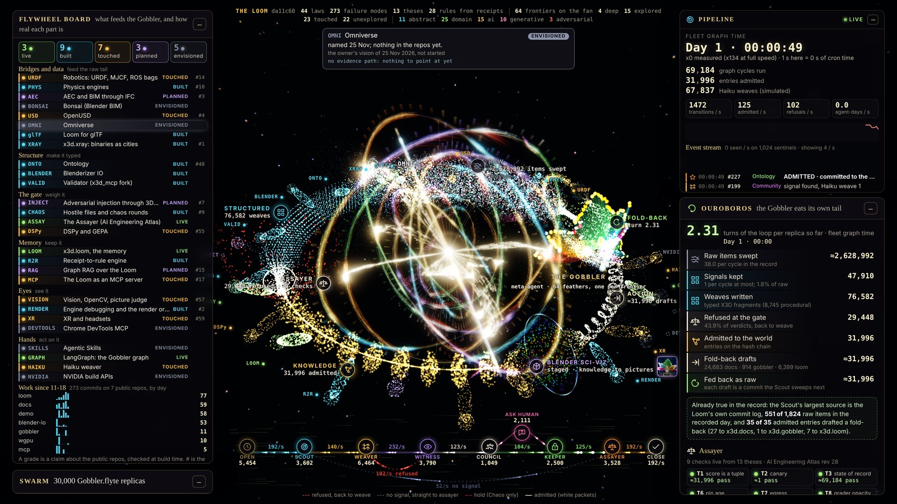

# Gobbler Gyroscope v6: head and flywheels together (Demo 23, version 6)

v1 to v5 are unchanged. v6 is v5's content (the Gobbler at the serpent's head, 27 graded lanes, the flywheel board, spotlight and fact strip) on **v4's flywheels**.

Owner's note on v5, 25 Nov: "the flywheels in the v5 look good but not quite as good as the flywheel ouroboros in the v4 standalone demo. can the gobbler head and upgraded flywheels not exist together." They can. This is that version.

## What was wrong with the wheels in v5

Nothing in the flywheel code changed between v4 and v5: `swarm/model.js`, `gpu.js` and `gl.js` are byte-identical. Three choices made for v5's extra content cost the wheels their look:

| In v5 | Effect | In v6 |
|---|---|---|
| Camera pulled back from 17 to 20 so a wide lane ring would fit | wheels and serpent drawn about 15% smaller | camera back at 17, v4's distance |
| Serpent ring turned so the bird faced the camera | the thick raw cloud moved in front of the wheels, where v4 has the thin thread of knowledge beads | ring back in v4's position: beads in front, raw cloud behind |
| Bird drawn large (0.065) | its fan covered part of the wheels | bird at 0.042, standing at the bite on the far right, seen from behind its fan, clear of the wheels |

The lane ring is pulled in from 1.34 to 1.23 serpent radii so it fits at v4's distance, and its halos are smaller.

**New key: H** hides every panel and leaves the scene, its labels and the pipeline rail (`shots/h2-clean.jpg`). The page also has a "Standalone" chip that opens `solo.html`.

Everything else, including what each lane's grade means and what is simulated, recorded, staged and envisioned, is in [`../v5/README.md`](../v5/README.md).

## Files changed against v5

`swarm/swarm.js` (camera distance, one number), `ouro/v5.js` (ring turn, bird scale, lane radius, halo size, the H key), `ouro/v5.css` (the clean mode), `index.html` (title, build id, nav chips). Every other file is byte-identical to v5, including `ouro/data.json` and `ouro/gobbler.bin`.

## Tested, and on what

| Check | Result | Rig |
|---|---|---|
| JS vs WGSL parity on v6's files, four runs | bit-identical 4 of 4 (a60287d1, 5ce35415, ed133b85, b9654a29) | Chrome for Testing 158.0.8127.36, headless, SwiftShader WebGPU |
| `solo.html` on WebGPU | wheels at v4's size with the bird, lanes and panels (`shots/h1`); panels hidden with H (`shots/h2`) | same, through `?capture=1` |
| `index.html` with `navigator.gpu` removed | WebGL2 fallback with all of v6 (`shots/h3`); 0 console errors, 0 page errors, 0 HTTP errors | same, WebGL2 on ANGLE/SwiftShader |

**Not tested here.** No real GPU, so no frame rate is quoted. The integrated WebGPU path of `index.html` (the swarm on Babylon's own canvas) cannot present in this rig; on a machine with WebGPU that page shows Babylon's wheels, not the standalone ones, so for the look compared here open `solo.html`. "As good as v4" was judged by eye against v4's standalone page in the same rig, at the same camera distance. No model was called and nothing was billed.

`shots/`: h1 solo on WebGPU (2x capture, shown at 1600 x 900); h2 the same with panels hidden; h3 the v6 page on WebGL2. All: Chrome for Testing 158.0.8127.36 headless, SwiftShader.
