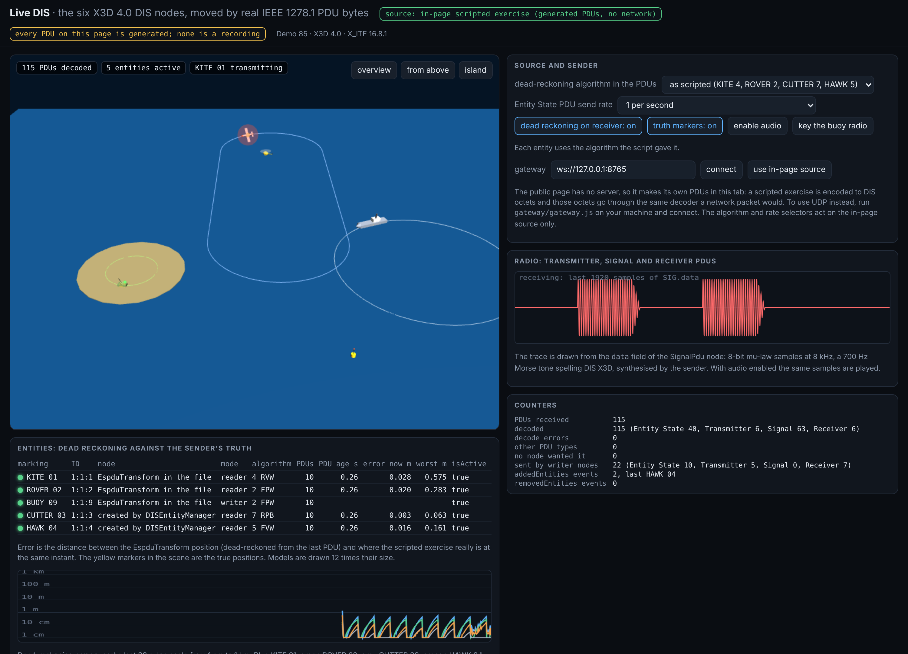

# Live DIS v1 (Demo 85): the six X3D 4.0 DIS nodes on real IEEE 1278.1 PDU bytes



Open `index.html` over http. The page loads `scene/live-dis.x3d` in X_ITE and moves an aircraft, a rover, a ship, a helicopter and a buoy with DIS PDUs. **Every PDU is generated**, by a scripted exercise in the page or by the bundled sender. No recorded traffic is used anywhere, and no network beyond one machine was used in any test.

## Scoreboard

| | Result | Grade |
|---|---|---|
| DIS nodes that X_ITE 16.8.1 parses, with every specification field | 6 of 6 (233 fields, 0 mismatches of name, type or access) | C |
| DIS nodes whose behaviour X_ITE 16.8.1 implements itself | 0 of 6 | C |
| DIS nodes live as reader with this runtime | **6 of 6** | C |
| DIS nodes live as writer with this runtime | **4 of 4** that have a writer mode (4 of 6 nodes; the other two have no networkMode) | C |
| Dead-reckoning algorithms verified against a closed form and against RK4 | **9 of 9** | C |
| Codec against opendis 1.1.0 (Python) | 160 PDUs both ways, 4,800 and 4,880 field comparisons, 0 mismatches, 160 octet-identical | C |
| Codec against open-dis 1.3.6 (JavaScript, DIS 6 classes) | 160 PDUs, 2,660 field comparisons, 0 mismatches | C |
| Test suite | 37 of 37 node tests pass, plus 2 Python scripts | C |

Grades: **C** confirmed by a run made for this demo, **L** likely, **S** suspected.

### What "live" means here

A node is **live as a reader** when all four hold, in one test run:
1. it is written in an X3D file that validates against the X3D 4.0 XSD;
2. X_ITE builds it and its fields can be read through the SAI;
3. with `networkMode="networkReader"`, fields with the names of the X3D 4.0 specification, on that X_ITE node, take values from decoded PDU octets, and the values read back equal what the sender put in the PDU;
4. the change has an effect an X3D author can use: a ROUTE from the node fires, or the scene changes.

For DISEntityManager and DISEntityTypeMapping, which have no networkMode, point 3 reads "in response to PDUs on its address and port".

A node is **live as a writer** when, with `networkMode="networkWriter"`, values set on its fields come out as PDU octets that an independent implementation (opendis for Python, listening on UDP) decodes to the same values.

### Node by node

| Node | X_ITE parses | X_ITE implements | Reader live | Writer live | Proof (all in `tests/browser.test.js`) |
|---|---|---|---|---|---|
| EspduTransform | yes, 94 of 94 fields | no: children are drawn at the origin whatever `translation` says; `isActive` stays false | yes | yes | Test 2: `translation` and `rotation` equal the dead-reckoned pose to 0 m and 7e-16 rad; marking, type, force, `deadReckoning`, articulation arrays equal the PDU; a ROUTE through a Script turns the turret. Test 3a: 7 Entity State PDUs from DEF BUOY decoded by opendis, octet-identical to what the page logged. |
| DISEntityManager | yes, 8 of 8 | no | yes | no writer mode | Test 2: `addedEntities` fired for CUTTER 03 and HAWK 04, `removedEntities` for HAWK 04 after it fell silent; two ROUTEs in the X3D file put them in a Group and took the helicopter out. |
| DISEntityTypeMapping | yes, 13 of 13 | no | yes | no writer mode | Test 2: the ship got `Inline models/ship.x3d` through MAP_SHIP. Test 3b: an entity of another type got MAP_ANY. |
| TransmitterPdu | yes, 50 of 50 | no | yes | yes | Test 2: `transmitState` seen as 1 and 2, `frequency`, `power`, `antennaLocation` equal the PDU; ROUTE to a Switch. Test 3a: frequency 156,800,000 Hz, power 30 dBm, state 1 and 2 decoded by opendis. |
| SignalPdu | yes, 34 of 34 | no | yes | yes | Test 2: the 160 values of `data` equal the PDU octets in 338 of 338 checks; the trace on the page is drawn, and the audio played, from that field. Test 3a: 160 mu-law octets written to `data` decoded by opendis, equal. |
| ReceiverPdu | yes, 34 of 34 | no | yes | yes | Test 2: `receiverState` 1 and 2, `receivedPower` equal the PDU; ROUTE to a Switch. Test 3a: 36-octet PDUs, transmitter 1:1:1 radio 1 (see the opendis note below). |

How it is done: X_ITE's own DIS component parses the nodes. `src/dis-runtime.js` finds them through the SAI and writes to, or reads from, their fields. It does not register node classes with X_ITE. Two steps go beyond the documented SAI: outputOnly fields are set with `node.getValue().getField(name).setValue(value)`, and the children of each EspduTransform are moved into an ordinary Transform that five ROUTEs feed from the EspduTransform's own fields.

Of the 94 EspduTransform fields the reader drives 34 (pose, velocity, acceleration, entity type, force, marking, algorithm, geoCoords, articulation, isActive, timestamp, the three mode flags). The fields for firing, detonation and collision are not driven: those come from other PDU types.

### Dead reckoning, algorithm by algorithm

Measured by `tests/dr.test.js` (Node 22.23.5, IEEE doubles). Every algorithm also has an RK4 reference (1 ms steps over 5 s, 20 random states, all three axes turning).

| DRM | Closed-form reference | Max position error | Max orientation error |
|---|---|---|---|
| 1 Static | P0, orientation unchanged | 0 m | 0 rad |
| 2 FPW | straight line P0 + V t | 0 m | 0 rad |
| 3 RPW | P0 + V t; attitude by quaternion q0·exp(ωt/2); level yaw ψ0 + r t | 0 m | 3.2e-14 rad |
| 4 RVW | parabola P0 + V t + A t²/2; attitude by quaternion | 9.1e-12 m | 8.9e-15 rad |
| 5 FVW | parabola, orientation unchanged | 0 m | 0 rad |
| 6 FPB | forward speed u along the nose: P0 + u t (cosθ cosψ, cosθ sinψ, −sinθ) | 3.9e-11 m | 0 rad |
| 7 RPB | level turn, circle of radius u/r | 3.8e-11 m | 1.6e-14 rad |
| 8 RVB | level turn with speed u + a t, integrated by parts | 3.3e-11 m | 3.1e-14 rad |
| 9 FVB | distance u t + a t²/2 along the nose | 3.2e-11 m | 0 rad |

The error column is the larger of the closed-form and RK4 comparisons. (C)

opendis 1.1.0 has a `DeadReckoning` module and it was used as a second check (`tests/crosscheck_opendis.py`, 200 random states). It integrates Euler rates to first order and moves body-frame entities along their initial heading, so it equals the closed form of the standard only in some cases. Where the two models are the same the difference is 0 m (algorithms 1 to 5, all cases; 6 to 9 with zero angular velocity, 80 cases) and at most 4.5e-16 rad (pure yaw). Elsewhere they differ by up to 1.7 km after 5 s, as expected. (C)

For algorithms 6 and 9 the position formula uses the PDU's angular velocity (matrices R1 and R2) while the orientation is held. That is my reading of Table E.1 of IEEE 1278.1-2012; I did not have the standard's text open during this work. (L)

### Dead-reckoning error against sender truth

End to end over UDP (test 3c): nine copies of the aircraft, one per algorithm, sent at the same instants at 1 PDU per second for 40 s. Mean and worst distance between the EspduTransform and the truth, per frame, in headless Chromium:

| DRM | mean m | worst m | | DRM | mean m | worst m |
|---|---|---|---|---|---|---|
| 1 Static | 52.1 | 106.1 | | 6 FPB | 1.67 | 9.39 |
| 2 FPW | 1.67 | 9.39 | | 7 RPB | 0.08 | 4.28 |
| 3 RPW | 1.67 | 9.39 | | 8 RVB | 0.08 | 4.28 |
| 4 RVW | 0.11 | 4.28 | | 9 FVB | 1.67 | 9.39 |
| 5 FVW | 0.11 | 4.28 | | | | |

The worst values come from the moment a turn begins between two PDUs. A full-lap table for 0.2, 1 and 5 PDUs per second is in `RECEIPT.json` (`exercise_lap`). (C)

### Transport (test 3, one run)

- Node sender to gateway to page: 1,410 PDUs sent, 1,410 into the gateway, 1,410 relayed, 1,410 received and decoded by the page, 0 errors. PDU location against truth at the PDU timestamp: worst 9.2e-5 m over 543 PDUs. (C)
- opendis sender to page: 25 of 25 PDUs reached the node; last location identical to the last one sent; dead-reckoned position against p0 + v t worst 3.4e-5 m. (C)
- Writer nodes to opendis receiver: 14 PDUs heard (7 Entity State, 3 Transmitter, 1 Signal, 3 Receiver), 14 octet-identical. (C)
- `tests/gateway.test.js`: multicast, broadcast and unicast on one machine, 4 of 4 PDUs octet-identical in each direction. (C)

## Instruments

| Instrument | Version |
|---|---|
| Viewer | X_ITE 16.8.1 (same file as `docs/demos/dance/v1/vendor`, plus `DISComponent.min.js` from npm `x_ite@16.8.1`) |
| Browser | headless Chromium 158.0.8127.36 through Playwright 1.63.0, SwiftShader software rendering (ANGLE, Vulkan 1.3.0, SwiftShader Device Subzero) |
| Node | 22.23.5; gateway dependency `ws` 8.23.1 |
| Python | 3.13.18; opendis 1.1.0; numpy 2.5.3; lxml 6.1.3 |
| Second codec reference | npm `open-dis` 1.3.6 |
| Schema | X3D 4.0 XSD; field lists from the X3D Unified Object Model 4.0 |
| Network | UDP on one Linux machine: multicast 239.1.2.3:3000, gateway and page on 127.0.0.1 |

## What this does not show

- No real GPU, phone, or browser other than headless Chromium was tried. Audio output was not listened to; the test checks the samples, not the speaker.
- No other vendor's simulator was involved. Interoperation is shown only with opendis and open-dis, and only on one machine. No traffic crossed a real network.
- Only PDU types 1, 25, 26 and 27 are decoded. Fire, Detonation, Collision and Remove Entity PDUs are not, so the matching EspduTransform fields stay at their defaults, and the manager removes entities by time-out only.
- The exercise is flat-earth near one point; entities do not follow the curve of the Earth. Positions are still sent as geocentric coordinates.
- The receiver does no smoothing: an entity jumps to each new PDU.
- `rtpHeaderExpected`, `multicastRelayHost` and `multicastRelayPort` are ignored. `frequency` is SFInt32 in X3D, so values above 2,147,483,647 Hz are clipped in the node.
- A writing EspduTransform sends zero angular velocity, and measures its velocity from the motion of `translation` when `linearVelocity` is left at zero.
- After binding, `children` of an EspduTransform reads back as one Transform that holds the original children.
- The mapping from DIS axes to X3D axes (x east, y up, z south; models nose along +x) is this demo's choice. The X3D specification does not fix one that I could confirm here. (S)
- opendis 1.1.0 has no fields for a Receiver PDU's own entity ID and radio ID (it writes 28 octets, the standard has 36). Those four values were checked against open-dis for JavaScript instead. open-dis 1.3.6 in turn misreads the fields after the Transmitter frequency and cannot write Signal data, so those were checked against opendis only.

## Run it again

```
cd docs/demos/live-dis/v1
npm install --prefix /some/dir ws open-dis          # test-time packages, kept outside the repository
pip install opendis numpy lxml
export NODE_PATH=/some/dir/node_modules:$(npm root -g)   # the second part only if Playwright is installed globally

node --test --test-concurrency=1 tests/*.test.js    # 37 tests, about 90 seconds; needs Playwright with Chromium
python3 tests/crosscheck_opendis.py                 # codec, dead reckoning and geodesy against opendis
python3 tests/validate_x3d.py /path/to/x3d-4.0.xsd  # 5 X3D files
node tools/shot.js                                  # shot.png
python3 tools/make_scene.py                         # rewrites the X3D files
```

Single files: `tests/codec.test.js` (8), `tests/dr.test.js` (13), `tests/exercise.test.js` (5), `tests/crosscheck-open-dis-js.test.js` (5), `tests/gateway.test.js` (3), `tests/browser.test.js` (3). Set `LIVE_DIS_RESULTS=/some/dir` to keep the numbers, then `node tests/make-receipt.js /some/dir > RECEIPT.json`. The browser test uses UDP port 3000; run the files one at a time, not in parallel.

With a gateway on your own machine:

```
cd gateway && npm install && node gateway.js        # WebSocket on 127.0.0.1:8765
node gateway/send-exercise.js --rate 1              # the scripted exercise on UDP 239.1.2.3:3000
```

then open the page with `?gateway=ws://127.0.0.1:8765`.

## Files

- `src/dis-codec.js` PDU codec; `src/dis-dr.js` dead reckoning; `src/dis-geo.js` WGS 84 and frames; `src/dis-signal.js` mu-law and tone; `src/dis-exercise.js` scripted exercise; `src/dis-runtime.js` the node runtime; `src/app.js` the page.
- `gateway/` UDP to WebSocket gateway and sender. `scene/` the X3D files. `tests/`, `tools/`, `RECEIPT.json`, `LEARNINGS.md`.

## Credit

- Viewer: [X_ITE](https://create3000.github.io/x_ite/) 16.8.1, MIT, create3000, in `vendor/x_ite/` with its `LICENSE.md` (only the parts the page loads).
- Field lists in `tests/fixtures/uom-dis-fields.json`: X3D Unified Object Model 4.0, Web3D Consortium, <https://www.web3d.org/specifications/X3DUOM.html>.
- Test-time cross-checks, not included: [opendis](https://pypi.org/project/opendis/) for Python and [open-dis](https://www.npmjs.com/package/open-dis) for JavaScript (BSD-2-Clause in its package.json), both from the Open-DIS project.
- Everything else was written for this demo and is MIT. No third-party code was copied. All PDUs are synthetic.
