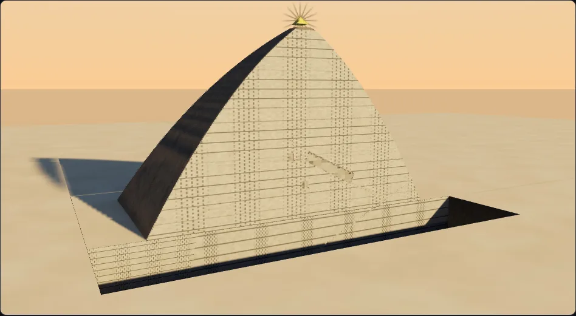

# Masonic Lodge XR v3 · Giza in section (Blenderized)

## v4: final-quality bake on an NVIDIA L4 (23 Nov 2026)

v4 is v3 with its baked textures and X3D replaced by the `g4`-profile bake. The page, the build sources and everything
else are copied from v3 unchanged, so text on the page that says "v3" describes the same scene.

| | v3 | v4 |
|---|---|---|
| bake profile | `local` | `g4` |
| baked surfaces | 15 | 15 |
| samples per surface | 128 to 128 | 512 to 512 |
| largest texture | 2048 px | 4096 px |
| textures on disk | 2.2 MB | 5.2 MB |
| bake time, all surfaces | 534 s (METAL, Blender 5.1.0) | 355 s (OptiX on one NVIDIA L4, Blender 5.3.0) |

Rig for every v4 number: Colab, one NVIDIA L4, Cycles OptiX, Blender 5.3.0, x3d-blender-io `8e56437`, notebook
`x3d.lab/notebooks/blender_bakes/giza_bakes_g4_v2.ipynb`. It was an L4, not the G4 the runbook names. Grading used the same
per-zone grades as v3 (`retone.py`). `giza-lodge.x3d` validates as X3D 4.0 (x3d_mcp fork `4d433af`), sha256 `aee5c99210cc447a…`.
The page loads with no console errors in headless Chromium (software GL); frame rate was not measured.

v1 and v2 are unchanged. v3 replaces the flat-shaded model that AR stands over each lodge with one built and baked in Blender,
and teaches the AR reader (`x3d2three.js`) to draw baked textures.

## What was done in Blender (`build/build_lodge.py`)

- **Khufu course by course:** 150 stepped courses, the casing gone, the top platform at 138.5 m.
- **Cut in section:** a Boolean on the plane of the passages, 7.29 m east of the axis, opens these as real voids in the cut face, each lit from inside:
  - the descending and ascending passages;
  - the Grand Gallery;
  - the Queen's Chamber;
  - the King's Chamber and the five relieving chambers above it;
  - the Subterranean Chamber in a sectioned bedrock block.
- **Excavation pit:** a pit east of the cut shows the bedrock section (Authored staging).
- **Khafre and Menkaure:** Khafre keeps its casing cap and Menkaure has its red granite foot (extents illustrative). They now stand south-west of Khufu, at Petrie's offsets: **v1 and v2 had them north-west**.
- **Capstone:** a gilt capstone hovers with its tip at the original apex height, 146.6 m. It is **Authored**, a symbol of the lodge, not Giza data; no capstone is known.
- **Light:** golden morning sun from the east-south-east with a Cycles sky, baked into 16 textures.
- **UVs for the courses:** stepped pyramids are UV-projected one side at a time onto their own face plane (`bakery.unwrap_slope`). Smart UV Project made one thin island per riser, and mipmaps then turned the courses into black stripes.

## What the exporter carried or lost

Carried by x3d-blender-io 47ed742:
- baked `UnlitMaterial` + `emissiveTexture` on every surface;
- 5 camera viewpoints;
- grades as metadata.

Baked away:
- the procedural materials;
- every light;
- the Cycles sky.

Added after export (`build/postprocess_lodge.py`):
- a morning-sky `Background`;
- EXAMINE navigation;
- a `Billboard` round the capstone radiance (Blender has none to export).

## AR

`x3d2three.js` v3 reads what the exporter writes:
- `UnlitMaterial` with `emissiveTexture` (as `MeshBasicMaterial` with an sRGB map);
- `TextureCoordinate`;
- `DEF`/`USE`;
- `Billboard`.

The phone draws the same baked stone as the X_ITE preview. Total download: 0.29 MB X3D plus 2.2 MB JPEG.

## Checks (what ran)

- x3d_mcp fa0b389: `giza-lodge.x3d` XSD valid, 0 semantic errors, 0 warnings (`receipts/validation.json`).
- Headless Chromium with SwiftShader, X_ITE 16.7.1: v2 and v3 shot from the same 5 viewpoints. Each pose was added to both scenes through SAI (`build/ab_shots.cjs`, `shots/check.json`). Both pages loaded with 0 console errors.
- **Not run:** AR on a phone with the new reader. The v3 reader parses in Node; it has not drawn this file in AR.js yet.

## Honest limits

- This is a `local`-profile bake from an 8 GB M3 (542 s). The final bake runs on the G4 (`build/G4-BAKE-RUNBOOK.md`); it sharpens the void interiors, which are soft here.
- Course heights, the pit and the capstone are illustrative or Authored. Interior positions are as in Giza Crawl (Petrie 1883).
