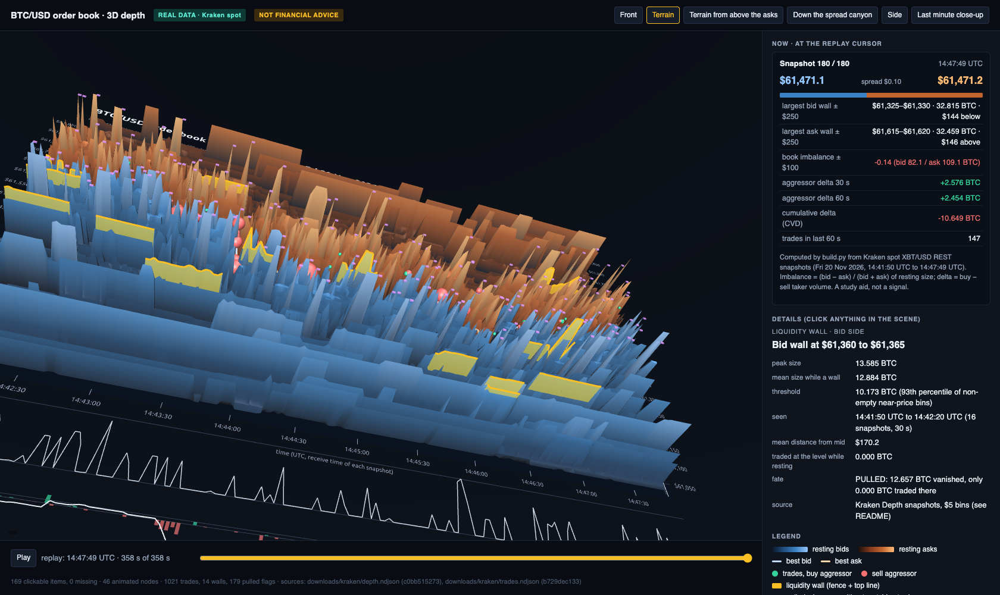
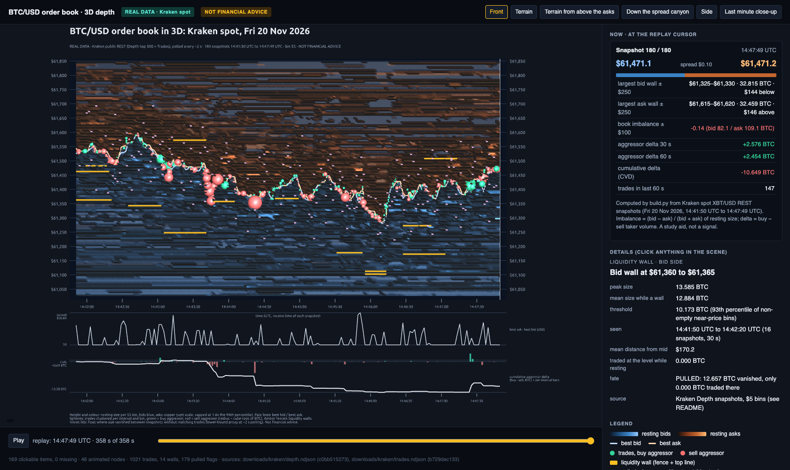

# orderbook-3d: BTC/USD order-book depth in 3D (X3D 4.0 + X_ITE)

**Real data, Kraken spot XBT/USD, 6 minutes on Fri 20 Nov 2026 (14:41:50–14:47:49 UTC). A visual study tool, not financial advice.**





## What you see

The scene works like a 3D Bookmap. Head-on (orthographic **Front** view), it is a heatmap. Turn it, and the same data becomes terrain.

- **Axes:**
  - X = time, one column per depth snapshot (~2 s apart), labelled with real UTC receive times.
  - Y = price, in $5 bins from $61,020 to $61,850.
  - Z (towards you) = resting size in each bin.
- **Resting book:** bids are blue and asks copper, shading from dark (thin) to pale (thick). Height uses a square-root scale against 23.07 BTC, the 99th-percentile bin near price, and is capped at 1.6× so the big levels stay readable. Exact sizes are in the panel.
- **Best bid and best ask:** pale blue and pale orange lines that run along the terrain at the true touch price, not the binned one.
- **Trades:** spheres sitting on the terrain, green for buy aggressor and red for sell aggressor. Trades are clustered per snapshot interval, $5 bin and side, and the radius scales with the cube root of the BTC traded.
- **Liquidity walls (amber fence and top line):** a bin of at least 10.17 BTC (93rd percentile of non-empty near-price bins) that holds for at least 10 snapshots (~20 s). The detection found 14 walls.
- **Pulled liquidity (violet lids):** size that vanished between two snapshots without matching trades, drawn where the size used to be. 179 flags were raised, each at least 15.26 BTC (97th percentile).
- **Strips below the book:**
  - spread (best ask − best bid, USD);
  - cumulative aggressor delta (CVD, BTC), with per-interval buy and sell bars.
- **Replay:** Play or the scrubber (~9× real time). Each 4-snapshot chunk (~8 s) of terrain, trades, lines, walls, lids and strips appears only once its last snapshot is reached, and a white cursor marks "now". Nothing from the future is drawn.
- **"Now" card at the cursor:**
  - best bid, best ask and spread;
  - the largest bid and ask walls within ±$250 of mid (bin, size, distance);
  - book imbalance within ±$100, with a bar;
  - aggressor delta over 30 s and 60 s, CVD, and trades in the last 60 s.
- **Clicks:**
  - an 8-second book window: BBO, mid change, buy/sell volume, delta, largest trade, pulled total, imbalance;
  - a wall: peak and mean size, life span, distance, volume traded there, and its fate (pulled, consumed by trades, shrank, or price moved away);
  - each of the top 30 pull flags and the top 40 trade clusters.
- **Viewpoints:** Front (heatmap, orthographic), Terrain from the bid side, Terrain from above the asks, Down the spread canyon (from now), Side (depth by price across all snapshots, latest nearest), Last-minute close-up.

### What this record shows (from `out/build-report.json`)

- **Price:** mid went $61,534.20 → $61,471.15. The low was $61,281.25 and the high $61,589.20 (a $308 range in 6 minutes).
- **Trades:** 1,021 trades, 12.24 BTC buy-aggressor against 22.89 BTC sell-aggressor, so CVD ended at −10.65 BTC.
- **Walls:** 12 of the 14 were bids. 9 ended **PULLED** (the size vanished with no trades at the level), 3 left the ±$250 band as price moved (still resting), and 2 shrank below the threshold.
- **Pulled flags:** the largest were a ~42.2 BTC ask block that disappeared at $61,530 (14:47:05), $61,550 (14:44:51) and $61,565 (14:47:17). That looks like one participant moving a large resting order (a re-quote), not many separate cancels.
- **"Pulled" total:** 3,788 BTC, about 100× the volume traded. On a spot venue whose depth is mostly market-maker ladders, most vanished size is re-quoting as price moves. **It is not evidence of spoofing.**
- **Spread:** it was above $1 in 53 of 180 snapshots (max $30.60), though Kraken's normal touch is $0.10. That could be real thinning during the fast move or an artefact of REST snapshots. This data cannot tell the two apart.

## Method (also in the `build.py` docstring)

| item | rule |
|---|---|
| venue | **Kraken spot XBT/USD** (pair `XXBTZUSD`). Not a perpetual and not CME futures. |
| book | `GET https://api.kraken.com/0/public/Depth?pair=XBTUSD&count=500`: top 500 price levels per side (≈ −$1,050 / +$2,500 around mid), every ~2 s (gaps 1.78–2.16 s, median 2.00 s), 180 snapshots, ~35 KB each |
| trades | `GET https://api.kraken.com/0/public/Trades?pair=XBTUSD&since=<cursor>`, polled in step with the book, deduplicated by trade id. Kraken's `b`/`s` field is the taker (aggressor) side. |
| time | snapshot time = local receive time; trades are placed by exchange timestamp, interpolated between snapshot times |
| bins | $5. The window is the mid range ± $260, clipped to prices both sides cover in *every* snapshot, so the edge of the top-500 list never looks like pulled size. |
| near price | ± $250 of the mid at that snapshot (used for walls, pulls and the reference percentiles) |
| height | sqrt(size / 23.07 BTC) × 2.2 m, capped at 1.6× |
| wall | ≥ 93rd percentile of non-empty near-price bins (10.17 BTC) for ≥ 10 snapshots, one missing snapshot tolerated. Fate is read from the next snapshot: price moved away (still above threshold but outside ± $250), shrank (kept ≥ 50 %), consumed (traded ≥ 50 % of the drop), otherwise PULLED. |
| pulled | (size lost at a bin between consecutive snapshots) − (all volume traded at that bin in the interval), flagged at ≥ 97th percentile (15.26 BTC) |
| imbalance | (bid − ask) / (bid + ask) of raw level sizes within ± $100 of mid |
| delta | buy − sell taker volume (BTC) in the trailing 30 s and 60 s; CVD from the first snapshot |

Every number on screen is computed by `build.py` from the two NDJSON files below. The scene `<head>` names both files with their sha256.

## Sources (downloaded 2026-11-20, free, no key)

| file | bytes | sha256 |
|---|---|---|
| `downloads/kraken/depth.ndjson` (180 Depth responses) | 6,318,008 | `c0bb515273400dd7b05812dda34a337135448887c78abee92d5ee553d3f64043` |
| `downloads/kraken/trades.ndjson` (180 Trades responses, 1,021 unique trades in the window) | 106,240 | `b729dec133f507bbc6592d4927815412c730520549c22c1eb9426c81688ce5a0` |

`downloads/kraken/poll.log` reads `{"depth_snapshots": 180, "trade_polls": 180, "errors": 0, "seconds": 360.6}`.

Tried and not used:
- `api.binance.com` answered **HTTP 451** (Binance geo-blocks the US), so no Binance global data.
- Binance.US answered, but its book is thin.
- Coinbase Exchange answered, but its trade `side` is the *maker* side, which is easy to misread.

**ES:** real CME ES L2 (market-by-price or market-by-order) is not free. No free public ES depth sample turned up, so this scene has no ES and nothing synthetic.

## Files and run

- `build.py` is stdlib only. It writes `out/orderbook-scene.x3d` (about 1.1 MB), `out/orderbook-panel.json` (about 170 KB) and `out/build-report.json`.
- `index.html` is the page.
- `vendor/x_ite` symlinks the atlas copy of X_ITE 16.7.0.
- `tools/poll_kraken.py` is the stdlib poller.
- `tools/shoot.mjs` runs the headless Playwright check and screenshots. It serves files through `page.route`, so no server is needed, and uses the cached `chromium_headless_shell-1217`.

```bash
cd ~/Projects/x3d/work/orderbook-3d && python3 -I build.py
```

```bash
python3 -m http.server 8850 --bind 127.0.0.1 --directory ~/Projects/x3d/work/orderbook-3d
```

To record a fresh window (about 6.4 MB per 6 minutes), run the poller, which overwrites `downloads/kraken/`, then rebuild:

```bash
cd ~/Projects/x3d/work/orderbook-3d && python3 -I tools/poll_kraken.py 360 2.0
```

## Checks (2026-11-20)

- **x3d_mcp** (`validate_one.py`): XSD valid. Semantic check: 0 errors, 0 warnings, 175 infos. The infos are unused-DEF notes for the TouchSensors the page reads over SAI. See `out/validation.txt`.
- **X_ITE 16.7.0 in headless Chromium** (Playwright 1.63, cached `chromium_headless_shell-1217`, SwiftShader, 1680×1000; `tools/shoot.mjs`, results in `shots/check.json`):
  - The page reached ready with 0 page errors and 0 console errors.
  - The only console lines were 4 SwiftShader `GPU stall due to ReadPixels` performance warnings from mouse picking, not X_ITE messages.
  - 169 of 169 clickable items resolved; 46 animated nodes.
  - Real mouse clicks opened "Bid wall at $61,460 to $61,465" (Terrain view) and "Sold 0.244 BTC at $61,382.1" (Front view, `shots/06-front-trade-clicked.png`). The first scan for a trade in the last-minute view ran out of its 120 s budget, so `06-last-minute-trade-clicked.png` shows that view without a click.
  - At 45 % the replay showed snapshot 82/180 (14:44:33 UTC), and 25 of 45 chunks were still hidden. Play then advanced 18 s of record in 2 s of wall time.
- **Screenshots:** 6 viewpoints plus the replay shot, all in `shots/`.
- **Not checked:** GPU and mobile rendering, and the in-app browser pane, where X_ITE's load stalls while the pane is hidden.
- **Output hashes at this build:**
  - `out/orderbook-scene.x3d` `5dd2f739415ab31e66e1660b6010895d248012b1c7b45be077c96e7b18ab0048`
  - `out/orderbook-panel.json` `c4683a3879652ea9e7906494966a68dff8666fc9dc002f0382467a6b6a310ec3`
  - `build.py` `4b736d43a1f4824465cb93559577a48c1a1fb83935ef27cde663bca39e4d72ca`

## Limits

- **REST snapshots, not a feed.** Anything placed and cancelled inside one ~2 s gap is invisible, and an order modification looks like cancel plus add. "Pulled" is a lower bound for cancels and also counts re-quotes. It is not true L3 cancel data.
- **Top 500 levels only,** and only the mid ± $260 window is drawn.
- **Snapshot time is the local receive time.** Network latency (tens of ms) is not removed.
- **One venue.** Kraken is a fraction of global BTC spot volume, and perpetual-swap venues carry far more.
- **Six minutes.** Percentile thresholds are relative to this record; a different window gives different absolute thresholds.
- **Raw data stays local** for study and is not redistributed.

> Published in x3d.demo on 2026-11-20. The raw `downloads/` are not included (they belong to their publishers); fetch them as described above to rebuild. X_ITE 16.7.0 is loaded from `../../x3d-mujoco-bridge/v1/vendor/x_ite/` instead of a local `vendor/x_ite`.
