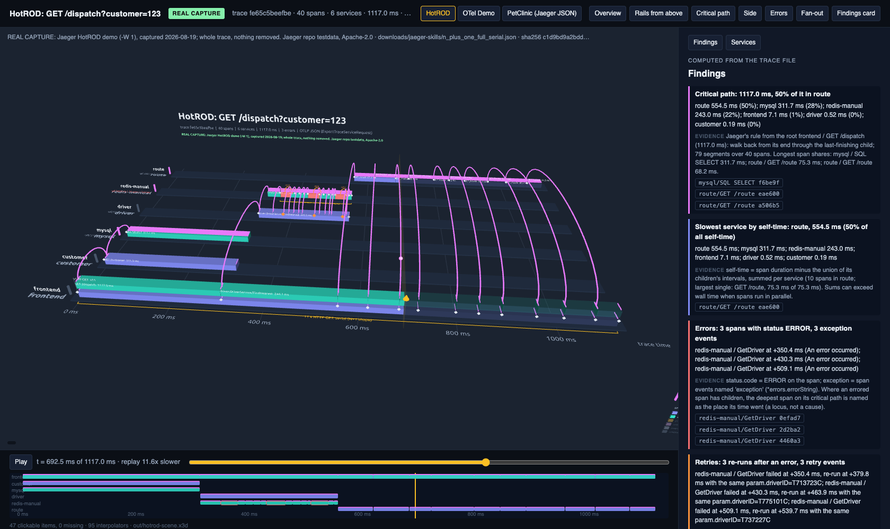

# otel-trace-3d: a multi-service OpenTelemetry trace as an accountable X3D 4.0 scene

**Real data.** The main scene is a whole, untrimmed trace captured from Jaeger's HotROD demo. The second is a capture from the OpenTelemetry Demo (astronomy shop). Both come from the Jaeger repository's test data, and each ships with a manifest that records how it was captured and the answer a tool should reach. The third scene is a jaeger-ui test fixture in Jaeger JSON. It is there to exercise the second reader, and its capture is not documented, which the page says. No value in any scene is invented.



## What it shows

- **Services as rails.** There is one rail per service, set in depth (Z) in the order each service first appears. X is trace time, 24 m for the whole trace. On a rail, a child sits one row above its parent when both are in the same service, and moves up a row when it would overlap a sibling. That is why 14 parallel PetClinic queries stack to 9 rows.
- **Spans as bars**, coloured by span kind: server, client, producer, consumer, internal. Red marks status ERROR, with a red dot at the bar's end. Diamonds mark span events: red for `exception`, orange for events named like a retry, white for the rest.
- **Arcs** join a parent and a child that sit on different rails. Client to server is an rpc arc and producer to consumer a message arc. Any other pair is a call arc: HotROD names its Redis and MySQL clients as their own services, so `driver` (server) to `redis-manual` (client) is a call. Span links get a lilac arc labelled "link". Retries get an orange arc from the failed span to its re-run.
- **The critical path** is a fuchsia ribbon on the bars and a thicker fuchsia arc. Jaeger's rule is applied from the root: walk back from the end, take the last-finishing child that started before the cursor, clip it, recurse into it, then move the cursor to its start.
- **Fan-out brackets and gaps** are amber, lying flat on the floor in front of the rail.
- **Replay.** One `TimeSensor` (16 s cycle, 0.8 s lead-in, the trace stretched over 13 s) fills each bar from its start to its end, moves a translucent playhead sheet across all rails, and sends a packet along each arc. It runs in any X3D browser, without the page.
- **Findings card**, both in the scene and in the page panel. It covers the critical path, the slowest service by self-time, errors, retries, fan-out and gaps. When the trace file has a manifest, it also checks the result against that manifest. Each finding carries its evidence: the rule applied and the span ids, which are clickable chips in the page.
- **Viewpoints:** Overview, Rails from above, Critical path, Side, Errors, Fan-out and Findings card. The PetClinic scene has no Errors view because it has no errors.
- **Page** (`index.html`, X_ITE 16.7.0), in trace-3d's house style. Click any bar, rail or the findings card for details in the side panel. A span shows its attributes grouped as http, db, rpc, messaging, exception and other, plus its events, links, self-time and critical-path time. The **Services** tab ranks self-time and critical-path time per service. The footer has a scrubber, an HTML mirror of the rails (click to jump), and play/pause that resumes from the scrubbed point. The header switches between traces (`?t=hotrod`, `?t=otel-demo`, `?t=petclinic`) and shows the view buttons. The panel holds the legend.

## What the findings say (computed, not judged)

| trace | finding | evidence |
|---|---|---|
| HotROD | Critical path 1117.0 ms: route 554.5 ms (50%), mysql 311.7 ms (28%), redis-manual 243.0 ms (22%) | Jaeger's rule from `frontend / GET /dispatch`: 79 segments over 40 spans |
| HotROD | Slowest service by self-time: route, 554.5 ms | 10 `GET /route` spans with no children |
| HotROD | 3 `GetDriver` spans ERROR (`redis timeout`), each with an `exception` event | `status.code` = 2, events named `exception` |
| HotROD | 3 retries: each failed `GetDriver` is re-run with the same `param.driverID` (T713723C, T775101C, T737227C). `driver` logs 3 "Retrying GetDriver after error" events | next sibling with the same service, name and identifying attributes |
| HotROD | Fan-out: 13 x `GetDriver` serial (N+1 shape: wall 206.0 ms, durations sum 205.7 ms) and 11 x `HTTP GET` serial | maximum overlap of the group's intervals = 1 |
| HotROD | **Manifest agrees:** 11 x HTTP GET under `9c3834fb`, 0 overlapping pairs, wall 1116.6 ms, sum 871.2 ms | `n_plus_one_full_serial.manifest.json` |
| OTel Demo | Only errored span: `frontend-proxy / POST` (Envoy, http 504). Its own critical path ends in `frontend / POST`, 15.00 s, status UNSET | the deepest span on the errored span's critical path |
| OTel Demo | **Manifest agrees:** locus `frontend / POST` (`909a94f9`), 15001 ms | `error_timeout_masked.manifest.json` |
| OTel Demo | Gap: 32.9 ms in `load-generator / user_checkout_multi` between `user_add_to_cart` and the checkout POST | intervals inside a parent that no child covers |
| PetClinic | Fan-out: 14 x `HikariProxyPreparedStatement.executeQuery`, up to 9 at once | maximum overlap = 9 |

The errored span's own critical path is reported as a *locus*, the place its time went, not a cause. The OTel Demo trace cannot say what `frontend` was waiting on, and its manifest says the same (`mechanism_determinable_from_trace: false`).

## Sources

Each file was fetched on 2026-11-20 from `raw.githubusercontent.com`, pinned to a commit. Both repositories are Apache-2.0; a copy of the licence is in `downloads/`.

| file | from | bytes | sha256 |
|---|---|---|---|
| `downloads/jaeger-skills/n_plus_one_full_serial.json` | jaegertracing/jaeger@22e560d, `cmd/jaeger/internal/extension/jaegerquery/internal/mcptools/internal/handlers/testdata/skills/` | 110,862 | `c1d9bd9a2bdd0aa188a695ecded8c4cff8295a30226d0be2279873e13abf8872` |
| `downloads/jaeger-skills/n_plus_one_full_serial.manifest.json` | same | 1,228 | `6b7c7c14f8c1ea6963c7a7dfd54c3aec69cc67e115caf3518aad06705e3ae162` |
| `downloads/jaeger-skills/error_timeout_masked.json` | same | 72,702 | `1667cc2be323fe90eeb825bba6627673611d9d6c46acae99ef5ba67d36b45852` |
| `downloads/jaeger-skills/error_timeout_masked.manifest.json` | same | 2,174 | `95ef77f2ecf0462251d02651af48fb1449941bae9b81fa329cee5519cd640d07` |
| `downloads/jaeger-skills/README.md` | same (how the fixtures were captured and trimmed) | 7,382 | `7956d2b30806e6585db9c93af7e2ef731f6e53cfad9bc5e503f07216838e7e43` |
| `downloads/jaeger-ui/spanAmongEachOtherGroupedAndSpans.json` | jaegertracing/jaeger-ui@b9fb749, `packages/jaeger-ui/src/components/TracePage/TraceStatistics/tableValuesTestTrace/` | 12,399 | `182ed2832b13fd9513cb2777a5192f34d892aa08149e432375a4a1e237f10992` |
| `downloads/LICENSE-jaeger-Apache-2.0` | jaegertracing/jaeger@22e560d `LICENSE` | 11,357 | `c71d239df91726fc519c6eb72d318ec65820627232b2f796219e87dcf35d0ab4` |

The HotROD file's git blob hash (`1021cd1d…`) matches the one the GitHub contents API reports at that commit.

**Capture details, quoted from the manifests:**
- **HotROD:** image `jaegertracing/example-hotrod@sha256:69be0c58…`, flag `-W 1`, endpoint `GET /dispatch?customer=123`, captured 2026-08-19. The trace is whole: 40 spans, 6 services.
- **OTel Demo:** commit `2e72d8b`, flags `productCatalogFailure: on` and `cartFailure: 100%`, captured 2026-08-06. The Jaeger maintainers trimmed it from 107 spans across 11 services to 26 spans across 5 services. The successful add-to-cart branch was kept.

## Method

- `otelread.py` (standard library) reads either format into one span model.
  - **OTLP JSON** is `ExportTraceServiceRequest`: `resourceSpans → scopeSpans → spans`. The older `instrumentationLibrarySpans` key is accepted too. `kind` and `status.code` may be numbers or enum names, ids may be hex or base64, and every `AnyValue` type is read.
  - **Jaeger JSON** is the query API shape: `data[].spans` + `processes`. `span.kind`, `error` and `otel.status_*` come from tags, and events from `logs`. The parent is the first `CHILD_OF` reference (else the first reference); other references become links.
  - If a file holds several traces, the one with the most spans is used.
  - It then computes depth, children, and **self-time** (duration minus the union of the children's intervals), the critical path, and the findings above.
- `build.py` (standard library) writes `out/<name>-scene.x3d` (X3D 4.0, Interchange profile plus PointingDeviceSensor 1, Text 1, Interpolation 1, Geometry3D 4, Time 1, Navigation 2), plus `out/<name>-panel.json` for the page and `out/<name>-report.json`.
  - The scene `<head>` records the source path, its sha256, its format, the manifest's sha256 and the data label.
  - Scene text is kept ASCII because X_ITE's default font lacks arrow glyphs.
- `selftest.py` exercises the paths the real traces do not reach:
  - **Round trip:** it writes the real HotROD trace out as Jaeger JSON and reads it back. Both readers must agree span by span: parent, service, name, kind, status, events, attributes, and times to 1 µs. The finding titles and the critical-path length must also match.
  - **Kinds, links and ids:** a tiny **SYNTHETIC** OTLP document, built in memory and never shipped, adds producer/consumer spans, two span links, enum-name kinds and base64 ids. It is built to a temporary scene, checked, and deleted.

## Files

| file | what |
|---|---|
| `otelread.py`, `build.py` | reader + analysis, scene writer (sha256 `edaa99d0…`, `b126200b…`) |
| `selftest.py` | the checks above |
| `index.html` | the X_ITE page; the page loads X_ITE 16.7.0 from `../../x3d-mujoco-bridge/v1/vendor/x_ite/` in this repository |
| `shots.cjs` | headless check + screenshots. It starts its own `http.server` on port 8852 for the run, uses Playwright 1.58.2 from `x3d-physx-bridge/node_modules`, and writes `shots/check.json` |
| `out/hotrod-scene.x3d` (179,694 bytes, sha256 `40ae81b9…`), `out/otel-demo-scene.x3d` (101,524 bytes, `f2a6ad68…`), `out/petclinic-scene.x3d` (53,986 bytes, `d7538cb2…`) | the scenes |
| `out/validation.txt` | x3d_mcp result |
| `shots/` | 10 screenshots, 1680x1000, headless Chromium |

## Run

```bash
cd docs/demos/otel-trace-3d/v1 && python3 -I build.py && python3 -I selftest.py
```

```bash
for n in hotrod otel-demo petclinic; do ~/Projects/x3d/x3d_mcp/.venv/bin/python ~/Projects/x3d/work/flywheel-review/atlas/validate_one.py docs/demos/otel-trace-3d/v1/out/$n-scene.x3d; done
```

```bash
python3 -m http.server 8852 --bind 127.0.0.1 --directory docs   # then open /demos/otel-trace-3d/v1/
```

Then open http://127.0.0.1:8852/ (`file://` won't work because the page fetches files). Serve from `docs/` so the shared X_ITE path resolves.

Any other OTLP JSON or Jaeger JSON file works the same way: `python3 -I build.py path/to/trace.json myname` writes `out/myname-*`, and `?t=myname` opens it. Add it to `TRACES` in `index.html` to get a header button. Its on-screen label will read "TRACE FILE: … (provenance not recorded here)" until you give it one in `PRESETS`.

```bash
cd docs/demos/otel-trace-3d/v1 && node shots.cjs
```

## Checks (2026-11-20)

- **x3d_mcp** (local fork `fa0b389`, `validate_one.py`, Python 3.12.8): all three scenes are XSD-valid with 0 semantic errors and 0 warnings. The infos (54, 39 and 26) are unused-DEF notes for TouchSensors and viewpoints, which the page reads through SAI.
- **selftest.py:** 12 of 12 checks pass.
- **X_ITE 16.7.0 in headless Chromium** (SwiftShader, `shots.cjs`, `shots/check.json`):
  - **Clickable items:** 47, 32 and 20, with 0 missing.
  - **Real canvas clicks:** a mouse click in the centre of the Findings view opened the findings panel in all three scenes.
  - **Replay:** `fraction_changed` fired 26, 29 and 43 times in 4 s and the fraction moved. Under CPU rendering HotROD runs at about 5–7 fps, so its sampled rate is noisy. The OTel Demo advanced 0.258 of a cycle against 0.251 expected.
  - **Console:** 0 errors in all three scenes. The OTel Demo and PetClinic also logged 0 warnings. HotROD logs 4 Chromium GPU-driver warnings, `GL Driver Message … GPU stall due to ReadPixels`. That is a performance notice from the graphics driver under SwiftShader, not from the page or the scene.
- **Not verified:**
  - **In-app browser pane:** X_ITE's load stalls while the pane is hidden. Also, the preview tool had no free server slot: other chats held all 5.
  - **Real GPU or mobile:** not checked.
  - **Waterfall views:** the OTel Demo has only Overview and Errors screenshotted, and PetClinic only Overview.

## Limits

- **Span kinds and links:** neither real trace has PRODUCER/CONSUMER spans or span links. HotROD has only SERVER/CLIENT, and the OTel Demo trace adds INTERNAL. Message and link arcs are tested only by the synthetic self-test. The legend dims the kinds a trace lacks.
- **Linear time:** in the 15 s OTel Demo trace, the real work (about 80 ms) is a sliver at the left. A broken or log time axis is not built. The Errors view frames that start region.
- **The HotROD story is its flag:** at `-W 1` every call is serial, so nearly every span is on the critical path and almost every arc is fuchsia. The paired `n_plus_one_full_concurrent.json` (same trace at `-W 3`) was not downloaded. It is the natural next comparison.
- **Retry detection is a rule:** "next sibling, same service and name, same identifying attributes, after the error", plus events named like a retry. Retries made by a different parent, or with no identifying attribute, would be missed or matched on name alone.
- **Self-time sums can exceed wall time** when spans run in parallel, and the panel says so. Clock skew between services is not corrected: children are clipped to their parent.
- **Labels** are placed greedily per rail and skipped when there's no room, so every span stays clickable but not every span is labelled. Runs of same-named siblings get a single "xN" label.
- **Unspecified provenance:** the jaeger-ui PetClinic fixture's capture is not documented in that repository.
- The page fetches `out/<name>-panel.json`; nothing is published, committed or sent anywhere.
