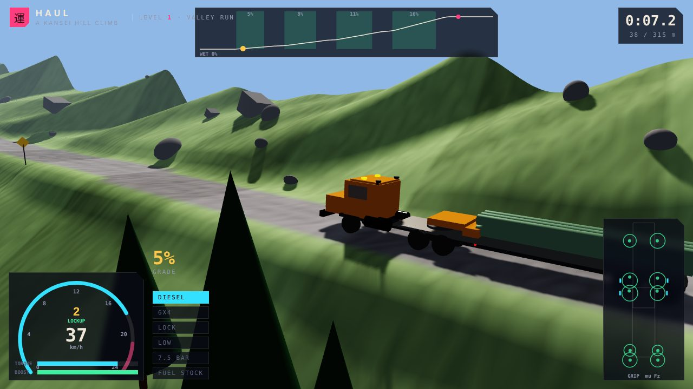
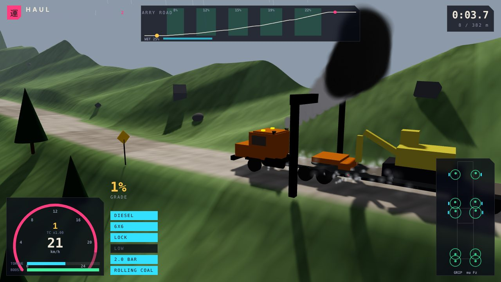
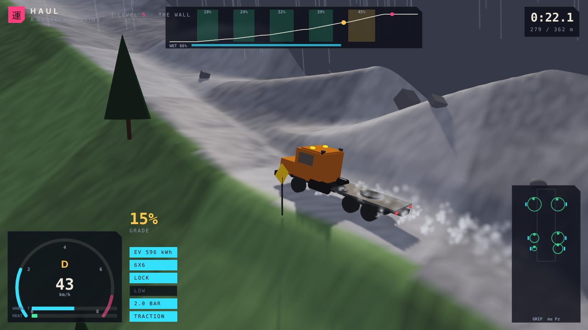

# HAUL · a KANSEI hill climb

**A heavy 6x6 truck, diesel or electric, hauling a loaded trailer up five mountain roads. Each hill is steeper than the last, and the rain soaks the ground while you climb.**

HAUL is KANSEI (hagopjay/platformer, `kansei/v1`, the night-drift game) turned uphill and made heavy:
- **Engine:** Babylon becomes PlayCanvas 2.24.3.
- **Driving:** drifting becomes traction.
- **Simulation:** KANSEI's deterministic sim becomes a 240 Hz truck sim built on Ammo (Bullet).
- **The X3D tether stays.** The truck, the trailer and every level are X3D 4.0 files. The simulation drives on the same bytes PlayCanvas draws.



## Play

```sh
npm start            # node tools/serve.mjs, then open http://localhost:8080
```

There's no build step and nothing to install: PlayCanvas and Ammo are vendored (`vendor/`). Any static server works.

| Key | | Key | |
|---|---|---|---|
| <kbd>W</kbd> <kbd>S</kbd> | throttle, brake (they ramp; <kbd>Shift</kbd> caps the throttle at 40 %) | <kbd>Space</kbd> | full brake |
| <kbd>A</kbd> <kbd>D</kbd> | steer | <kbd>R</kbd> | drive / reverse (when slow) |
| <kbd>X</kbd> | 6x4 ↔ 6x6 | <kbd>K</kbd> | lockers (diff locks) |
| <kbd>L</kbd> | low range ×2.6 (when stopped) | <kbd>[</kbd> <kbd>]</kbd> | tyre pressure, 2.0–8.5 bar (central inflation, live) |
| <kbd>F</kbd> | diesel fuel map: stock, rich, rolling coal | <kbd>J</kbd> | exhaust brake |
| <kbd>M</kbd> | automatic ↔ manual (<kbd>Q</kbd> <kbd>E</kbd>) | <kbd>T</kbd> | EV traction control |
| <kbd>C</kbd> | camera: side, chase, cab | <kbd>Tab</kbd> | the tinker card |
| <kbd>Enter</kbd> | retry | <kbd>Esc</kbd> | menu (<kbd>1</kbd>–<kbd>5</kbd> level, <kbd>0</kbd> test hill, <kbd>P</kbd> power) |

## The five climbs

| # | Level | Cargo | Ground | Rain | Steepest | What it teaches |
|---|---|---|---|---|---|---|
| 1 | Valley Run | 4 t pipe | asphalt | dry | 16 % | torque, gears, the converter |
| 2 | Quarry Road | 10 t excavator | gravel | drizzle | 22 % | a heavy trailer and loose stones |
| 3 | Logging Cut | 12 t logs | dirt, ruts, a mud side | rain | 26 % | open diffs give only the weaker wheel's grip: lock them |
| 4 | Clay Switch | 3 t generator | clay, wet granite, ledges | heavy | 33 % | air down, 6x6, keep the boost up |
| 5 | The Wall | none | wet granite slab, ledges | storm | 45 % | everything, and time: the slab gets wetter every second |

Each level's steepest pitch isn't hand-picked. The level generator (`src/sim/level.js`) sets it with a traction budget (`src/sim/feasible.js`):
- **Best setup:** within reach of 6x6, lockers and aired-down tyres, at the wetness the rain will have reached when you get there.
- **Naive setup:** out of reach of 6x4, open diffs and 7.5 bar from level 3 on.

The climb bar at the top of the HUD colours each pitch by that margin.

## Physically intuitive, on purpose

- **The friction circles** (bottom right) are your ten tyres seen from above.
  - A circle's size is that tyre's grip, µ·Fz: it shrinks when the wheel unloads, and when the rain or a puddle takes the µ.
  - The dot is the force the tyre is giving. Inside the circle the tyre grips; on the rim it's at the limit; red means sliding.
- **Weight is traction.**
  - On a slope the load moves to the tandem (centre-of-mass height over wheelbase).
  - The trailer's fifth wheel puts 28 % of the trailer on your drive wheels.
  - The rest of the trailer is weight you have to pull and doesn't give you grip. That's why The Wall comes without one.
- **Rain is a clock.** Wetness rises from the level's starting value at its rain rate. Each surface loses its own share of grip when wet: asphalt 32 %, dirt 46 %, granite 44 %, gravel only 16 %. Standing water takes up to 30 % more.
- **Diesel against EV.**
  - **The diesel** (450 kW, 2,780 N·m, through a torque converter) has to spool its turbo. Lift off and the boost dies, and the black smoke is the fuel it couldn't burn yet. Rolling coal adds 8 % torque.
  - **The EV** (700 kW, 65 kN·m at the wheels) has instant torque and per-wheel traction control, but it carries 2.5 t of battery, and its motors derate when they get hot.



## How it is built

| | |
|---|---|
| `src/sim/spec.js` | every number: surfaces, truck, diesel, EV, driveline, tyres, trailer |
| `src/sim/truck.js` | the simulation (240 Hz): Ammo bodies and hitch; swept-circle suspension; relaxation-length tyres; diesel and EV; open and locked driveline |
| `src/sim/level.js` | five generated levels, X3D in and out (ElevationGrid + `kansei:haul-level` metadata); the test hill |
| `src/sim/feasible.js` | the traction budget that designs and checks the levels |
| `src/sim/x3dxml.js` | the minimal X3D reader (adapted from KANSEI's, MIT) |
| `src/game/*` | PlayCanvas: X3D → entities, world and weather, particles, HUD, synthesised sound, cameras, keyboard |
| `assets/truck.x3d`, `assets/trailer.x3d` | the models, with `kansei:haul-truck` / `kansei:haul-trailer` metadata (hubs, exhaust, hitch) |
| `levels/level1..5.x3d` | the climbs (`node tools/build.mjs` rewrites them and the models) |

The physics is in [docs/PHYSICS.md](docs/PHYSICS.md), with the gates it's held to and their results.

```sh
npm test             # 17 tests in about 14 s: the physics gates (tests/limits.json) and the X3D tether
NODE_PATH=$(npm root -g) node tools/playtest.cjs --level=5 --power=ev --seconds=30   # headless Chromium playtest
```



## Licences

HAUL is MIT (`LICENSE`). Vendored: PlayCanvas engine 2.24.3 (MIT, `vendor/PLAYCANVAS-LICENSE`) and Ammo.js, Bullet compiled to WebAssembly, the build in PlayCanvas's engine repository (zlib, `vendor/ammo/LICENSE`). The X3D reader is adapted from KANSEI (hagopjay/platformer, MIT).
