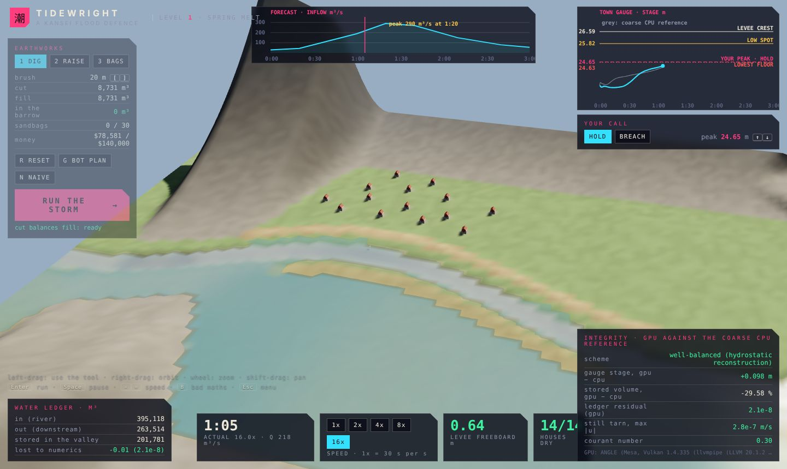
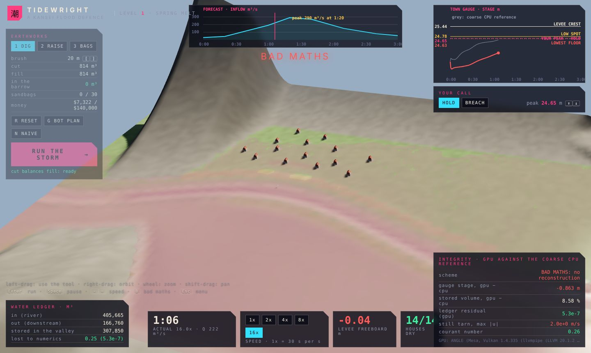

# TIDEWRIGHT · a KANSEI flood defence

**A storm is coming down the valley.** You read the forecast, shape the land under an earth budget (every cubic metre you raise comes out of the ground somewhere else), call it (hold or breach, and where the town gauge will peak), then watch the flood at 1x to 16x.

The water is the shallow-water equations:
- hydrostatic reconstruction, HLL fluxes and semi-implicit Manning friction;
- solved on your GPU with WebGL2 float textures;
- checked live against a CPU reference.

The valley is an X3D 4.0 file: the solver reads its ElevationGrid and PlayCanvas draws the same bytes.



## Play

```sh
npm start            # node tools/serve.mjs, then open http://localhost:8080
```

There's no build step and nothing to install: PlayCanvas 2.24.3 is vendored (`vendor/`). It needs WebGL2 with `EXT_color_buffer_float`.

| Input | | Input | |
|---|---|---|---|
| left-drag | use the tool | <kbd>1</kbd> <kbd>2</kbd> <kbd>3</kbd> | dig, raise, sandbags |
| right-drag, wheel, shift-drag | orbit, zoom, pan | <kbd>[</kbd> <kbd>]</kbd> | brush radius |
| <kbd>H</kbd> <kbd>J</kbd>, <kbd>↑</kbd> <kbd>↓</kbd>, click on the gauge | call hold or breach, set your predicted peak | <kbd>Enter</kbd> | run the storm (once cut balances fill) |
| <kbd>Space</kbd>, <kbd>-</kbd> <kbd>=</kbd> | pause, speed 1x–16x (1x = 30 s per s) | <kbd>B</kbd> | **bad maths**: the scheme without hydrostatic reconstruction |
| <kbd>G</kbd> <kbd>N</kbd> <kbd>R</kbd> | load the bot's plan, the naive plan, reset | <kbd>Esc</kbd> | menu |

## Spring Melt

The snow goes off the fells at once, and the river rises from 30 to 290 m³/s.
- **The town:** 14 houses behind an old levee with a low spot.
- **The farmland:** across the river, behind a natural bank ridge.
- **The narrows:** a clay sill downstream.
- **The tarn:** a still mountain lake that stays still unless the maths is bad.

The HUD shows:
- **Water ledger:** in, out, stored, and *lost to numerics*.
- **Levee freeboard.**
- **The town gauge:** the stage against time, with the crest, the low spot, the lowest floor and your call.
- **INTEGRITY:** the GPU against a coarse CPU solver running beside it; the ledger residual; the still tarn's largest speed; the Courant number.

Three plans run through the whole storm:

| Plan | Houses flooded (Node CPU = headless GPU) |
|---|---|
| Do nothing | 12 of 14 |
| Naive: patch the low spot with earth dug right behind it | 4 |
| The bot: open the farmland as a washland, dig the sill, raise the low spot, the rest of the spoil on the crest (8,731 m³ moved, $78,581) | **0** |



## How it is built

| | |
|---|---|
| `src/sim/swe.js` | the CPU reference solver (float64, portable math, per-step hash) |
| `src/gpu/swe-gl.js` | the WebGL2 solver: x-flux, y-flux, update and friction, outflow, and reduction passes on RGBA32F |
| `src/sim/analytic.js`, `ladder.js`, `gates.js` | exact references, the ladder cases, the gate runner and its wrong twins |
| `src/sim/level.js` | Spring Melt's generator, and the X3D writer and reader (`kansei:tidewright-level` metadata) |
| `src/sim/earth.js` | earthworks under the earth budget |
| `src/sim/game.js` | the storm set-up, observations, ledger and score, shared by Node and the page |
| `src/game/*` | PlayCanvas: world, HUD, the storm controller (GPU and coarse CPU), input |
| `tools/bot.mjs` | the bot's and the naive plans, as tapes of brush strokes |
| `levels/spring-melt.x3d` | the level (`node tools/build.mjs` rewrites it) |

The physics, every gate with its number and host, what changed after the first run, and what's not done: [docs/PHYSICS.md](docs/PHYSICS.md).

```sh
npm test                 # 16 tests, about 2 minutes: the analytic ladder with its wrong twins, the level, determinism, the receipts
npm run receipt          # docs/receipts/ladder-node.json
npm run gpu-gate         # docs/receipts/gpu-gate.json (headless Chromium via a global playwright; about 3 min)
npm run level-gpu        # docs/receipts/level-gpu.json (the three plans on the GPU; about 2 min)
npm run playtest -- --plan=bot --speed=16 --shots=3 --out=rec
```

## Licences

- **TIDEWRIGHT:** MIT.
- **PlayCanvas 2.24.3:** MIT (`vendor/PLAYCANVAS-LICENSE`).
- **The X3D reader and the X3D-to-PlayCanvas loader:** from HAUL (MIT), which adapted them from KANSEI's (MIT).
