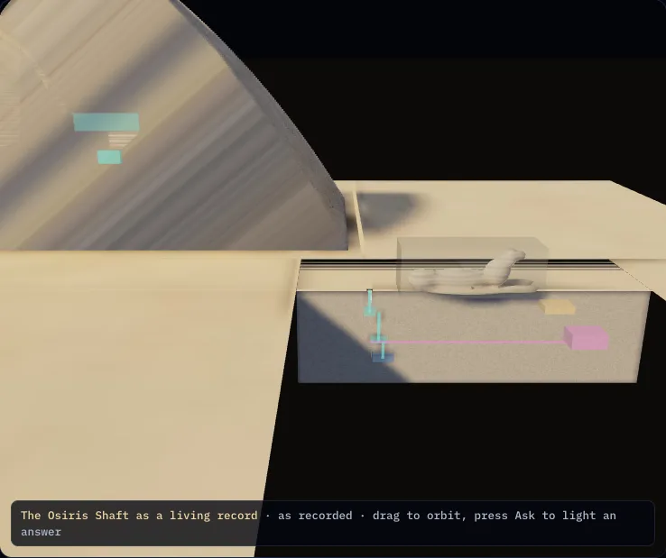

# Semantic Twin Cases v3 · a Blender context layer for the heritage case

v1 and v2 are unchanged. In v3 the heritage case (the Osiris Shaft, the Sphinx and the Great Pyramid) is drawn inside a
context layer. The layer was modelled and baked in Blender, and exported by x3d-blender-io.

**The record is not touched.**
- `../v1/data/heritage/scene.xml`, its Boxes and DEFs, the RDF twin built from it, and every query, SHACL check and count on the page are exactly as in v2.
- The page adds `context/heritage-context.x3d` beside the record with an `Inline` after the record loads. "Hide Blender context" removes it.
- While the context is shown, the page draws the SphinxBody box at 70% transparency so the Sphinx inside can be seen. That is display only.

## What was done in Blender (`build/build_context.py`)

The layer is built in the record's own schematic frame. Every Box is read from `scene.xml`.

- **Rock section:** a bedrock block cut on a section plane through the shaft centres. Every underground record Box is carved out of it with a Boolean, slightly enlarged, so the translucent tier-coloured Boxes sit in real hollows.
- **Plateau:** the surface with the shaft mouth open.
- **Sphinx:** a massing modelled with metaballs inside the SphinxBody Box, in layered limestone whose soft beds erode back.
- **Khufu:** a stepped core at true size, cut through the King's Chamber Box so the KhufuKingsChamber and KhufuBigVoid Boxes show from the overview.

All of it is **Illustrative**: the record's distances are schematic, and Khufu is about 500 m from the shaft in reality.

## Exporter

x3d-blender-io 47ed742 carried the baked `UnlitMaterial` + `emissiveTexture` surfaces and the metadata. `build/assemble_context.py` drops the layer's Background and NavigationInfo, because an Inline's bindables are never bound.

## Checks (what ran)

- x3d_mcp fa0b389: `context/heritage-context.x3d` XSD valid, 0 semantic errors, 0 warnings (`context/validation.json`).
- Headless Chromium with SwiftShader, X_ITE 16.7.1: v2 and v3 shot from the record's three viewpoints (`shots/check.json`).
- One console error on both v2 and v3: a 404 for a font in v1's vendored X_ITE (`PTSans-Regular.woff2`). It predates v3.
- **Not rerun:** the page's query, SHACL and oracle checks. Their inputs are unchanged files.

## Limits

These are `quick`-profile textures. The final bake runs on the G4 (`build/G4-BAKE-RUNBOOK.md`). The same layer is used by Fault Lab v3.
