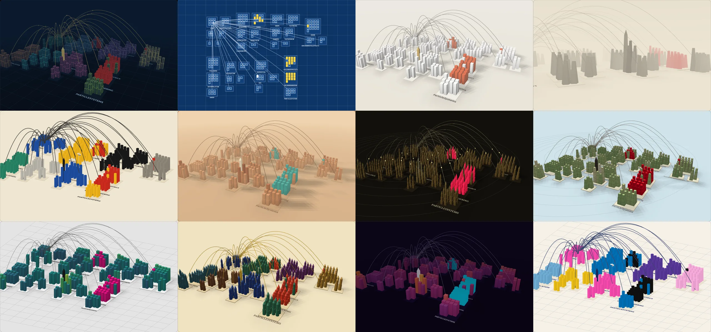
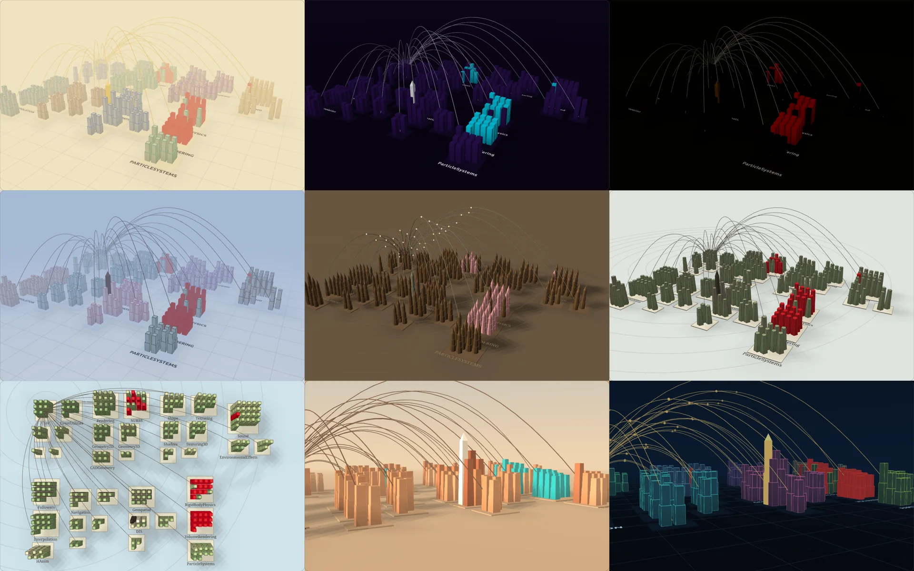

# Demo 75 · Style Loom: one scene, twelve looks, one grammar (v1)

The data demos had settled on one look, the neon night city. This page takes one data scene and re-dresses it from a shared **style vocabulary and grammar**. Live page: `index.html`. Spec: [x3d.loom/x3d.style/SPEC.md](https://github.com/hagopjay/x3d.loom/blob/main/x3d.style/SPEC.md).



Top row: Neon Noir, Blueprint, Paper Maquette, Ink Wash. Middle: Bauhaus Block, Terracotta, Brass Orrery, Atlas. Bottom: Viridis Lab, Illuminated Manuscript, Thermal, Risograph. Frames: X_ITE 16.7.1, Chromium 157 (Playwright), SwiftShader WebGL2.

## What is on the page

| part | what it shows | drawn from |
|---|---|---|
| style chips | 12 styles; click one and the page compiles a new X3D 4.0 world and hands it to X_ITE | `data/catalogue.jsonld`, `kit/compile.mjs` |
| operators | transpose (palette of another style), mix (slider), invert (day / night), repair | `kit/grammar.mjs`, `kit/repair.mjs` |
| grammar check | 14 rules, each with its measured value, live for whatever is on screen | `kit/grammar.mjs` `lint` |
| the sentence | all 48 tokens of the current style, by part of speech | `resolve(style)` |
| style as data | the JSON-LD document, and the Metadata that lands in the X3D file | `flatten(style)` |
| matrix | 12 structures × 12 palettes, as is and inverted: 288 sentences, coloured by verdict; click a cell to load it | `data/matrix.json` |
| what the linter found | the authored styles that failed and what repair moved | `data/build-receipt.json` |
| evals socket | the three model-free baselines | `data/evals-receipt.json` |
| page chrome | the page's own colours follow the current style's palette | CSS variables set from `palette` |

The scene is the **X3D node city**: 260 concrete X3D 4.0 nodes. District = component (36). Height = declared fields (x3d.py 4.0.65.8). Alert = not yet drawn by the three.js bridge (32). Hero = `EspduTransform` (73 fields). Links = each component to Core (35).

## Results (grades: Confirmed = re-run here)

| claim | result | instrument |
|---|---|---|
| X3D validity | 12 of 12 worlds XSD 4.0 valid; semantic: 0 errors, 0 warnings | x3d_mcp fork 4d433af (`data/validate-receipt.json`) |
| page load | 0 console errors, 0 HTTP errors, 0 broken images | Chromium 157 (Playwright), `data/page-check.json` |
| frames | 22 frames; 1 black, and it should be (see below); 12 of 12 styles land in the luminance band their `intent.key` declares | X_ITE 16.7.1, Chromium 157, SwiftShader (`shots/shots-receipt.json`) |
| authored styles | 4 of 12 failed the grammar as written: Neon Noir, Ink Wash, Bauhaus Block, Risograph; all pass after repair, mean colour drift 0.001 to 0.010 Delta E OK | `kit/grammar.mjs`, `kit/repair.mjs`, Node 22 |
| the incumbent | Neon Noir: two categories 0.020 apart for deutan readers (need 0.04); 2 of 22 colours moved, max 0.013 | Machado 2009 simulation, severity 1.0: Likely for what a reader sees |
| scale | 288 sentences: 104 valid as written, 158 after repair | `data/matrix.json` |
| ground colour | the drawn ground equals `palette.ground` to the byte in 3 lit styles | pixel read of the frames |
| ontology | 555 vocabulary triples; catalogue conforms to SHACL; 6 of 6 broken styles rejected | rdflib 7.6.0, pyshacl 0.40.2 (`data/rdf-receipt.json`) |
| X3D round trip | 12 of 12 worlds return all 48 tokens exactly | `MetadataSet xst:Style` read back |
| glTF lane | 12 of 12 worlds pass S0..S6 through `KHR_xmp_json_ld` and back, 61 Metadata nodes each | x3d.loom `x3dsem 0.1.0` (`data/gltf-receipt.json`) |
| evals | dev (n = 87): do nothing 0.432, throw the palette away 0.501, repair 0.646; ceiling 1.0 | `kit/evals.mjs`; no model called, DSPy seam off |

**The black frame.** `shots/op-invert-maquette.webp` is the Paper Maquette with its lightness flipped: black card on a black ground. On the first run the linter passed it 10 of 10 and the frame came back at mean luminance 0.011. The rule (G3) was wrong and was tightened; the linter now fails this sentence, and the frame is kept as the exhibit.

## Operator frames



Top: Neon Noir's structure in Manuscript colours; Maquette in Thermal colours; Maquette inverted (the black frame). Middle: Neon Noir inverted and repaired; Terracotta × Brass at 50%; Ink Wash × Atlas at 50%. Bottom: Atlas in plan; Terracotta at street level; Neon Noir at street level.

## Rebuild

```sh
# 1. the kit (in x3d.loom/x3d.style): scene, lint, repair, compile, receipts
python3 tools/build_scene.py && node bin/build.mjs
python3 tools/validate.py /path/to/x3d_mcp out out/validate-receipt.json
node bin/vocab.mjs && python3 tools/check_rdf.py && python3 tools/gltf_roundtrip.py
node bin/eval.mjs baselines out/evals-receipt.json
bin/sync-demo.sh /path/to/x3d.demo/docs/demos/style-loom/v1          # copies kit/, data/, worlds/, vocab/
# 2. frames (here), with the site served from docs/
NODE_PATH=$(npm root -g) node build/shots.mjs http://127.0.0.1:8765/demos/style-loom/v1/ shots 2   # then PNG -> WebP
```

## What was and was not tested

Tested: everything in the table, on one Linux container (Node 22, Python 3.13), with X_ITE 16.7.1 under SwiftShader software rendering.

Not tested: a hardware GPU (no frame rate is claimed); any engine other than X_ITE; rendering the glTF output; readers with colour-vision deficiency; a second scene; a learned optimizer. Shadow edges in the Terracotta and Maquette frames are blocky under SwiftShader; whether a GPU draws them smoother was not checked.

Data sources and takedown: [DATA-ATTRIBUTION.md](DATA-ATTRIBUTION.md).
