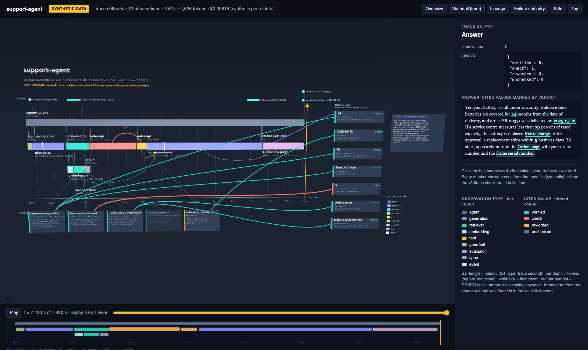

# trace-3d: an LLM trace (Langfuse format) as an accountable X3D 4.0 scene

**SYNTHETIC DATA.** The trace is invented: a fictional bike-shop support agent (Halden Bikes). No live system, model, customer or price is behind any value. The label appears in the trace file, the scene's `<head>`, the scene itself and the page header.



## What it shows

- **Waterfall in 3D.** X = trace time (2.4 m per second), Y = nesting depth (as in Langfuse's tree), Z thickness = tokens (square root; generations, embedding and judge only). Bar colour is the observation type (Langfuse v2 types: AGENT, GENERATION, RETRIEVER, EMBEDDING, TOOL, GUARDRAIL, EVALUATOR, SPAN, EVENT). A white tick marks `completionStartTime` (first token). The ERROR-level tool call is red with a red dot, and a red **retry** arc joins it to the WARNING-level retry.
- **Scores lane.** The five scores sit above the observations they score: numeric scores as gauges, boolean and categorical as discs, each with its `source` (EVAL / API / ANNOTATION).
- **Lineage band.** The retrieved documents and the tool output are drawn as source cards (similarity, rerank score, "dropped" for the one rerank cut). Threads run from each source to the **cited values** column, coloured by the x3dtrace verdict. The answer card sits beside them. 6 of 7 citations are `verified`; the planted "ships within 5 business days" is `check`, because its quote "ships within 7 to 10 business days" was found but does not contain 5.
- **Replay.** One `TimeSensor` (16 s cycle; the run plays 1.6x slower than it ran, after a 0.8 s lead-in) grows each bar from its start time to its end time, sweeps an amber playhead, and sends data packets along the data-flow arcs (sources → compose-answer → judge). It runs in any X3D browser, and the page is not needed for it.
- **Six viewpoints.** Overview, Waterfall (front), Lineage, Failure and retry, Side (tokens as thickness), High oblique.
- **Page** (`index.html`, X_ITE 16.7.0). A click on any bar, source, citation, score or the answer opens its details in the side panel, including the source text with the quote marked (LOCATE) and where the value sits in the answer. The page also has a scrubber with an HTML mirror of the waterfall (click a lane to jump), a play/pause button that resumes from the scrubbed point, view buttons and a legend.

## Files

| file | what |
|---|---|
| `SURVEY.md` | What the lineage tools in x3d.ML, x3d_mcp, x3d.loom, x3d.docs, x3d-blender-io and x3d.demo do, and which ideas carry over to an LLM trace |
| `trace/langfuse-rag-support-agent.synthetic.json` | The trace (sha256 `6c13a383...`): 12 observations as Langfuse `ObservationsV2Response` / `ObservationV2`, 5 scores as v1 `Score`, plus a trace object |
| `make_trace.py` | Builds that file deterministically (the place to change the story) |
| `downloads/langfuse-openapi/openapi.yml` | Langfuse's published OpenAPI spec, fetched 2026-11-20 from `raw.githubusercontent.com/langfuse/langfuse/main/web/public/generated/api/openapi.yml` (466,650 bytes, sha256 `cdaac03b...`). `build.py` checks every observation and score key against it |
| `build.py` | Trace → `out/trace-scene.x3d` + `out/trace-panel.json` + `out/build-report.json`. Standard library plus the vendored engine |
| `vendor/x3dtrace.py`, `vendor/NOTICE-x3dtrace.md`, `vendor/SOURCE.txt` | Copied unchanged from hagopjay/x3d.ML@ef94650 (engine sha256 `dcba70d7...`). `vendor/x_ite` is a symlink to the atlas copy of X_ITE 16.7.0 |
| `out/trace-scene.x3d` | The scene (about 80 KB, X3D 4.0, Interchange profile plus components) |
| `out/validation.txt` | x3d_mcp result |
| `index.html` | The viewer page |
| `shots/` | X_ITE screenshots (headless Chromium through Playwright, 1680x1000) |

## Run

```bash
cd ~/Projects/x3d/work/trace-3d && python3 make_trace.py && python3 -I build.py
```

```bash
~/Projects/x3d/x3d_mcp/.venv/bin/python ~/Projects/x3d/work/flywheel-review/atlas/validate_one.py ~/Projects/x3d/work/trace-3d/out/trace-scene.x3d
```

```bash
python3 -m http.server 8847 --bind 127.0.0.1 --directory ~/Projects/x3d/work/trace-3d
```

Then open http://127.0.0.1:8847/ (the page fetches files, so `file://` won't work). To use another Langfuse export, run `python3 -I build.py path/to/trace.json`. The file must hold the same envelope: `trace`, `observations.data[]` (ObservationV2) and `scores[]` (Score). Lineage appears when a GENERATION's `output.citations` holds `{field, value, quote, source}` items whose `source` names a retrieved document id (RETRIEVER output `documents[].id/text`) or `tool:<name>`.

## Checks (2026-11-20)

- **Schema:** 0 problems. Each of the 12 observations uses only the 42 `ObservationV2` properties and has all 11 required ones; each of the 5 scores uses only `BaseScore` plus its `NumericScore` / `BooleanScore` / `CategoricalScore` properties. The trace-level object is **not** schema-checked: the current spec no longer documents the `GET /api/public/traces/{id}` body (`TraceWithFullDetails`).
- **x3d_mcp** (local fork fa0b389, `validate_one.py`): XSD valid; semantic 0 errors, 0 warnings, 36 info. The infos are unused-DEF notes for the TouchSensors the page reads through SAI.
- **X_ITE 16.7.0 in headless Chromium:** 30 of 30 clickable items resolved, 0 missing. Console: 0 errors, 0 warnings. Real mouse clicks on compose-answer, the failed order-api and the flagged citation each opened the right panel entry. Play from t = 1.0 s advanced 1.25 s of trace time in 2 s of wall time (= 1/1.6). Screenshots from 5 viewpoints are in `shots/`. Waterfall (front) was not screenshotted.
- **Not verified:** the in-app browser pane (X_ITE's load stalls while that pane is hidden), a GPU or mobile check, and any real Langfuse export. No real export was used.

## Limits

- The trace is synthetic. Model names (`provider-x/...`) and the price table (USD per 1M tokens, in `trace.metadata`) are invented, so the costs are only arithmetic on invented prices.
- Layout is for traces with a few dozen observations. Overlapping siblings at the same depth would need lanes in Z (not built). Label placement is greedy and avoids bars and other labels in X/Y only.
- The x3dprov chain (`generate` + `trace` steps in the scene head) and PROV-O / OpenLineage views of the LLM run are not built yet. See SURVEY.md, items 5 and 6.
- LangSmith's run-tree format is not supported. Only the Langfuse envelope above is read.

> Published in x3d.demo on 2026-11-20. The raw `downloads/` are not included (they belong to their publishers); fetch them as described above to rebuild. X_ITE 16.7.0 is loaded from `../../x3d-mujoco-bridge/v1/vendor/x_ite/` instead of a local `vendor/x_ite`.
